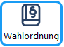
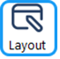
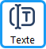

Das Konfiguration-Menü konfiguriert die Bestimmungen und Gestaltung der Dokumente.

| **Befehl** | **Beschreibung** | **Taste** |
|---|---|---|
| Wahlordnung | Hinterlegen Sie die Vorschriften Ihrer Wahlordnung (→ [Wahlordnung konfigurieren](../../handbuch/4_vorbereitung/4-2_wahlordnung.md)). |  |
| Layout der Dokumente | Eingabe der Parameter für die Gestaltung der Wahldokumente: Wahlbekanntmachung, Stimmzettel, Wahlergebnis (→ [Layout](../../handbuch/7_wahldokumente/7-4_layout.md)). |  |
| Textbausteine | Bearbeiten Sie die Texte, die auf Stimmzetteln und den Bekanntmachungen erscheinen sollen (→ [Textbausteine](../../handbuch/7_wahldokumente/7-3_textbausteine.md)). |  |
| Personendaten | Hier wird festgelegt, welche Personendaten eingelesen und auf den Wahldokumenten ausgegeben werden sollen (→ [Personendaten konfigurieren](../../handbuch/4_vorbereitung/4-8_personendaten.md)). |  |
| Gender-Trennzeichen | Legen Sie ein Trennzeichen für uniWAHL fest (→ [Gender-Trennzeichen](../../handbuch/2_installation/2-6_gender.md)). |  |
| Office-System | Welche Office-Anwendung wird verwendet? (→ [Office](../../handbuch/2_installation/2-5_office.md)) |  |
| Arbeitsverzeichnis | Geben Sie das Arbeitsverzeichnis an.(→ [Arbeitsverzeichnis](../../handbuch/2_installation/2-3_arbeitsverzeichnis.md)) |  |
