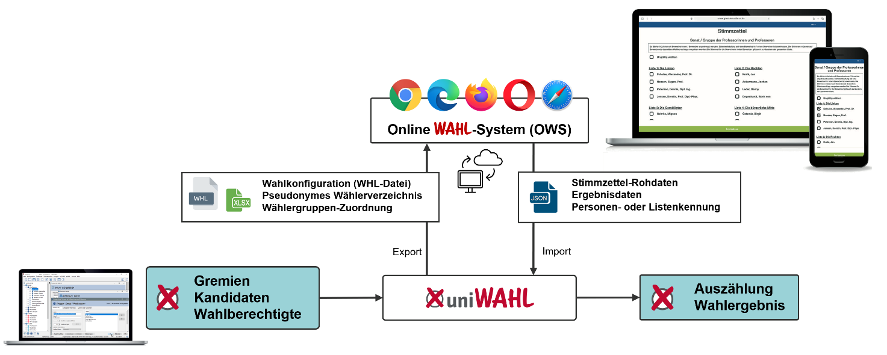

Der grundsätzliche Unterschied von Online-Wahlen gegenüber anderen Verwaltungsvorgängen, die über das Internet abgewickelt werden, ist, dass

- eine wählende Person einerseits sicher identifiziert und authentifiziert werden muss – wie auch bei anderen personenbezogenen Vorgängen wie Bankgeschäften usw. –,
- andererseits muss aber in derselben Sitzung die Stimmabgabe ano­nym erfolgen, d.h. aus der abgegebenen Stimme darf kein Rückschluss auf die Person möglich sein.

Das sind zwei entgegengesetzte Forderungen, die nur mit großem technischen Aufwand erfüllt werden können. Verschiedene Anbieter können die Durchführung der Stimm­ab­gabe über das Internet übernehmen.

*Abb. : uniWAHL unterstützt die Online-Stimmabgabe*

Die Vorbereitung der Wahl wird in *uniWAHL* durchgeführt und in das Online-Wahlsystem übertragen:

- Alle für die Online-Stimmzettel benötigten Informationen (Personendaten, Wahlverfahren, Stimmenzahl etc.) werden von *uniWAHL* in Excel-Tabellen, xml-Dateien und JSON-Dateien bereitgestellt.
- Für die Eingabe der Kandidierenden steht das vollständige Wahlberechtigtenverzeichnis zur Verfügung, was aus Datenschutzgründen nur intern benutzt werden kann.
- Bei der Online-Stimmabgabe muss den Wählenden genau der passende Satz von Stimmzetteln angeboten werden, z.B. eine Studentin der Wirtschaft muss die Stimmzettel erhalten für Senat/Stud, FakR Wi/Stud, Fachschaft Wi, StuPa, Frauenbeirat. Die Zuordnung der Stimmzettel zu Wähler:innengruppen wird von *uniWAHL* in einfacher und übersichtlicher Weise unterstützt.
- Die ausgezählten Stimmen werden nach der Wahl in *uniWAHL* eingelesen und mit den anderweitig gewonnenen Stimmen zusammengeführt und ausgewertet.
