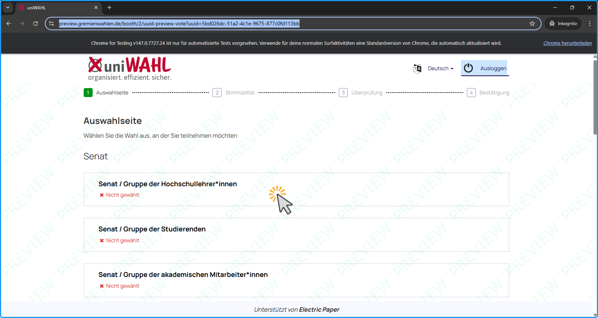
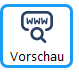
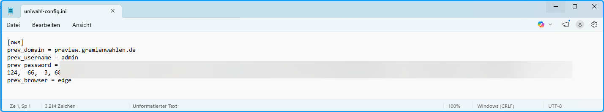
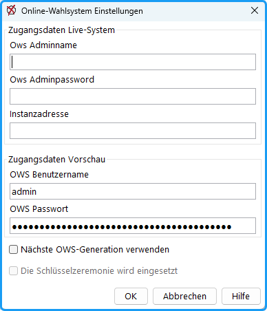

Eine der neuesten Erweiterungen in uniWAHL bringt eine wesentliche Verbesserung durch die Live-Vorschau von digitalen Stimmzetteln. Es steht eine Funktion zur Verfügung, die es ermöglicht, die Wahlkonfiguration über einen **API-Aufruf** hochzuladen. Dabei wird automatisch eine UUID (Universally Unique Identifier) vergeben. Diese UUID kann anschließend direkt in der URL als Parameter genutzt werden, um die entsprechende Konfiguration in der digitalen Wahlkabine zu laden.
Es ergeben sich daraus mehrere direkte **Vorteile**:
- Auch große oder komplexe Wahlen lassen sich sehr performant direkt in einer Web-Vorschau anzeigen.
- Der Link mit UUID ist kurz und kann unkompliziert per E-Mail oder in Dokumentationen weitergegeben werden.
- Da jede Wahlkonfiguration beim Upload eindeutig identifiziert wird, kann jederzeit die richtige Version abgerufen werden – unabhängig von lokalen Änderungen oder temporären Speicherständen.
- Layouts können schneller geprüft und freigegeben werden, da der Vorschauprozess vollständig entkoppelt von der Datenmenge ist.

Bei der Implementierung wurden gezielt **Sicherheitsmaßnahmen** berücksichtigt, um Ihre Konfigurationen bestmöglich zu schützen:
- Die UUID selbst enthält selbst keine Informationen, sondern dient lediglich als Schlüssel zum Abruf der spezifischen Vorschaukonfiguration.
- Die UUID vom Typ 4 (random) ist ein 128-Bit-Wert, der nach modernen Standards als nicht erratbar gilt.
- Kein Benutzername, keine Institution, keine personenbezogenen Inhalte sind in der URL enthalten.
- Die Vorschau ist nicht indexierbar, d.h. sie wird von Suchmaschinen nicht gefunden.
- Es handelt sich ausschließlich um temporäre Darstellung der Stimmzettel, z.B. mit Listennamen und Kandidierenden – also Daten, die ohnehin öffentlich gemacht werden, sobald eine Wahl stattfindet.
- Die Daten werden nicht analysiert, protokolliert oder mit anderen Systemen verknüpft. Sie dienen ausschließlich dem Zweck, die Live-Vorschau korrekt anzuzeigen.
- Die Vorschau-Server befinden sich innerhalb Deutschlands und unterliegen damit der DSGVO sowie hohen Standards für Datenschutz und IT-Sicherheit. Das Hosting erfolgt bei einem zertifizierten Rechenzentrum mit regelmäßigen Sicherheitsprüfungen.

*Abb.: Live-Vorschau der Demo-Wahl*

 
Zur Erzeugung einer Live-Vorschau am Preview-Server wird eine **reine Vorschau der Wahlkabine ohne echte Wahl** (keine Stimmabgabe - damit auch kein Wahlergebnis, keine Wählergruppen oder -daten) erzeugt. Die Preview öffnet sich direkt im ausgewählten Webbrowser (Standard ist Microsoft Edge).

- Starten Sie uniWAHL und öffnen Sie eine WHL-Datei.
- Klicken Sie die Schaltfläche "**Online-Vorschau öffnen**" in der Symbolleiste oben rechts.
- Testen Sie zuerst, ob die Vorschau korrekt geöffnet wird (Zur Anzeige muss mindestens 1 Wahlbereich im Status `Kandidateneingabe fertig` (dunkelblau) sein).
- Die dargestellte Vorschau entspricht 1:1 der Wahlkabine, die später im Online-Wahlsystem hochgeladen wird. Machen Sie sich dort mit dem Wahlablauf und den Texten bzw. Elementen der Wahlkabine vertraut.

:::warning

**Achtung:** Sollte keine Live-Preview angezeigt werden können, besteht in den meisten Fällen ein Netzwerkproblem bzw. eine Restriktion innerhalb der hauseigenen Firewall. Wir bitten Sie in diesem Fall, Ihre IT-Administration zu kontaktieren und eine explizite Freigabe für den Live-Preview-Server unter "preview.gremienwahlen.de" einzurichten.

:::

:::tip

**Tipp:** Die Live-Vorschau wird auch im Kontext der [Textbausteine](../7_wahldokumente/7-3_textbausteine.md#texte-zur-online-wahl) oder des [Layouts](../7_wahldokumente/7-4_layout.md) der Wahldokumente angezeigt, so dass von hier aus sehr schnell auf die Vorschau geänderter Texte oder Layoutkonfigurationen zugegriffen werden kann.

:::

## Einstellungen {#einstellungen}

In der Konfigurationssteuerdatei "**C:\Users\&lt;Benutzername&gt;\uniwahl\uniwahl-config.ini**" sind auch die Parameter zur Live-Vorschau gespeichert.
 

- **prev_domain**: Domain des OWS-Servers, an dem die Preview ausgeführt wird.
- **prev_username**: Benutzer, mit der API-Aufruf durchgeführt wird.
- **prev_password**: Verschlüsseltes Passwort des API-Benutzers.
- **prev_browser**: Kürzel des Browsers, der zur Vorschau aufgerufen werden soll, z.B. "**edge**" für Microsoft Edge, "**firefox**" für Mozilla Firefox oder "**chrome**" für den Chrome Browser.

Die **Domain** und der **Vorschau-Browser** können direkt in der INI-Datei geändert werden.

Die Zugangsdaten (prev_user und prev_password) lassen sich in uniWAHL unter dem Menüpunkt `OWS > Einstellungen` hinterlegen.
 
