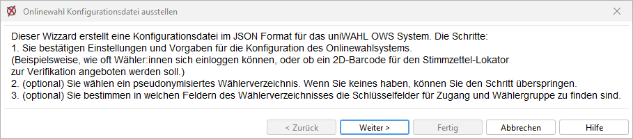
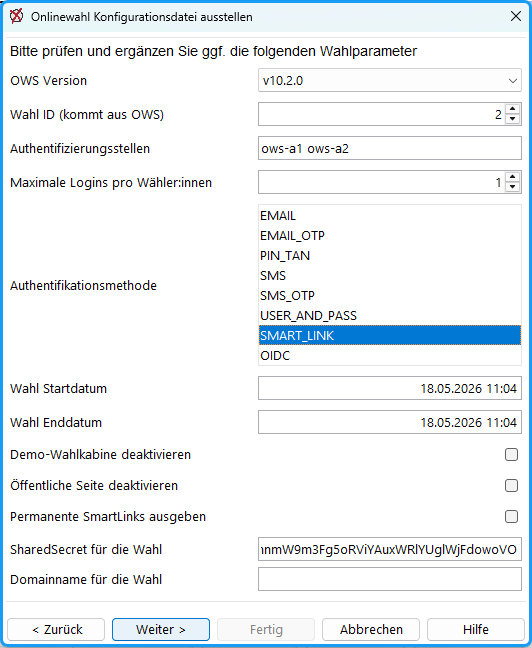
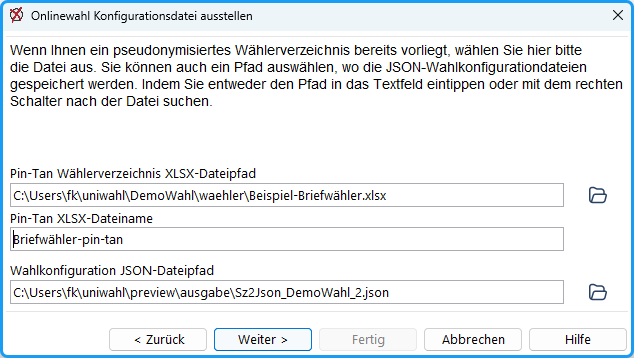
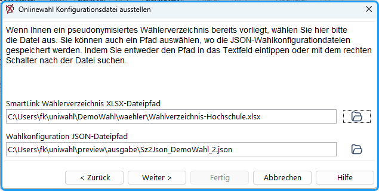
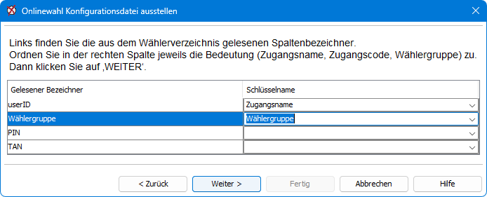
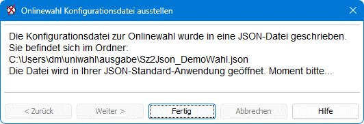
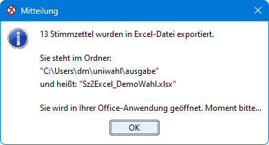
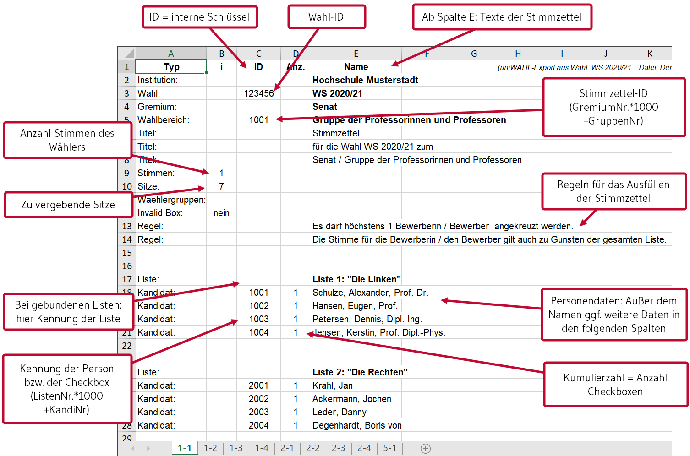
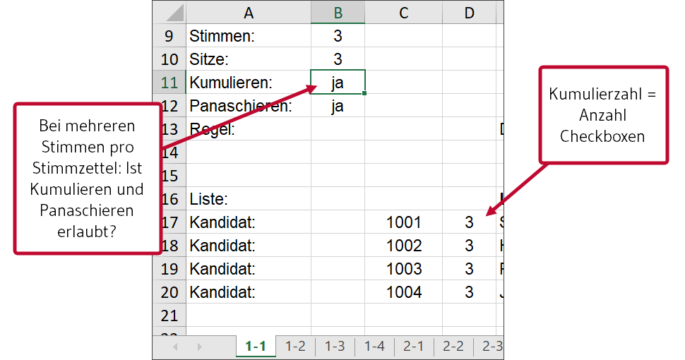
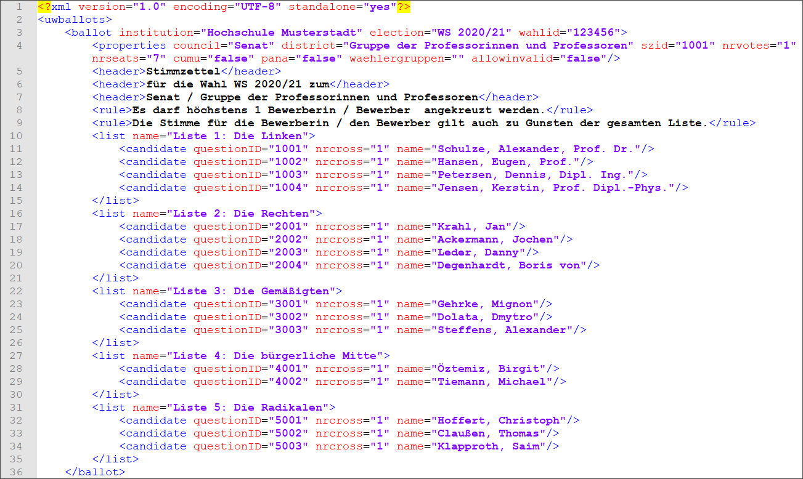

Diese Funktion ermöglicht die automatische Erzeugung von „Online-Stimmzetteln“, die dieselben Informationen und Texte enthalten müssen wie mögliche Papierstimmzettel. Damit werden Übertragungsfehler bei manueller Erstellung vermieden. Die Ausgabe kann in einer Excel-Tabelle, als xml- oder json-Datei erfolgen, die im Ordner *Arbeitsverzeichnis**/ausgabe* abgelegt werden. Diese können an den Provider weitergegeben werden. Da die Dateien nur die Daten enthalten, die auf den Stimmzetteln erscheinen, unterliegen sie keinem besonderen Datenschutz.

## Export der Daten im JSON-Format {#export-der-daten-im-json-format}

Zur Übergabe an ein uniWAHL Online-Wahlsystem (OWS) können die Konfigurations- und Stimmzettel-Informationen in eine JSON-Datei ausgegeben werden.

Mit dem Menübefehl `OWS / Stimmzettel im JSON-Format erzeugen` bzw. `OWS / Nominierung erzeugen` oder `OWS / Wahlverzeichnis-Prüfung` wird der Assistent „Onlinewahl Konfigurationsdatei ausstellen“ gestartet, der Sie durch die notwendigen Schritte zur Erstellung einer OWS-Konfigurationsdatei führt.

*Abb. : Wizzard zur Konfiguration der uniWAHL OWS-Anbindung*

Zunächst werden die Wahlparameter in Abstimmung mit Electric Paper konfiguriert:

 Abb. : Konfiguration von uniWAHL OWS

1. **OWS Version** (nur Online-Wahlsystem der ersten Generation) gibt die genutzte Version des Onlinewahlsystems an (Kompatibilität)
1. **Plattform-Version (OWS v2)** (nur Online-Wahlsystem der zweiten Generation): Auswahl v9, v10 oder v11; muss zur Zielinstanz passen (Erläuterung im Mouseover)
1. **Wahl ID (kommt aus OWS)** wird fortlaufend in OWS erhöht und hier eingetragen
1. **Authentifizierungsstellen**: Servernamen der genutzten Kryptographie-Stellen
1. **Maximale Logins pro Wähler:in**
1. **Authentifikationsmethode** (Mehrfachauswahl mit gedrückter SHIFT/STRG-Taste):
      - EMAIL / EMAIL_OTP: Die Zugangsdaten werden per E-Mail verschickt.
      - PIN_TAN: Es werden Zugangsdaten (Pin und TAN) in Excel generiert. Die Länge der PIN-TAN-Kombinationen und der genutzte Zeichensatz kann festgelegt werden.
      - SMS / SMS_OTP: Die Zugangsdaten werden per SMS verschickt.
      - USER_AND_PASS: Es werden Zugangsdaten (Benutzer, Passwort) in Excel generiert.
      - SMART_LINK: Es werden parametrisierte URL zur Integration ins Intranet generiert.
      - OIDC: Der Zugang erfolgt mittels Identity Provider (OpenID Connect).
1. **Wahl Startdatum** und **Wahl Enddatum** (Format TT.MM.JJJJ hh:mm)
1. **Demo-Wahlkabine deaktivieren** – deaktiviert die statische URL zur Demo-Wahlkabine
1. **Öffentliche Seite deaktivieren** – deaktiviert die statische URL zur Öffentlichen Seite
1. **Permanente SmartLinks ausgeben** (nur bei SMART_LINK) - erzeugt feste, unveränderliche Direktlinks. Online-Wahlsystem der ersten Generation: nur möglich, wenn die Wahl ID bereits bekannt ist. Online-Wahlsystem der zweiten Generation: gesperrt; die Begründung steht im Mouseover.
1. **SharedSecret für die Wahl** (nur bei SMART_LINK) – Schlüssel wird für das SMART Link Verfahren benötigt
1. **Election-Event-Id (aus OWS v2)** (nur Online-Wahlsystem der zweiten Generation mit SMART_LINK): darf beim ersten Durchlauf leer bleiben. Ablauf: Konfiguration exportieren, Event in OWS v2 anlegen, Election-Event-Id dort ablesen, den Assistenten erneut öffnen und die Id eintragen – erst dann entstehen die SmartLink-Zugangsdaten vollständig.
1. **Domainname für die Wahl** (nur bei PIN_TAN oder SMART_LINK) – Rechnername, aus dem die Anmelde-URLs der Wahl entstehen (ohne `https://`). Im Online-Wahlsystem der zweiten Generation ist es der Rechnername von Keycloak, ggf. mit Basispfad (z. B. `example.org/auth`); bleibt das Feld leer, wird der Rechnername automatisch gebildet. Die Domain inkl. der Zugangsdaten wird automatisch in das Ausgabeverzeichnis von uniWAHL geschrieben und kann zur Integration bereitgestellt werden.
1. **Pin-Tan Länge** - Legt die Länge der erzeugten Pin-Tan-Kombinationen (Codes) fest, die aus dem importierten Wahlverzeichnis erzeugt werden (Nur PIN/TAN-Verfahren)
1. **Pin-Tan Zeichensatz:** enthält alle Zeichen (Wertebereich), die zur Erzeugung von Pin-Tan-Kombinationen (Codes) genutzt werden können
1. **Pin-Bezeichnung**: Für einige Wähler ist der Begriff "PIN" nicht sprechend. Es kann daher eine eigene Bezeichnung (Benutzername, Mitgliedsnummer) hinterlegt werden.
1. **Tan-Bezeichnung**: Für einiger Wähler ist der Begriff "TAN" nicht sprechend. Es kann hier eine eigene Bezeichnung (Passwort, Geburtsdatum) hinterlegt werden.
1. **OIDC Provider hinzufügen** (nur bei OIDC): legt je Identity Provider einen Block mit den Feldern „Name“, „Beschreibung“, „Icon“, „authorization_endpoint“, „client_id“, „issuer“, „scope“, „token_endpoint“, „jwks_uri“, „logout_uri“, „source_claim“ und „client_secret“ an.

:::note Online-Wahlsystem der zweiten Generation: PIN/TAN zusammen mit SmartLink

Sind PIN_TAN und SMART_LINK gemeinsam gewählt, ist die PIN die Benutzerkennung der wählenden Person aus dem Wählerverzeichnis und damit kein Geheimnis; geheim ist allein die TAN. „Pin-Tan Länge“ und „Pin-Tan Zeichensatz“ wirken dann nur auf die TAN. Ohne SmartLink bleibt die PIN eine eigene Zufallskennung.

:::

Zur direkten Übergabe an uniWAHL OWS kann ein pseudonymes Wähler:innenverzeichnis (in .XLS, .XLSX, .TXT oder .CSV) direkt eingelesen werden. Dieser Schritt ist optional und kann auch später direkt im OWS nachgezogen werden.

**Je nach Authentifikationsmethode werde verschiedene Textfelder zum Ausfüllen ausgewählt.**

*Abb. : Pseudonymes Wähler:innenverzeichnis einlesen und Ablagepfad definieren*

*Abb. : Pseudonymes Wähler:innenverzeichnis einlesen und Ablagepfad definieren*

Der Ablagepfad der Übergabedatei (JSON) lässt sich im unteren Feld „Wahlkonfiguration JSON-Dateipfad“ definieren (Standard: `ausgabe\Sz2Json_<whl>_<id>.json` im Arbeitsverzeichnis; `<whl>` = Name der Wahlprojekt-Datei, `<id>` = Wahl ID).

Die Schlüsselfelder zur Wähler:innengruppenkodierung können direkt aus dem Wähler:innenverzeichnis importiert und hinterlegt werden. Dieser Schritt ist (optional) nur dann notwendig, wenn ein pseudonymes Wähler:innenverzeichnis direkt übertragen werden soll.

*Abb. : Spaltenbezeichner zuordnen*

Die Felder PIN und TAN können individuellen Spalten der Importdatei zugeordnet werden, so ist der Import vordefinierter PIN/TAN-Kombinationen in die JSON-Datei möglich.

**Wählergruppen kontrollieren:** Im nächsten Schritt zeigt der Assistent die Wählergruppen aller Stimmzettel. Leere und doppelte Werte sind gelb markiert, Werte, die im eingelesenen Wählerverzeichnis nicht vorkommen, rot. Die Werte können hier direkt korrigiert werden. Sind beim Weiterklicken noch rot markierte Werte vorhanden, fragt uniWAHL nach, ob trotzdem fortgesetzt werden soll. Siehe auch [Kontrolle der Zuordnungen](./10-4_waehler_innengruppen.md#kontrolle-der-zuordnungen).

*Abb. : Wahlkonfiguration im JSON-Format ausgeben*

Die Konfigurationsdatei wird anschließend ausgegeben und im Arbeitsverzeichnis abgelegt. Die Datei wird zusätzlich in Ihrer Standard-Anwendung für json-Dateien Browser dargestellt. Ist SMART_LINK gewählt, schreibt uniWAHL zusätzlich eine Datei mit den SmartLink-Zugangsdaten neben die JSON-Datei; der Pfad wird auf der Abschlussseite angezeigt.

:::note Online-Wahlsystem der zweiten Generation

Zusätzlich zur JSON-Datei wird die Datei `<whl>_sg_out.zip` geschrieben. Sie enthält die Wahl als JSON-Datei, die Wählerdatei (Spalten `username`, `authorized-election-ids` und `area_name`) sowie eine Berichtsdatei. Die zweite Generation wird unter `OWS / Einstellungen` mit „Nächste OWS-Generation verwenden“ eingeschaltet; SmartLinks lassen sich mit `OWS / SmartLink testen` ausprobieren.

:::

## Ausgabe als Excel-Tabelle (End of life) {#ausgabe-als-excel-tabelle-end-of-life}

Mit dem Menübefehl: „*eWAHL / Stimmzettel im XLSX-Format erzeugen*“ wird eine Arbeitsmappe erzeugt, die alle für die Stimmzettel benötigten Daten enthält.

Wählen Sie den Ausgabeordner und Dateinamen. Std.: „*ausgabe/Sz2Excel..“*

Jeder Stimmzettel wird in einer eigenen Tabelle (sheet) mit den Namen *GremienNr-GruppenNr.*. dargestellt

*Abb. : Stimmzettel als Excel ausgeben*

*Abb. : Aufbau der Excel-Tabelle*

 Abb. : Bei Mehrheitswahl oder bei Listenwahl mit Einzelbewerbern: Typ: „Einzelbewerber“

## Export der Stimmzetteldaten in XML (End of life) {#export-der-stimmzetteldaten-in-xml-end-of-life}

Zur Übergabe an ein Online-Wahlsystem können die Stimmzettel-Informationen in eine xml-Datei ausgegeben werden. Es wird dringend empfohlen, auch eine Excel-Ausgabe zu erzeugen, da diese übersichtlicher ist und Fehler leichter gefunden werden können.

Mit dem Menübefehl: „*eWAHL / Stimmzettel im XML-Format erzeugen*“ wird eine xml-Datei erzeugt, die alle für die Stimmzettel benötigten Daten enthält.

Wählen Sie den Ausgabeordner und Dateinamen. Std.: „*ausgabe/Sz2xml..“*

Die Datei wird in Ihrem Browser dargestellt, wenn er entsprechend konfiguriert ist. (Abb.)

*Abb. : Stimmzettel als XML-Datei*

| **Das Format der xml-Stimmzetteldateien ist [hier](../13_formate/index.md) beschrieben.** |
|---|
