uniWAHL unterstützt die automatisierte Übertragung von Stimmzettel-Daten, Konfigurationen und (pseudony-men) Wahlverzeichnissen in Online-Wahlsysteme. Dem Online-Wahlsystem muss mitgeteilt werden, welchen Wahlberechtigten welche Stimmzettel zur Verfügung gestellt werden müssen, d.h. jeder Stimmzettel muss „wissen“, welchen Personen er zugewiesen werden soll.

Dazu werden in uniWAHL:
1.   Im Wahlverzeichnis wichtige Merkmale zur Wahlberechtigung ausgewählt, die über die Zuordnung der Stimmzettel entscheiden.
1.   Bei jedem Wahlbereich / jeder Statusgruppe diese Merkmale hinterlegt, damit die Stimmzettel passend erstellt werden können.

## Merkmale der Wahlberechtigten {#merkmale-der-wahlberechtigten}

Wähler:innengruppen fassen die Wähler:innen zusammen, die dieselben Merkmale besitzen. Zu jeder Person werden im Wahlverzeichnis die Merkmale zusammengefasst, die sie den Wähler:innengruppen zuordnen, z.B. Status, Fakultätszugehörigkeit, Geschlecht. Bei der Vorbereitung des Wahlverzeichnisses sollte darauf geachtet werden, dass die Parameter mit den zu wählenden Wahlbereichen übereinstimmen. So sollte z.B. eine Spalte im Wahlverzeichnis die Fakultät enthalten, damit man später alle Studis einer Fakultät als Wähler:innengruppe zusammenfassen kann.

## Zuordnung der Wähler:innengruppen-Merkmale zu den Personen {#zuordnung-der-waehler-innengruppen-merkmale-zu-den-personen}

Durch den Menübefehl unter `OWS / Wahlverzeichnis kodieren` wird ein Assistent gestartet, der jeder Person im Wahlverzeichnis die Wähler:innen-Merkmale zuordnet. Vor dem Start wird gefragt, ob ein vorher erstellter Code-Satz bearbeitet oder ein neuer erzeugt werden soll.

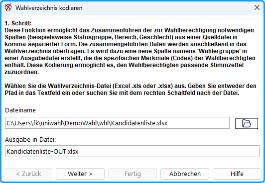

*Abb. : Wahlverzeichnis kodieren*

Im folgenden Beispiel sind die Zugehörigkeit zur Fakultät und die Statusgruppe (Prof, Stud, WiMi, MTV) codiert, diese Codes können frei gewählt werden, z.B. „Fak3“ statt „Fakultät für Rechtswissenschaften und...“. Sinnvoll sind kurze, selbsterklärende Akronyme, damit die Angaben einfach kontrolliert werden können.

**1. Schritt:** Wählen Sie das Wahlverzeichnis (Excel .xls oder .xlsx; erste Zeile: Bezeichner) aus, dem die Merkmale hinzugefügt werden sollen, und die Datei, in die das bearbeitete Wahlverzeichnis geschrieben werden soll (Vorschlag: *Dateiname + „-OUT“*).

Klicken Sie `Weiter`.

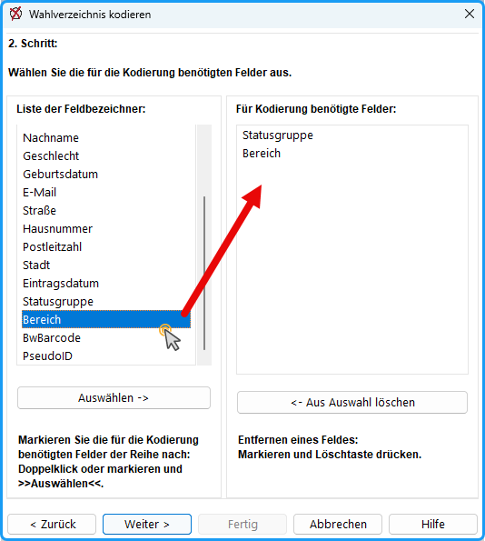

*Abb. : Für die Kodierung benötigte Felder*

**2. Schritt:** Wählen Sie die Bezeichner für die Spalten aus, die die Merkmale enthalten, indem Sie diese doppelklicken. Sie werden dadurch in die rechte Liste der ausgewählten Felder übernommen. (siehe Abb., Beispiel: Statusgruppe und WahlFB)

Klicken Sie `Weiter`.

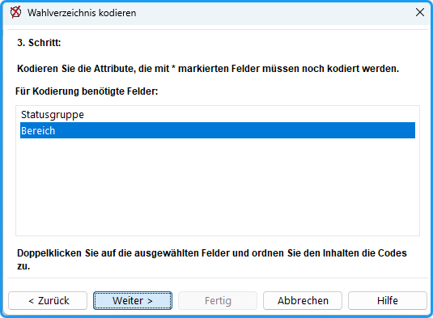

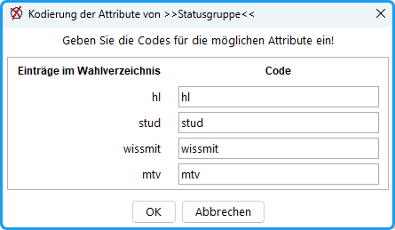

*Abb. : Benötigte Felder und Trennzeichen*

**3. Schritt:** In der Liste (Abb.) erscheinen die ausgewählten Feldbezeichner. Durch Doppelklick auf den jeweiligen Bezeichner öffnet sich ein Dialog, in dem man den in der Datei in dieser Spalte gefundenen Einträgen beliebige Codes (z.B. Abkürzungen) zuweist. Diese können aus Buchstaben oder Ziffern bestehen. Wiederholen Sie den Vorgang für alle ausgewählten Bezeichner. Die noch nicht kodierten Bezeichner werden durch * markiert.

Kodieren Sie alle Attribute, die mit * markiert sind.

Klicken Sie `Weiter`.

Eine neue Tabelle wird erzeugt, in die die Wähler:innengruppen-Merkmale als zusätzliche Spalte eingetra­gen werden (Abb.). Die ursprüngliche Datei bleibt unverändert.

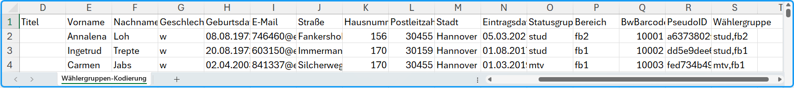

*Abb. : In das Wahlverzeichnis wurden Eintragungen zur Wähler:innengruppe hinzugefügt*

Später können in dieser neuen Tabelle die persönlichen Daten der Personen durch die anonyme persönliche Personenkennung ersetzt werden; diese Tabelle wird an den Online-Dienstleister weitergeben (Abb.).

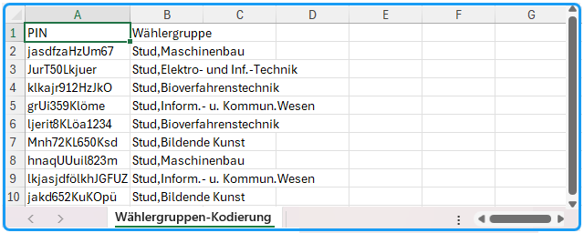

*Abb. : Alle Spalten mit persönlichen Daten wurden durch eine Personenkennung (PIN) ersetzt*

Zusätzlich werden die für die Kodierung benutzten Einstellungen und eine Liste aller vergebenen Wähler:innenmerkmale-Codes in einer weiteren Datei (*Dateiname + „-CODE.uwx“)* gespeichert und können für eine spätere Bearbeitung wieder aufgerufen werden. (Sie können die Datei öffnen, indem Sie Windows sagen, dass es uwx-Dateien mit Excel oder Calc öffnen soll.)

## Zuordnung der Stimmzettel zu Wähler:innengruppen {#zuordnung-der-stimmzettel-zu-waehler-innengruppen}

Im Dialogfenster jedes Wahlbereichs befindet sich ein Eingabefeld „Wähler:innengruppe“, in das die für den Stimmzettel dieses Wahlbereichs zugeordneten Wähler:innengruppen-Merkmale eingetragen werden. Die Merkmale werden durch Komma getrennt (siehe Abb.).

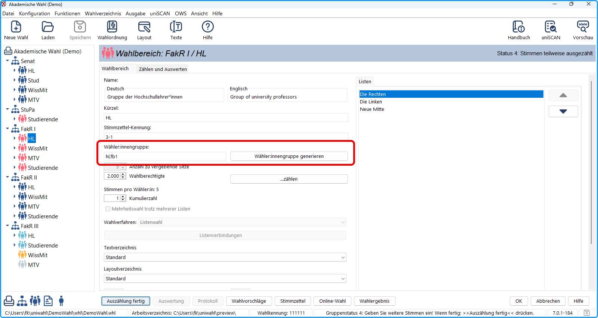

*Abb. : Beispiel: Dieser Stimmzettel wird allen Hochschullehrer*innen im Fachbereich I angeboten*

Beispiel zur Bedeutung der Wähler:innengruppen-Parameter:

**Ein Stimmzettel soll Personen vorgelegt werden, die *alle* angegebenen Wähler:innen-Merkmale besitzen:**

| „stud“ | Alle Studierenden ohne Rücksicht auf andere Parameter |
|---|---|
| „hl,fb1“ | Professor:innen der Fakultät-1; bei der Person muss „hl“ *und* „fb1“ vorhanden sein. |
| „w“ | Alle weiblichen Personen unabhängig von Status, Fakultät usw. |

| **Einer Person aus dem Wählerverzeichnis, die keiner Wähler:innengruppe angehört, werden alle Stimmzettel angezeigt werden.** |
|---|

## Kontrolle der Zuordnungen {#kontrolle-der-zuordnungen}

Nach der Eingabe der Zuordnungen der Stimmzettel zu Wähler:innengruppen, sollte man die Richtigkeit kontrollieren und protokollieren. Mit dem Menübefehl: `OWS / Wähler:innengruppen kontrollieren` wird ein Dialog geöffnet, der die Kontrolle und Nachbearbeitung der Wählergruppen ermöglicht.

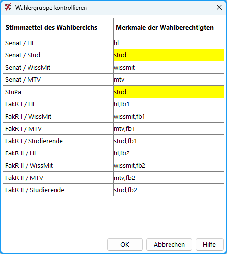

*Abb. : Kontrolle der Zurordnung (Warnungen werden gelb angezeigt)*

Anschließend wird eine Tabelle erzeugt, die in Excel (siehe Abb.) geöffnet wird. Diese protokolliert die Zuordnung und kann an die interne IT zur Erzeugung der Merkmale übergeben werden.

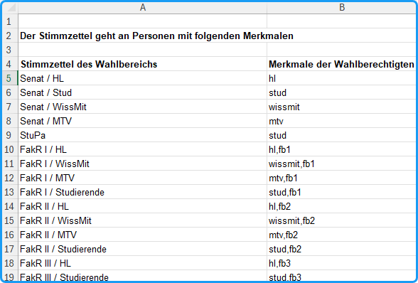

*Abb. : Zuordnung der Stimmzettel zu den Merkmalen der Personen*

## Übergabe der Wähler:innenmerkmale {#uebergabe-der-waehler-innenmerkmale}

Zur Übergabe an das Onlinewahlsystem (siehe S. 115) werden die jedem Stimmzettel zugewiesenen Wähler:innengruppen-Merkmale mit den Stimmzettel-Daten übergeben.

- A. In den *Excel-Tabellen* der Gremienübersicht [**Ausgabe/Tabelle**] erscheint die Zuordnung jeweils in der Spalte „*Wählergruppe*“:
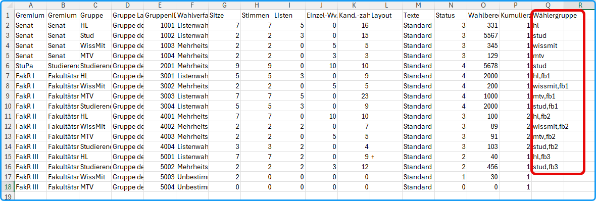

*Abb. : Gremienübersicht mit Angabe der Wähler:innengruppen*

- B. In der *JSON-Ausgabe* (Menü OWS) werden die Wählergruppen-Codes in sogenannte Events bzw. Child Elections übersetzt und den Wähler:innen zugeordnet:
&gt; "children_election_info" : \{"natural_order" : [ 3, 4, 5, 6, 7, 8, 9, 10, 11, 12, 13, 14, 15 ], ...

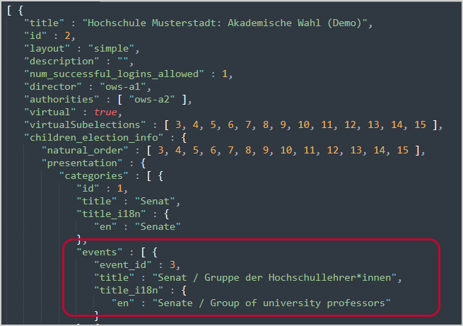

*Abb. : Stimmzetteldaten in JSON*

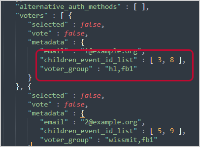

*Abb. : Wählerdaten in JSON*
