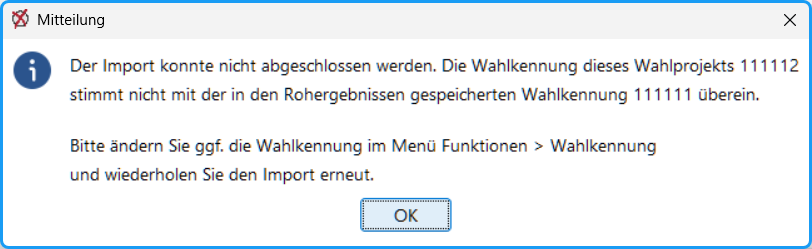
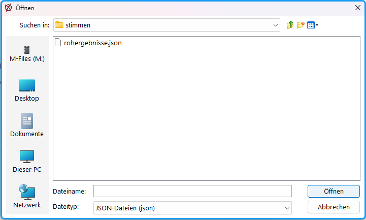
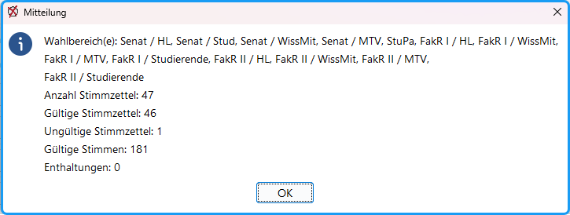
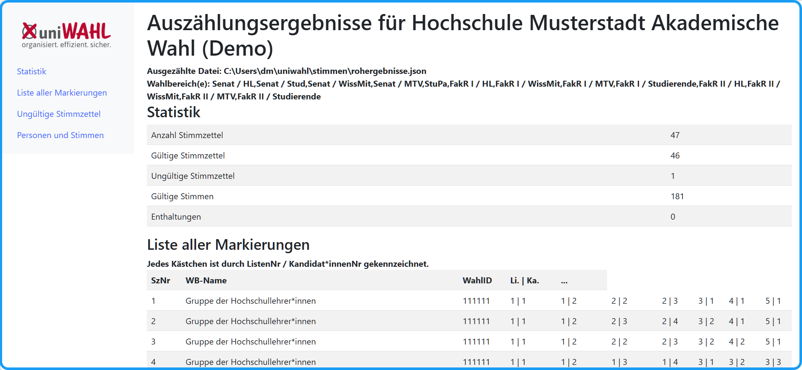

Für den Import der Stimmen in *uniWAHL* werden am besten Rohdaten verwendet, das heißt, dass die Informationen für jeden einzelnen Stimmzettel und für jede Checkbox geliefert werden. Dadurch kann *uniWAHL* bei jedem Stimmzettel entscheiden, ob er gültig ist und wie jede Stimme gezählt wird. So kann die Auszählung an alle in *uniWAHL* implementierten, z.T. komplizierten Wahlordnungen durchgeführt werden.

Menü­befehl `OWS / Importiere Rohdaten` (früher Menü „eWAHL“)

Zur Kontrolle wird die Wahlkennung mitgeteilt, zu der die zu importierenden Stimmen passen müssen. (Das ist wichtig, wenn man wegen unterschiedlicher Wahlordnungen verschiedene Wahlvorgänge angelegt hat.)

* Abb. : Mitteilung der Wahlkennung*

Wählen Sie die zu importierende Datei. (Der Dateiname sollte die Kennung enthalten.)

* Abb. : Importierte Rohdaten *

Nachdem Sie die jeweilige Datei geöffnet haben öffnet sich ein Dialog, welcher die Wahlbereiche und Stimmen/Stimmzettel auflistet.

Die Stimmen werden direkt den Kandidat:innen und Listen zugewiesen und die Import-Statistik wird mitgeteilt.

Alle betroffenen Wahlbereiche werden als „teilweise ausgezählt“ markiert.

* Abb. : Auswertung*

## Auszählungsergebnisse - Import-Protokoll {#auszaehlungsergebnisse-import-protokoll}

Ein vollständiges Import-Protokoll wird im Browser geöffnet. Dieses enthält zuerst die Import-Statistik, eine Liste aller Markierung als Stimmzettel-Protokoll, in dem für jeden Stimmzettel die „Ankreuzungen“ aufgelistet werden, die ungültigen Stimmzettel und die Personen und Stimmen, die per Import in uniWAHL hinzugefügt werden.

* Abb. : Importprotokoll (unterster Teil)*

### Statistik {#statistik}

Oben wird angezeigt, welche Datei ausgezählt wurde. Während der Erzeugung wird die die &lt;name&gt;.JSON-Datei in eine &lt;name&gt;.HTML (das Protokoll) umgewandelt, so dass der Import nicht versehentlich mehrfach durchgeführt werden kann.

Darunter sind die berücksichtigten Wahlbereiche mit Kurzbezeichnungen aufgeführt.

Im Bereich Statistik werden die wichtigsten Auszählungszahlen dargestellt, je nachdem welche Wahlordnungskonfiguration vorgenommen wurde (z.B. Ungültige Stimmzettel, Ungültige Stimmen, Enthaltungen).

### Liste aller Markierungen {#liste-aller-markierungen}

Diese Ansicht zeigt, welche Kästchen auf den Stimmzetteln durch ListenNr / Kandidat*innenNr gekennzeichnet wurden. Jede Zeile entspricht einem Stimmzettel.

Links stehen die Grunddaten:

- SzNr: laufende Stimmzettelnummer
- WB-Name: Gremium, Wahlbereich bzw. Gruppe
- WahlID: hier jeweils „111111“
- Li. und Ka.: vermutlich Liste und Kandidatin

Rechts folgen die eigentlichen Markierungen. Diese werden im Format Liste | Kandidat*in angezeigt, zum Beispiel: 1 | 2 (Liste 1, Kandidat:in 2).

### (Nach-)Nominieren von Kandidat:innen {#nach-nominieren-von-kandidat-innen}

Im Fall von Nominierungen werden in einer Tabelle die Namen der nominierten Personen angezeigt und den Stimmzetteln zugeordnet. Die auf die Person fallende Stimmenzahl erscheint in der letzten Spalte.

Diese nominierten Kandidat:innen können direkt in uniWAHL eingegeben werden. Öffnen Sie dazu den angegebenen Wahlbereich (Gremium / Gruppe). Wenn die Person noch nicht vorgeschlagen wurde, betätigen Sie die Taste: „Neuer Kandidat" . Anschließend geben Sie ihr die ermittelten Stimmen.

### Ungültige Stimmzettel {#ungueltige-stimmzettel}

Die Ansicht „Ungültige Stimmzettel“ listet alle Stimmzettel auf, die nicht in die gültige Auswertung übernommen wurden. Auch hier wird über die SzNr die Stimmzettelnummer angezeigt.

In der Spalte Ursache steht der Grund für die Ungültigkeit. Im gezeigten Beispiel wurde der Stimmzettel als ungültig gewertet, weil die Option „Ungültig“ ausgewählt wurde. Dadurch kann im Prüf- oder Nachzählfall nachvollzogen werden, weshalb ein Stimmzettel nicht als gültig gezählt wurde.

### Personen und Stimmen {#personen-und-stimmen}

Die Tabelle „Personen und Stimmen“ zeigt das Ergebnis auf Kandidat*innenebene. Jede Zeile enthält den Namen einer Person, eine interne ID und die erreichte Stimmenzahl.

Die ID dient der eindeutigen technischen Zuordnung der Person. Das ist hilfreich, wenn Namen mehrfach vorkommen oder Daten aus verschiedenen Systemen zusammengeführt werden. Die Spalte Stimmen zeigt, wie viele gültige Stimmen auf die jeweilige Person entfallen sind.

### Wahlergebnis ermitteln {#wahlergebnis-ermitteln}

Nach erfolgreichem Import und der Verarbeitung aller Stimmen aus anderen Quellen (manuelle Auszählung, uniSCAN) können Sie das Wahlergebnis wie folgt herstellen:

1. Menü Funktionen: "Wahlberechtigte zählen (alle Bereiche)"
1. Menü Funktionen: "Auszählung fertig (alle Bereiche)"
1. Menü Funktionen: "Sitzverteilung starten (alle Bereiche)"
1. Menü Ausgabe: "Wahlergebnis &gt; alle Gremien"

Damit ist das Wahlergebnis innerhalb weniger Minuten ermittelt.
