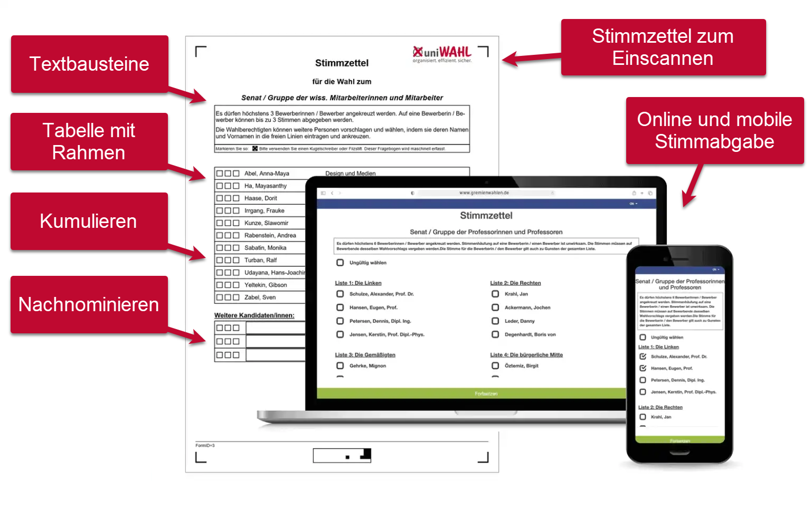

import DocCardList from '@theme/DocCardList';

Bei Verwendung des uniWAHL OWS Moduls werden die vorhandenen Wahldaten einfach in das Onlinewahlsystem übertragen und stehen dann auch elektronisch zur Verfügung. Mit uniWAHL OWS können Wahlvorgänge daher komplett online gestaltet werden – von der Stimmabgabe bis zur Auszählung. Das System bietet eine benutzerfreundliche Oberfläche für Wählende, eine sichere Authentifizierung sowie automatisierte Prozesse zur Auswertung der Stimmen.

<DocCardList />

