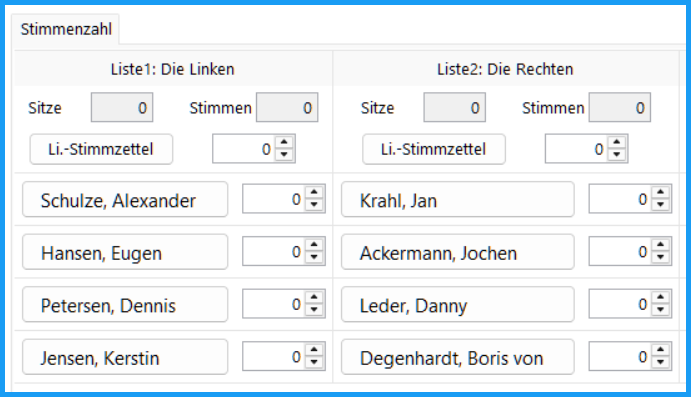
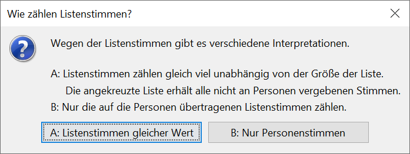
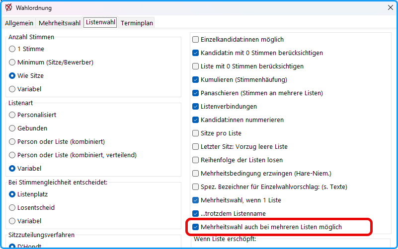
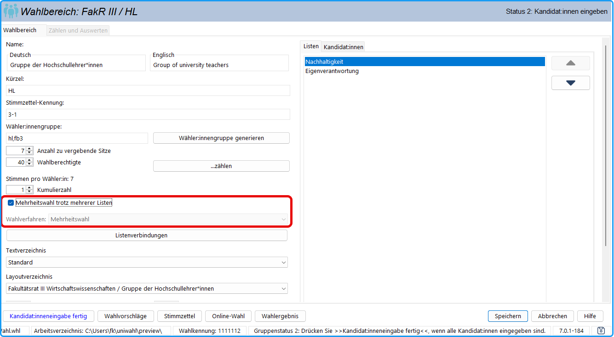

## Verschiedene Auswerteverfahren {#verschiedene-auswerteverfahren}

## D'Hondtsches Höchstzahlenverfahren {#d-hondtsches-hoechstzahlenverfahren}

(*Divisorverfahren mit Abrundung*) Die einer Gruppe zustehenden Sitze werden den einzelnen Wahlvorschlägen nach der Reihenfolge der Höchstzahlen zugeteilt, die sich durch Vollrechnung, Halbteilung, Drittelung usw. der Zahl der für die einzelnen Wahlvorschläge abgegebenen Stimmen ergeben.

## Hare-Niemeyer-Verfahren {#hare-niemeyer-verfahren}

(*Quotenverfahren mit Restausgleich nach größten Bruchteilen*) Jeder Wahlvorschlag erhält zunächst so viele Sitze, wie sich für ihn entsprechend dem Verhältnis der Zahl der auf ihn entfallenen Stimmen zur Stimmenzahl aller Wahlvorschläge als ganze Zahl ergibt. Weitere Sitze sind in der Reihenfolge der höchsten verbleibenden Zahlenbruchteile zu vergeben.

Erhält ein Wahlvorschlag, auf den mehr als die Hälfte der Stimmenzahl aller Wahlvorschläge entfallen ist, bei diesem Verfahren nicht mindestens die Hälfte der insgesamt zu vergebenden Sitze, so erhält dieser Wahlvorschlag abweichend von dem genannten Verfahren den ersten der nach Zahlenbruchteilen zu vergebenden Sitze.

Enthält eine Liste weniger Kandidat:innen als ihr Sitze zustehen würden und sollen diese überschüssigen Sitze auf die anderen Listen verteilt werden, werden zuerst der ausgeschöpften Liste die möglichen Sitze zugewiesen. Alle übrigen Sitze werden anschließend neu auf die verbliebenen Listen verteilt.((* Eine Sitzzuteilung der verbliebenen Sitze an die Listen in der Reihenfolge der nächsten Zahlenbruchteile würde die Erfolgswertgleichheit der Stimmen verletzen. Beispiel: 4 Listen mit 6/ 3/ 6/ 3 Kandidat:innen mit 36/ 75/ 30/ 3 Stimmen erhalten rechnerisch 3/ 5/ 2/ 0 Sitze. Da die 2. Liste nur 3 Kandidat:innen hat, würde bei Zuteilung der überschüssigen Sitze auf die Listen mit den nächsten Nachkommastellen die Liste 3 und 4 je einen zusätzlichen Sitz erhalten: Sitzverteilung 3/ 3/ 3/ 1. Der Erfolgswert für Liste 4 wäre 3 Stimmen/Sitz, während ein 4. Sitz für die Liste 1 einen Erfolgswert von 9 Stimmen pro Sitz bedeuten würde. - Bei Vergabe von 3 Sitzen an Liste 2 und Verteilung der restlichen 7 Sitze an die anderen Listen ergäbe sich die Sitzverteilung: 4/ 3/ 3/ 0.
))

## Verfahren nach Sainte-Laguë {#verfahren-nach-sainte-lagu}

(*Divisorverfahren mit Standardrundung*) Die Summe der auf die einzelnen Vorschlagslisten oder Listenverbindungen jeder Gruppe oder Teilgruppe entfallenen gültigen Stimmen werden der Reihe nach durch die ungeraden Zahlen 1,3, 5, ... (oder 0.5, 1.5, 2.5, 3.5...) geteilt. Die Sitze werden der Reihe nach auf die Wahlvorschläge mit den jeweils höchsten Teilzahlen (Höchstzahl) verteilt.

## Vergleich der Verfahren {#vergleich-der-verfahren}

Eine Beschreibung der Wahlverfahren findet sich unter [http://www.wahlrecht.de/verfahren](http://www.wahlrecht.de/verfahren).

Im Idealfall wäre beim Verhältniswahlrecht das Verhältnis der Mandate genau gleich dem Verhältnis der Stimmen. Da es aber keine Bruchteile eines Mandates geben kann, ist dies nur näherungsweise möglich. Das Verfahren von d’Hondt unterscheidet sich deutlich von den anderen beiden Verfahren bezüglich der Weise, wie diese Näherung geschieht. Das Verfahren nach d’Hondt führt dazu, dass die Mandatszahl für kleine Listen eher abgerundet und für große Listen eher aufgerundet wird. Bei Hare-Niemeyer und Sainte-Laguë ist die Behandlung der Rundungsfehler unabhängig vom Stimmenanteil.

Die Bundeswahlleitung kommt in einer Studie vom 4. Januar 1999 zu dem Fazit, dass das Verfahren nach Sainte Laguë dem Verfahren nach Hare-Niemeyer (wegen dessen Paradoxien) und dem Verfahren nach d'Hondt vorzuziehen ist.

Am 24. Januar 2008 beschloss der 16. Deutsche Bundestag in seiner 139. Sitzung für die Sitzzuteilung das *Divisorverfahren mit Standardrundung* (Sainte-Laguë) zu verwenden. Diese Änderung wurde erstmals bei der Bundestagswahl am 27.9.2009 angewendet.

## Zuteilung der Sitze bei kombinierter Verhältniswahl {#zuteilung-der-sitze-bei-kombinierter-verhaeltniswahl}

Bei der kombinierten Verhältniswahl können sowohl die einzelnen Personen (personalisierte Verhältniswahl) als auch die Listenwahlvorschläge (Listenwahl) angekreuzt werden.

Die Gesamtzahl der Stimmen einer Liste setzt sich aus der Summe der Listen- und Kandidat:innenstimmen zusammen. Diese Gesamtstimmenzahlen bestimmen die den einzelnen Listen nach d'Hondt o.ä. zustehenden Sitze.

*Beispiel: Die Liste A besteht* *aus 8 Kandidat:innen, die folgende Stimmenzahlen bekamen: 30, 50, 60, 20, 10, 80, 10, 40. Zusätzlich bekam die Liste 210 Stimmen. Die Gesamtzahl der Stimmen ist 510. Mit dieser Zahl bewirbt sie sich mit den anderen Wahlvorschlägen um die Sitze.*

Bei jeder Liste werden die der Liste zugefallenen Sitze in zwei Anteile aufgeteilt (nach d'Hondt o.ä.):

1. die Sitze, die auf Grund der Listenstimmen an die Liste, und
1. die, die auf Grund der Kandidat:innenstimmen an die Kandidat:innengesamtheit entfallen.

Die Sitze, die der Liste auf Grund der Listenstimmen zufallen, gehen an die Kandidat:innen in der Listenreihenfolge.

Anschließend werden die der Liste auf Grund der Kandidat:innenstimmen zugefallenen Sitze den noch nicht gewählten Kandidat:innen nach der Stimmenzahl zugewiesen.

*Beispiel: Angenommen die Liste A (s.o.) habe 5 Sitze erworben. Nach d’Hondt fallen auf die 210 Listenstimmen 2 Sitze (damit sind die ersten beiden Kandidat:innen gewählt) und auf die 300 Kandidat:innenstimmen 3 Sitze, mit denen die Kandidat:innen Nr. 3, 6, und 8 gewählt sind.*

## Kombinierte Verhältniswahl mit verteilten Stimmen (kombiniert, verteilend) {#kombinierte-verhaeltniswahl-mit-verteilten-stimmen-kombiniert-verteilend}

Wie bei der kombinierten Verhältniswahl (s. 14.2.2) können sowohl die einzelnen Personen als auch die Listenwahlvorschläge angekreuzt werden. Die wählende Person hat so viele Stimmen wie Sitze in dem Wahlbereich zu vergeben sind.

Bei Verhältniswahl (Listenwahl) kann die wählende Person

- einen Wahlvorschlag unverändert annehmen (1 Kreuz) oder
- Bewerber:innen innerhalb der ihr zustehenden Stimmenzahl jeweils eine oder ggf. mehrere Stimmen geben;
- sie kann auch einen Wahlvorschlag kennzeichnen und einzelnen Bewerber:innen innerhalb der ihr zustehenden Stimmenzahl eine oder ggf. mehrere Stimmen geben.

Wurde ein Wahlvorschlag angekreuzt, erhalten die Bewerber:innen dieses Wahlvorschlags, die weniger als die erlaubte Stimmenanzahl haben, in der Reihenfolge der Benennung jeweils eine Zusatzstimme bis zur Erreichung der insgesamt zustehenden Stimmenzahl.

// Der Zuteilung der Sitze auf die Wahlvorschläge liegt die Anzahl der auf die Wahlvorschläge entfallenen gültigen Stimmzettel (nicht: Stimmen) zu Grunde. Deshalb werden in diesem Fall die Stimmzettel pro Liste gezählt. Ein Stimmzettel entfällt auf einen Wahlvorschlag, wenn der gesamte Wahlvorschlag oder/und mindestens einer seiner Bewerber angekreuzt wurden.

Über die Taste: „**Li.-Stimmzettel**“ bzw. das entsprechende Eingabefeld kann die Anzahl der Stimmzettel, die für diese Liste abgegeben wurden, eingegeben werden. Nach diesen Zahlen werden die Sitze auf die Listen verteilt.

*Abb. : Ohne Panaschieren: Anzahl Stimmzettel einer Liste*

Die Zuteilung der Sitze auf die Bewerber innerhalb der Liste erfolgt nach der Stimmenzahl der Personen.

//: (Verteilen der Stimmen auf Personen mehrerer Wahlvorschläge): Wenn bei Listenwahl das Panaschieren erlaubt ist, erfolgt die Sitzzuteilung nach der Anzahl der auf die Listen entfallenen Stimmen (= „Zählstimmen”). Dabei erhalten die Wahlvorschläge zuerst so viele Stimmen, wie an Personen auf ihnen vergeben wurden.

*Abb. : Mit Panaschieren: Eingabe der Zählstimmen*

Wurde ein Wahlvorschlag angekreuzt (nur einer darf angekreuzt werden), bekommen die Bewerber dieses Wahlvorschlags Zusatzstimmen. Der Wahlvorschlag erhält dann als zusätzliche Zählstimmen

- entweder die volle Anzahl von Stimmen, die noch nicht an Personen (auch anderer Wahlvorschläge) vergeben wurden (Fall A),
- oder nur die an Personen dieses Wahlvorschlags vergebenen Zusatzstimmen (Fall B). Eine Liste mit wenigen Bewerbern könnte dadurch benachteiligt werden.

Beim Stimmenimport wird deshalb folgende Frage gestellt:

*Abb. : Interpretation von Listenstimmen*

:::tip

Das Programm merkt sich die letzte Einstellung, so dass die Auswahl mit der Eingabetaste bestätigt werden kann.

Beim Import der Stimmen aus uniSCAN oder OWS werden alle genannten Optionen berücksichtigt und automatisch die Stimmzahlen bestimmt.

:::

## Mehrheitswahl trotz mehrerer Listen {#mehrheitswahl-trotz-mehrerer-listen}

Bei den meisten Hochschulen findet Mehrheitswahl statt, wenn nur Einzelwahlvorschläge oder nur ein Listenwahlvorschlag eingereicht wurden. An einigen Hochschulen findet Mehrheitswahl auch dann statt, wenn bestimmte andere Bedingungen erfüllt sind, z.B. *„Mehrheitswahl findet statt, wenn die Zahl der Bewerber bei mehreren Wahlvorschlägen zusammen höchstens doppelt so groß ist, wie die Zahl der zu wählenden Mitglieder"* oder *„wenn von einer Wähler:innengruppe weniger als vier Bewerber zu wählen sind"*. Für diese Fälle wurde in *uniWAHL* eine Option in der Wahlordnung eingefügt.

 Abb. : Mehrheitswahl auch bei mehreren Listen möglich

In der Karteikarte *Wahlordnung / Listenwahl* erscheint eine weitere Auswahlmöglichkeit: *„Mehrheitswahl auch bei mehreren Listen möglich".*

Ist bei der „*Wahlordnung*" diese Option gewählt, erscheint im Eingabefenster jedes Wahlbereichs (Gruppe) die zusätzliche Option: *„Mehrheitswahl trotz mehrerer Listen*".

*Abb. : Mehrheitswahl trotz mehrerer Listen*

Wenn diese gewählt wird, wird
- als Wahlverfahren: *Mehrheitswahl* gesetzt,
- der Reiter „*Listen*" geöffnet („*Kandidaten*" bleibt, weil das bei Mehrheitswahl so ist)
- und die Wahlverfahren-Auswahl deaktiviert.

Bei der *Bekanntmachung der Wahlvorschläge* und den *Stimmzetteln* werden die Wahlvor­schläge wie Listen aufgeführt, erhalten aber in der Überschrift statt „Liste" den Begriff „Kennwort"
(bzw. den in den Textbausteinen dafür gewählten Ausdruck).

Die Sitzzuteilung erfolgt nach den Grundsätzen der Mehrheitswahl.

Beim *Wahlergebnis* werden die „Listen" ähnlich wie bei den Wahlvorschlägen und Stimmzetteln listenweise aufgeführt. Wenn im *Layout /Wahlergebnis* die Option *„Reihenfolge nach Rang"* gewählt wurde, wird diese ignoriert. Wenn während der Wahlperiode später Kandidat:innen nachrücken sollen, muss bei Stim­men­gleichheit ggf. noch einmal gelost werden.
