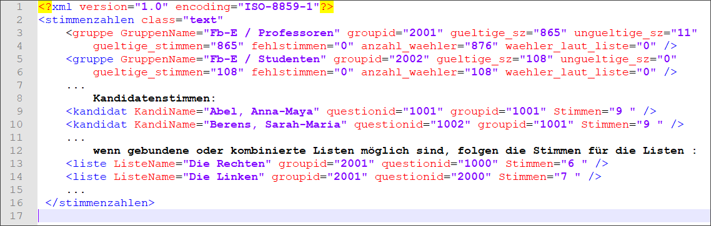

Für das Format der Datei mit den maschinell oder anderweitig gewonnenen Stimmenzahlen gelten folgende Regeln:

1. Die Datei ist eine XML-Datei, der Name hat die Erweiterung *„.stm*“ oder „.*xml*“.
1. Die Stimmen eines Kandidat:innen erscheinen im *Tag* „*kandidat*“.
1. „*groupid*“ ist die Kennung des Stimmzettels: GremiumNr.*1000+GruppenNr.
1. „*questionid*“ kennzeichnet den Kandidat:innen: ListenNr *1000+KandidatNr.
1. Der „*KandiName*“ erscheint nur zur Kontrolle.
1. Bei gebundenen Listen ist die „*questionid*“=ListenNr *1000
1. Die Kandidat:innen können in beliebiger Reihenfolge aufgeführt sein.

*Abb. : Beispiel für eine Stimmen-Datei zum Importieren ausgezählten Daten*
