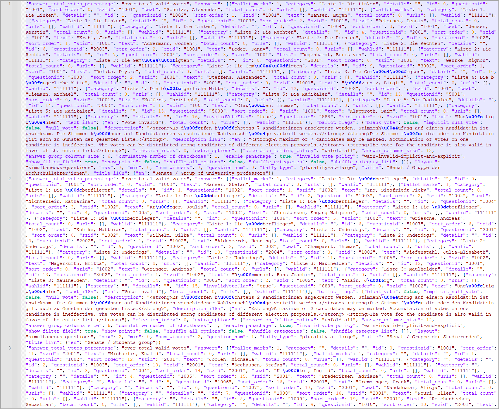

Für den Import der Stimmen in *uniWAHL* werden am besten Rohdaten (Menü­befehl „*OWS / Importiere Rohdaten*“ verwendet, das heißt, dass die Informationen für jeden einzelnen Stimmzettel, d.h. für jede Checkbox geliefert werden. Dadurch kann die Auszählung an alle in *uniWAHL* implementierten Wahlordnungen angepasst werden.

Das Datenformat der xml-Datei ist festgelegt durch:

&lt;!ELEMENT result (ballotprocess *)&gt;
&lt;!ELEMENT ballotprocess (answer*)&gt;
&lt;!ELEMENT answer (wahlid,szid,questionid,value)&gt;
&lt;!ELEMENT wahlid (#PCDATA)&gt;
&lt;!ELEMENT szid (#PCDATA)&gt;
&lt;!ELEMENT questionid (#PCDATA)&gt;
&lt;!ELEMENT value (#PCDATA)&gt;

- Jeder Stimmzettel ist ein „*ballotprocess*“.
- Jede Checkbox ist eine „*answer*“, die sich auf eine Personen- oder Listenstimme beziehen kann.
- „*wahlid*“ kennzeichnet den Wahlvorgang .
- „*szid*“ kennzeichnet den Stimmzetteltyp, d.h. den Wahlbereich:
*szid =* GremiumNr *1000+GruppenNr
- „*questionid*“ ist die Kennung der Person (bei personalisierter Listenwahl oder Mehrheitswahl) oder der Liste (bei gebundenen oder kombinierten Listen). Beim Kumulieren haben mehrere Checkboxen dieselbe //questionid.
questionid =// ListenNr *1000+KandidatNr
Eine Checkbox zum Ungültigmachen hat die *questionid = 888.*
- Bei gebundenen Listen ist die „*questionid*“ = ListenNr *1000
- „*value*“ = 1 bei angekreuzten oder 0 bei nicht angekreuzten Checkboxen. Die Datei muss nur die angekreuzten „*answers*“ (value = 1) enthalten.

```
<?xml version="1.0" encoding="ISO-8859-1"?>
<result>
  <ballotprocess page="1">
    <answer>
       <wahlid>301856</wahlid>
       <szid>1003</szid>
       <questionid>1001</questionid>
       <value>1</value>
    </answer>
</ballotprocess>

<ballotprocess page="2">
    <answer>
       <wahlid>301856</wahlid>
       <szid>1003</szid>
       <questionid>1002</questionid>
       <value>1</value>
    </answer>
    <answer>
       <wahlid>301856</wahlid>
       <szid>1003</szid>
       <questionid>1003</questionid>
       <value>1</value>
    </answer>
</ballotprocess>

...

<ballotprocess page="1033">
    <answer>
       <wahlid>301856</wahlid>
       <szid>1003</szid>
       <questionid>1003</questionid>
       <value>1</value>
    </answer>
    <answer>
       <wahlid>301856</wahlid>
       <szid>1003</szid>
       <questionid>1004</questionid>
       <value>1</value>
    </answer>

</ballotprocess>
</result>
```

<br />Abb. : Beispiel für das Datenformat für das Importieren aus Rohdaten



*Abb. : Beispiel einer JSON-Importdatei*
