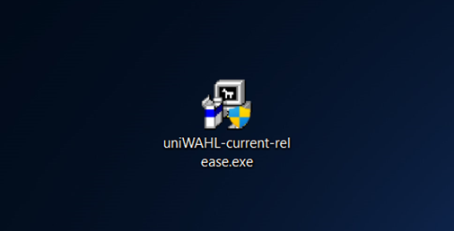
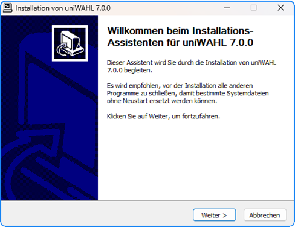
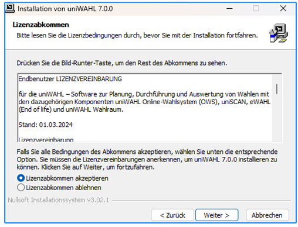
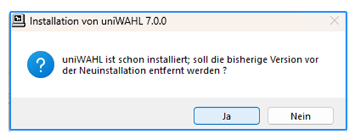
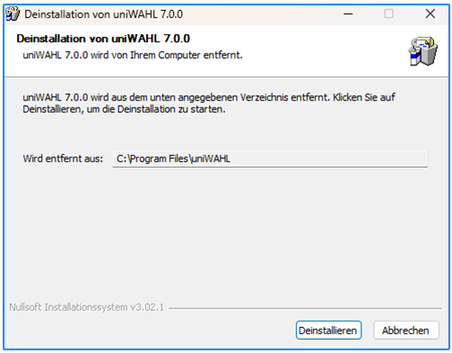
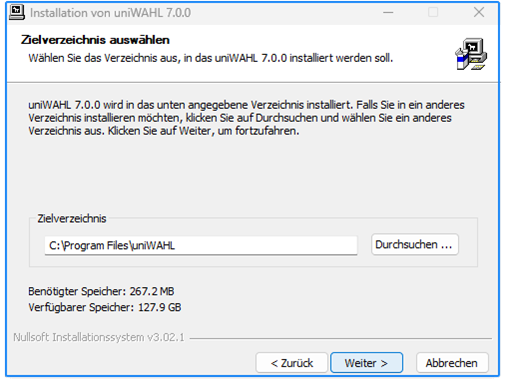
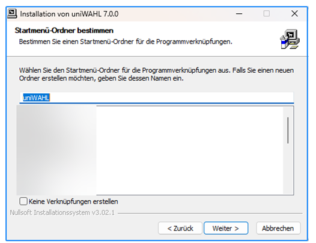
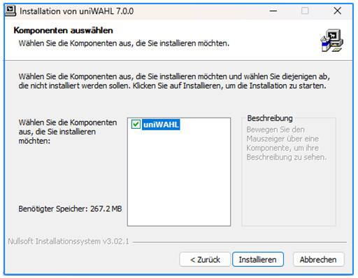
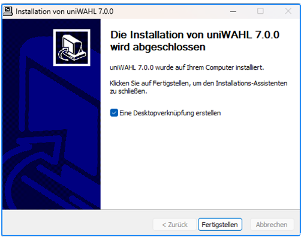

Dieser Artikel beschreibt die Installation von uniWAHL.

#### Systemanforderungen {#systemanforderungen}

- Microsoft Windows bis Windows 11.
- PC mit 64 Bit kompatiblem Prozessor mit min. 1.5 GHz (Empfohlen 4-Kern-Prozessor)
- Für die Installation mit Java und Libre/OpenOffice sind etwa 1 GB Festplattenplatz erforderlich.
- min. 2 GB Arbeitsspeicher (Empfohlen sind min. 16 GB RAM für uniSCAN)
- OpenOffice / LibreOffice (.odt) oder Microsoft Word ab 2010 (.docx)
- Adobe Acrobat Reader

#### Installationshinweise {#installationshinweise}

-  Während der Installation von uniWAHL werden nur die Programmpfade von uniWAHL aktualisiert (z.B. C:\Programme\uniWAHL und C:\Benutzer\&lt;Nutzername&gt;\uniWAHL), nicht aber die Arbeitsverzeichnisse (z.B. C:\uniWAHLDaten), in denen die Wahlprojektdaten liegen.
-  uniWAHL kann in mehreren Versionen in mehreren Pfaden installiert werden. Geben Sie während der Installation den gleichen Pfad einer bereits installierten Version (z.B. C:\Programme\uniWAHL) an, wird eine Deinstallation vorgeschlagen.
-  Alle Dateien von uniWAHL sind aufwärts kompatibel, es ist daher nicht zwingend notwendig, eine frühere Version von uniWAHL am gleichen Arbeitsplatz installiert zu lassen.
-  Bitte beachten Sie: das XML-Schema der uniWAHL-Dateien (WHL, WVZ, ORD) wird beim Update erweitert. Wenn Dateien mit neueren Versionen geöffnet und bearbeitet werden, werden diese aktualisiert und sind dann nicht länger abwärts kompatibel. Stellen Sie daher sicher, dass Sie an allen Arbeitsplätzen mit der gleichen uniWAHL-Version arbeiten.
-  Wir möchten Sie darauf hinweisen, dass es vor der Installation eines Updates sinnvoll ist, eine aktuelle und valide Datensicherung der Inhalte der/s Arbeitsverzeichnisse/s der Anwendung anzulegen.
-  Alte Arbeitsverzeichnisse sollten Sie nach Deinstallation der vorherigen Version ggf. manuell bereinigen, da diese während der Deinstallation generell unberührt bleiben.
-  Es muss sichergestellt sein, dass alle Anforderungen an die Hardware, das Betriebssystem und die Software vollständig erfüllt sind, bevor das Setup ausgeführt wird.
-  Außer der uniWAHL-Programmdatei z.B. im Ordner „*C:\Programme\uniWAHL*“ werden für jeden Benutzer beim ersten Start in seinem Heimatverzeichnis (normalerweise „*C:\Benut­zer\&lt;Nutzername&gt;*“) ein Ordner „*uniwahl*“ mit folgenden Dateien angelegt:
-  **uniwahl**.**ini** Konfigurationsdatei
-  **licence.lic** Lizenzdatei (standardmäßig für die Demo-Version).

#### Installation starten {#installation-starten}

1. Laden Sie die Setup-Datei herunter und starten Sie diese durch Doppelklick. Sie müssen dem System erlauben, das Programm zu installieren, obwohl der Herausgeber u.U. unbekannt ist. (ggf. wird hierzu die Hilfe Ihres Systemadministrator benötigt) Es sind administrative Rechte erforderlich, klicken Sie zum Starten der Installation auf `Ja`.

2. Klicken Sie auf `Weiter`, um mit der Installation fortzufahren.

3. **Lizenzvertrag:** Sie müssen den Lizenzvertrag akzeptieren, bevor Sie mit der Installation beginnen können. Klicken Sie anschließend auf `Weiter`.

4. Bestätigen Sie noch einmal mit `Deinstallieren`, damit es deinstalliert wird. Danach ist die Deinstallation abgeschlossen (mit `Fertigstellen` bestätigen) und die Neuinstallation wird normal fortgesetzt.

5. Wählen Sie das **Zielverzeichnis** aus. Falls Sie *uniWAHL* in diesem Pfad schon installiert hatten, können Sie ältere Programmstände vor einer Neuinstallation **deinstallieren**. Bestätigen Sie mit `Weiter` und `Ja`.

6. **Verknüpfung im Startmenü**: Jetzt können Sie auswählen, ob und wo eine Verknüpfung im Startmenü angelegt wird. Vorgeschlagen wird ein neuer Ordner *„uniWAHL“*.

7. Wählen Sie die gewünschten Komponenten aus und klicken Sie `Installieren`.

8. **Desktop-Verknüpfung erstellen**: Auf Wunsch kann für Sie eine direkte Verknüpfung auf dem Desktop erstellt werden.(empfohlen)

9. **Installation abschließen**: Klicken dann auf `Fertigstellen` zum Beenden der Installation.

:::tip

uniWAHL lässt sich durch die Auswahl verschiedener Programmpfade in unterschiedlichen Versionen installieren. So können Setups z.B. vorab getestet werden, bevor der ältere Programmstand entfernt wird.

:::
