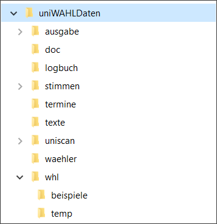
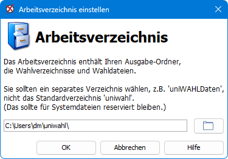

Beim ersten Start legt uniWAHL ohne Rückfrage das Demo-Arbeitsverzeichnis `…\uniwahl\DemoWahl\` an und öffnet die Wahl `DemoWahl.whl`.

Ein eigenes **Arbeitsverzeichnis** wählen Sie über `Konfiguration / Arbeitsverzeichnis / Öffnen andere ...` im Dialog „Arbeitsverzeichnis einstellen“. Verwenden Sie dafür nicht das Programmverzeichnis `…\uniwahl`, in dem sich `uniwahl-config.ini` und die Lizenzdatei `license.lic` befinden, sondern ein eigenes Verzeichnis, z. B. `…\uniWAHLDaten`. Dort werden dann u. a. folgende Verzeichnisse angelegt:

**.\ausgabe** (mit Unterordner **xml**) für die Ausgaben des Programms (→ [Wahldokumente, Auswertungen](../7_wahldokumente/index.md))

**.\waehler** für die Wahlverzeichnisse (.xlsx und .wvz-Dateien, Briefwahlunterlagen) (→ [Wahlverzeichnis](../4_vorbereitung/4-9_wahlverzeichnis.md))

**.\whl** für die Wahlvorgangs-, **.\stimmen** für die Abstimmungsdaten, außerdem **.\termine** und **.\uniscan\…**.

Nur im Demo-Arbeitsverzeichnis gibt es zusätzlich **.\doc** mit Handbüchern und Anleitungen; die Beispiel-Wahlen (`.whl`) liegen dort direkt in `DemoWahl\whl` (→ [Tutorium](../../tutorium/index.md)).

Das **Logbuch** liegt nicht im Arbeitsverzeichnis, sondern immer im Programmverzeichnis unter `…\uniwahl\logbuch` (→ [Logbuch](../8_funktionen/8-11_logbuch.md)).

Abb.: Arbeitsverzeichnis einstellen

Ohne **Lizenzdatei** läuft uniWAHL im Demo-Modus und zeigt beim Start einen Demo-Hinweis mit einem Feld, in dem Sie die Lizenzdatei angeben können. Alternativ installieren Sie die Lizenz über `Hilfe / Lizenz`.

:::tip

Es ist möglich, das Arbeitsverzeichnis auf einen Netzlaufwerk-Pfad (UNC-Pfad) zu legen, so kann mit verschiedenen Computern darauf zugegriffen werden. Wir empfehlen außerdem, das Arbeitsverzeichnis regelmäßig zu wechseln, z.B. ein Arbeitsverzeichnis pro Wahlprojekt anzulegen, um die bessere Übersicht zu behalten.

:::
