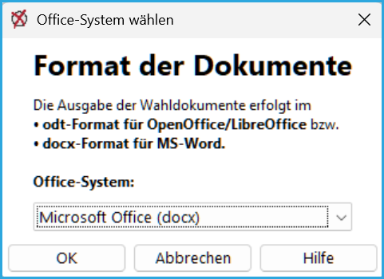

uniWAHL gibt zahlreiche Wahldokumente direkt in Microsoft Office, OpenOffice oder LibreOffice aus.

*Abb.: Wahl des Office-Systems*

Voreingestellt ist „Microsoft Office (docx)“. Umstellen können Sie dies über den Menübefehl `Konfiguration / Office-System`: Im Dialog „Office-System wählen“ wählen Sie „OpenOffice / LibreOffice (odt)“ oder „Microsoft Office (docx)“.
