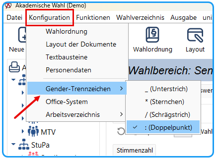

Die sprachliche Gleichstellung, auch bekannt als gendergerechte Sprache, spielt auch im Bereich der Wahlorganisation eine entscheidende Rolle. Mit der durchgängigen Verwendung von Gender-Trennzeichen wird die inklusive Haltung gegenüber Menschen aller Geschlechteridentitäten signalisiert. Es ist wichtig zu beachten, dass die Verwendung von Gender-Trennzeichen nicht nur eine Frage der politischen Korrektheit ist, sondern auch einen positiven Einfluss auf die Kultur der Wahlorganisation und Beziehungen zu Kandidat:innen und Wähler:innen haben kann. Dies trägt auch dazu bei, dass sich alle Kandidat:innen und Wähler:innen gleichermaßen respektiert sowie repräsentiert fühlen.

uniWAHL verwendet Gender-Trennzeichen innerhalb der Benutzeroberfläche und der Textbausteine. Die [Textbausteine](../7_wahldokumente/7-3_textbausteine.md) für Stimmzettel und andere Wahldokumente sind aufgrund der besseren Lesbarkeit mit dem „:“ (Doppelpunkt) vorbesetzt. Die Textbausteine lassen sich in uniWAHL überarbeiten, insofern das Trennzeichen nicht dem genutzten Standard der Institution entspricht. Die Benutzeroberfläche kann über das Menü „Konfiguration / Gender-Trennzeichen“ angepasst werden.

*Abb.: Gender-Trennzeichen einstellen*

:::info

Das geänderte Gender-Trennzeichen wird beim nächsten Start in allen Fenstern übernommen.

:::
