Das Hauptfenster ist die Schaltzentrale des Programms. Von hier aus werden alle Funktionen gestartet und gesteuert.

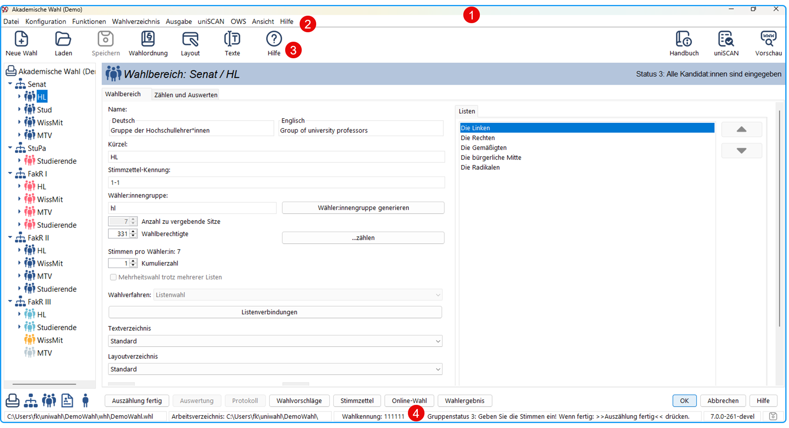

*Abb.: Das uniWAHL-Hauptfenster*

Im oberen Bereich befinden sich

- die **Kopfleiste** mit den Menüs (1) und
- die **Werkzeugleiste** (2).

Der linke Bereich ist das **Navigationsbereich**, in dem das zu bearbeitende Objekt ausgewählt wird.

Der rechte Bereich ist das **Arbeitsfeld**, in dem die Fenster zum Bearbeiten der verschiedenen Objekte geöffnet werden.

Die **Statusleiste** (3) unten enthält den Dateinamen des aktiven Objektes, einige Hilfsinformationen sowie die Versionsnummer des Programms.

## Kopfleiste {#kopfleiste}

Die Kopfleiste enthält die gewohnten Windows-Funktionen und die Menüs:

- Links: uniWAHL-Icon doppelklicken schließt die Anwendung.
- Daneben: die Menüs.
- Rechts:  *minimieren* - *Vollbild/angepasst* - *Fenster schließen*.

## Menüleiste {#menueleiste}

Die Menüs stehen in der Kopfleiste und erschließen alle Funktionen des Systems. Eine Übersicht über das Menüsystem finden Sie im Kapitel 13 „Menü-Befehle“ .

## Werkzeugleiste {#werkzeugleiste}

Die Werkzeugleiste (engl. *Toolpane* oder *Toolbar*) liefert den Einstieg zu den wichtigsten Funktionen. Sie kann aus- bzw. eingeblendet werden im Menü: `Ansicht / Werkzeugleiste` .

| Symbol | Funktion |
|---|---|
| 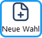 | Neue Wahl beginnen |
| 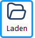 | Lade Wahlvorgang |
| 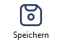 | Speichere Wahlvorgang unter dem bisherigen Namen |
| 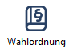 | Wahlordnungsbestimmungen einarbeiten |
| 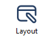 | Layout der Wahldokumente festlegen |
| 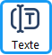 | Textbausteine |
| 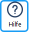 | Online Hilfe |
| 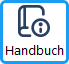 | Öffnet das Handbuch |
| 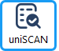 | Zeige uniSCAN Panel |
| 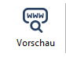 | Online-Vorschau öffnen |

## Statusleiste {#statusleiste}

Die Statusleiste am unteren Rand des Hauptfensters zeigt

- den Namen des gerade aktiven Wahlvorgangs an,
- gibt Kurzanweisungen für die weiteren Schritte und
- zeigt rechts die Versionsnummer des Programms.

Die Statusleiste lässt sich aus- bzw. einblenden im Menü `Ansicht / Statusleiste `.

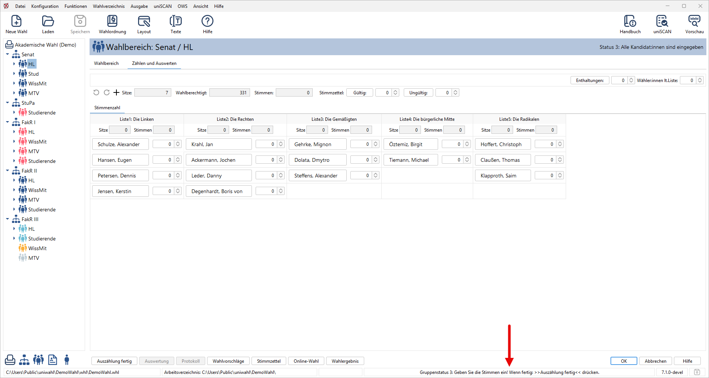

*Abb. : Statusleiste weist auf nächste Aktionen hin*
