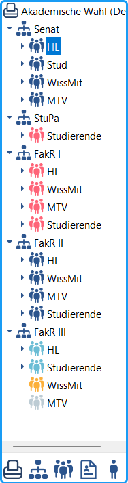
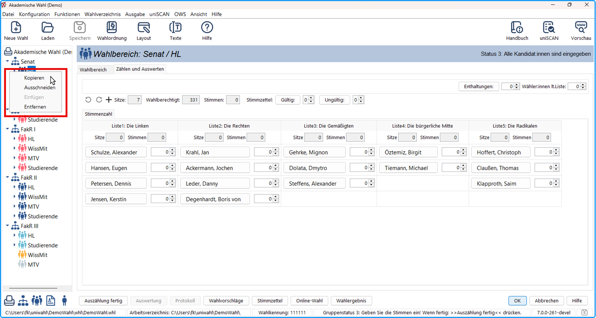

Im linken Navigationsbereich finden Sie die logische, hierarchisch aufgebaute Struktur des aktuellen Wahlvorgangs.

*Abb. : Navigationsbereich*

### Verwendete Symbole: {#verwendete-symbole}

|  |  |
|---|---|
|  | Wahlvorgang |
|  | Gremien |
|  | Gruppen |
|  | Listen |
|  | Kandidat:innen |

Diese Symbole werden auch in allen Fenstern verwendet. Sie ermöglichen eine Aufgliederung der Wahldarstellung nach verschiedenen Bereichen.

## Farbcode für den Bearbeitungsstand der Wahlbereiche {#farbcode-fuer-den-bearbeitungsstand-der-wahlbereiche}

Damit schnell ersichtlich ist, wie weit die Bearbeitung der einzelnen Wahlbereichen fertiggestellt ist, werden die Symbole der Gruppen durch einen Farbcode gekennzeichnet:

| Symbol | Farbe | Code | Status |
|---|---|---|---|
|  | grau | 0 | Keine Wahl |
|  | gelb | 1 | Die Anzahl der Sitze festgelegt |
|  | hellblau | 2 | Kandidat:innen eingeben |
|  | dunkelblau | 3 | Alle Kandidat:innen sind eingegeben |
|  | hellrot | 4 | Stimmen teilweise ausgezählt |
|  | rot | 5 | Stimmen fertig ausgezählt |
|  | grün | 6 | Ausgewertet |

Tabelle : Farbcodes für den Bearbeitungsstand

Durch die farbliche Markierung ist leicht zu erkennen, ob alle Wahlbereiche den gleichen, zum jeweiligen Zeitpunkt erarbeiteten Zustand erreicht haben, oder ob bei einer der Gruppen noch Handlungsbedarf besteht.

## Navigation im System {#navigation-im-system}

|  |  |
|---|---|
|  / Dreifachklick | Öffnet die zu dem Element gehörenden Unterelemente |
|  | Schließt die Unterelemente |
| Doppelklick | Öffnet das zu dem Element gehörende Eingabefenster |
|  | Navigationsbereich nach links/rechts verschieben |
|  | Betätigung dieser Tasten öffnet / schließt die Hierarchie bis zu der angegebenen Tiefe |

Tabelle : Navigationselemente

## Kontextmenü im Navigationsbereich {#kontextmenue-im-navigationsbereich}

Durch einfachen Rechtsklick im linken Navigationsbereich auf ein Gremium, einen Wahlbereich, eine Liste oder Kandidat:in erscheint ein Kontextmenü, das ein leichtes Kopieren des markierten Inhalts ermöglicht.

*Abb. : Kontextmenü im Navigationsbereich*

- **Kopieren**: Fügt ein Gremium, einen Wahlbereich, eine Liste oder Kandidat:in in eine virtuelle Zwischenablage ein.
- **Ausschneiden**: Entfernt ein Gremium, einen Wahlbereich, eine Liste oder Kandidat:in aus der aktuellen Position und legt das Element in der virtuellen Zwischenablage ab. Anschließend kann es an anderer Stelle über „Einfügen“ wieder eingefügt werden. Das ursprüngliche Element wird dabei aus der Struktur entfernt.
- **Einfügen**: Wird erst aktiv, wenn zuvor „Kopieren“ geklickt wurde. Fügt den Inhalt der virtuellen Zwischenablage an der aktuellen Position ein. Wichtig ist dabei, dass ein übergeordnetes Element markiert wird. Ein:e Kandidat:in wird also in eine Gruppe eingefügt, die Gruppe in ein Gremium usw.
- **Entfernen**: Löscht die aktuelle Auswahl (Es wird ein „Bestätigen“-Dialog angezeigt).

Durch die Mehrfachselektion können im Navigationsfeld mehrere Einträge gleichzeitig ausgewählt werden und anschließend gemeinsam kopiert, ausgeschnitten oder entfernt werden.
