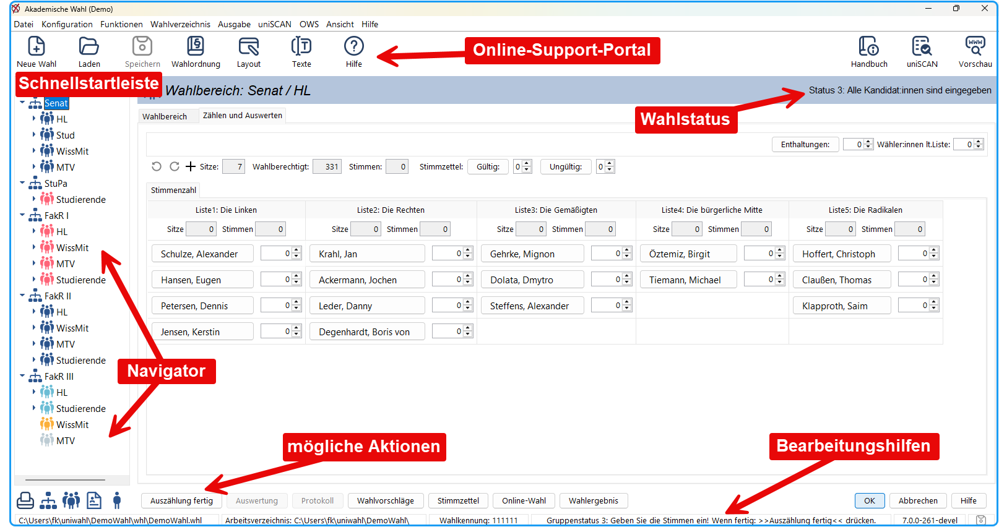

import DocCardList from '@theme/DocCardList';

In diesem Kapitel lernen Sie die wichtigsten Bedienungselemente kennen: Es folgt zuerst die Beschreibung des *Hauptfensters* mit dem *Navigationsbereich*, in dem Sie das zu bearbeitende Objekt auswählen und den aktuellen Zustand des Wahlverfahrens verfolgen können.

<DocCardList />

