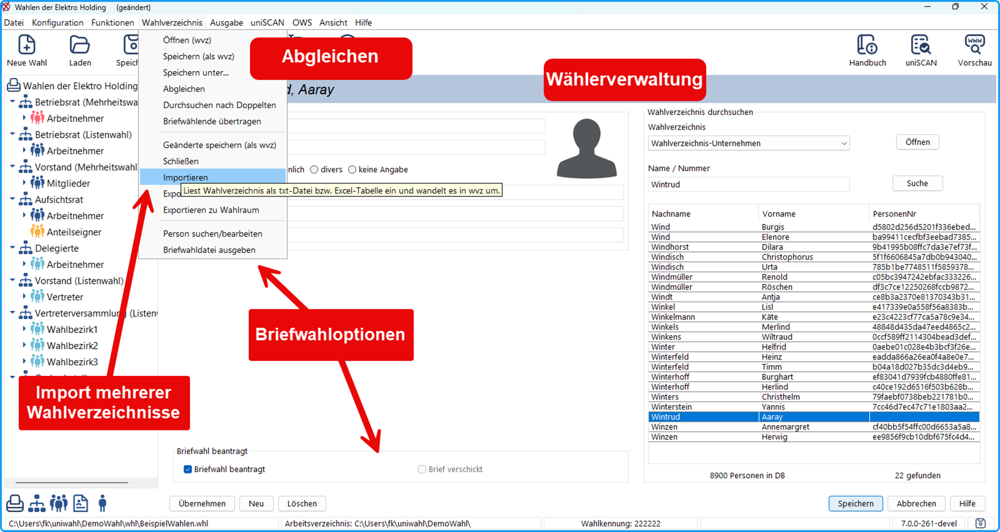
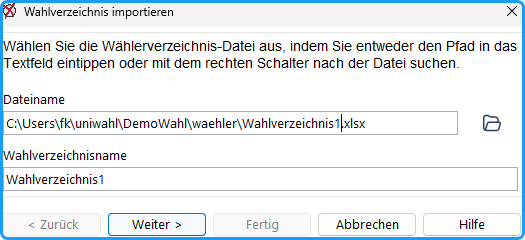
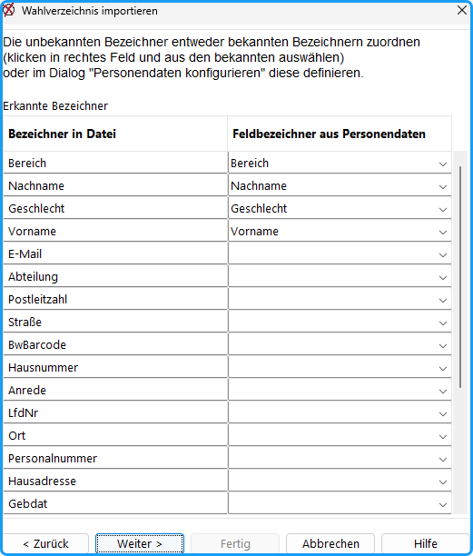
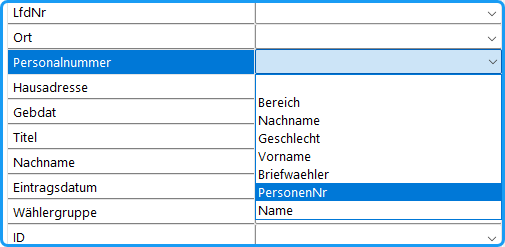
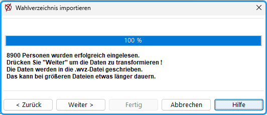
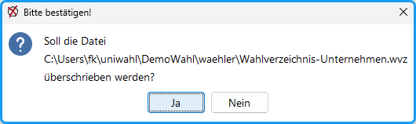
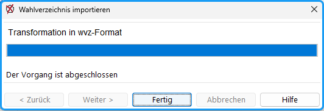

Das interne Wahlverzeichnis (*.wvz) wird aus einer Excel-Datei (xls, xlsx) oder einer Textdatei (txt, csv) erstellt. Menübefehl: **Wahlverzeichnis / Importieren**. Es öffnet sich ein Dialogfenster zur Auswahl der Wahlverzeichnis-Datei, aus der die interne Datenbank erzeugt werden soll.

**1.Schritt:** Wahlverzeichnis importieren -&gt; Datei wählen
**Dateiname** Der vollständige Dateiname des zuletzt benutzten Wahlverzeichnisses wird zum Import vorgeschlagen.

Alternativ kann man durch Betätigung dieser Taste  eine andere Datei zum Einlesen suchen.

**Wahlverzeichnisname:**
Geben Sie hier den Namen ein, unter dem das Wahlverzeichnis intern geführt werden soll. Den Namen können Sie frei wählen, z.B. „Studierende“ oder „Personal“; als Vorgabe wird der Dateiname vorgeschlagen.

Klicken Sie auf **Weiter &gt;**.

**2. Schritt:** Die Feldbezeichner im Wahlverzeichnis, die mit den Vorgaben im Programm und den im Dialog „*Personendaten konfiguriere*n“  ausgewählten übereinstimmen, erscheinen im oberen Teil der Tabelle.

Im unteren Teil sind die im Programm nicht vorgesehenen Feldbezeichner aufgeführt. Man kann denen, die benutzt werden sollen, in der rechten Spalte Bezeichner zuweisen, unter denen sie später aufgerufen werden können.

Klicken Sie in der entsprechenden Zeile auf den Pfeil in der rechten Spalte zum Öffnen einer Auswahlbox und wählen Sie einen der Bezeichner.
Nur die mit Schlüsselnamen bezeichneten Felder werden importiert.

Am besten konfigurieren Sie *alle* benötigten Personendaten *vorher*, dann erübrigt sich dieser Schritt.

:::warning

Die Zuordnung „PersonenNr“ ist Pflicht. Fehlt sie, bricht der Assistent beim Klick auf „Weiter >“ mit einer Fehlermeldung ab. Ordnen Sie dann mit „&lt; Zurück“ einem Bezeichner aus der Datei die „PersonenNr“ zu oder passen Sie den Bezeichner in der Importdatei an.

:::

Klicken Sie auf **Weiter &gt;**, wenn alle benötigten Felder ausgewählt wurden, um den Vorgang fortzusetzen.

**3. Schritt:** Die Daten werden eingelesen und die Anzahl der eingelesenen Personen wird angezeigt („Drücken Sie "Weiter" um die Daten zu transformieren“).

Klicken Sie auf **Weiter &gt;**.

**4. Schritt:** Die Daten werden in das interne Format umgewandelt und als `waehler\<Name>.wvz` im Arbeitsverzeichnis gespeichert (`<Name>` ist der im 1. Schritt eingegebene Wahlverzeichnisname). Eine Rückfrage erscheint nur, wenn diese Datei bereits existiert: Sie werden dann gefragt, ob sie überschrieben werden soll.

Wenn „Der Vorgang ist abgeschlossen“ angezeigt wird, klicken Sie auf **Fertig**. Das Wahlverzeichnis steht danach im Programm zur Verfügung.

