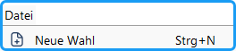
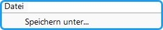
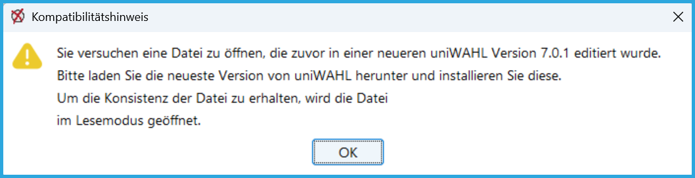
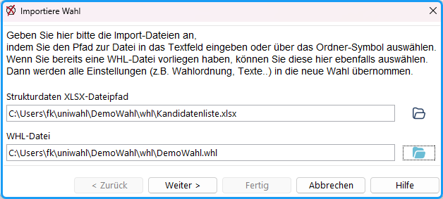
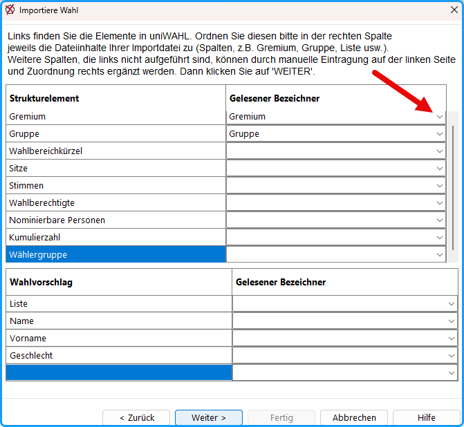
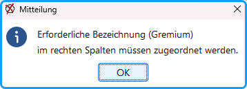
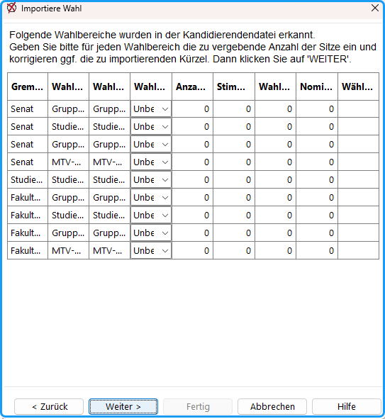

## Feststellung der Gremien {#feststellung-der-gremien}

Zu Beginn der Vorbereitung werden die Organe festgelegt, für die eine Wahl stattfindet. Durch Gründung, Umbenennung, Zusammenlegung und Auflösung von Fachbereichen können seit der letzten Wahl Änderungen eingetreten sein.

## Aufstellung des Wahlverzeichnisses {#aufstellung-des-wahlverzeichnisses}

- Die Wahlleitung hat alle Wahlberechtigten in ein Wahlverzeichnis einzutragen.
- Der Hauptwahlausschuss stellt das Wahlverzeichnis fest.
- Aufgrund der Zahl der wahlberechtigten Personen wird die Anzahl der Sitze in den Gremien, deren Mitgliederzahl variabel ist (z.B. Studentische Gremien), festgelegt.
- Die Wahlleitung weist auf die Wahl durch eine öffentliche Wahlausschreibung hin.

:::tip

**Tipp:** Wenn Sie die erforderlichen Personendaten (von der Personalabteilung und dem Immatrikulationsamt) anfordern, sollten Sie diese gleich in dem später für das Wahlverzeichnis benötigten Format erstellen lassen.

:::

## So beginnen Sie einen neuen Wahlvorgang {#so-beginnen-sie-einen-neuen-wahlvorgang}

Vor jeder neuen Wahl muss ein neuer Wahlvorgang (= Datei mit Erweiterung „.whl“) eröffnet werden. Dazu haben Sie verschiedene Möglichkeiten.

### Neue Wahl: {#neue-wahl}

Sie beginnen einen neuen Wahlvorgang:

|  |  |
|---|---|
|  | Betätigen Sie die Schaltfläche *Neue Wahl* in der Werkzeugleiste. Nun wird ein neuer Wahlvorgang angelegt. |
|  | In der Menüleiste unter *Datei* findet sich der Befehl *Neue Wahl*, welcher alternativ auch durch `Strg+N` ausgeführt werden kann. Dadurch wird ein neuer Wahlvorgang angelegt. |

### Oder: Bestehender Wahlvorgang {#oder-bestehender-wahlvorgang}

Sie bearbeiten einen schon angelegten Wahlvorgang, indem Sie die entsprechende Datei (z.B. von der letzten Wahl) laden und bearbeiten:

|  |  |
|---|---|
|  | Betätigen Sie diese Taste in der Werkzeugleiste (oder im Menü: `Datei / Öffnen)` und laden Sie einen vorhandenen Wahlvorgang. Überschreiben Sie ggf. den bisher geladenen Wahlvorgang. |
|  | Speichern Sie den zu bearbeitenden Wahlvorgang sofort unter einem neuen Namen: Rufen Sie im Menü: `Datei /Speichern unter...` auf und wählen Sie einen passenden Namen. |
|  | Mit dieser Taste im *Wahl-*Dialog löschen Sie alle Kandidat:innen des alten Wahlvorgangs. Dabei bleiben alle früheren Einstellungen erhalten: Gremien und Wahlbereiche, Wahlordnung, Textbausteine, Layouts usw. |

:::info

**Hinweis:** Vergessen Sie nicht, den neuen Vorgang sofort unter einem neuen Namen zu speichern.

:::

:::warning

**Achtung:** Durch regelmäßig erforderliche Änderungen der zugrunde liegenden Datei-Formate (.whl, .lay, .tv, .ord, .wvz) im Zusammenhang mit neuen Funktionen kann es vorkommen, dass sich neue Dateien mit älteren uniWAHL-Programmständen nicht mehr öffnen lassen (XML-Versionierung). Sie sollten daher die uniWAHL-Programmversion an allen Arbeitsplätzen einheitlich auf dem neuesten Stand halten.  

:::

### Oder: Wahlimport {#oder-wahlimport}

Sie importieren eine Struktur wie eine bereits bestehende Kandidierendenliste im Menü *Datei / Importiere Wahl*. Hier werden Sie durch einen Assistenten geführt, der das Einlesen der Gremienstruktur aus einer XLSX-Datei ermöglicht. Insbesondere bei hohen Kandidierendenzahlen, wenn alle Wahlvorschläge bereits vorliegen, ist dieses Verfahren zu empfehlen, da so komplexere Strukturen sehr schnell per Import aufgebaut werden können.

*Abb. : Wahl importieren*

Im nächsten Schritt müssen Sie den Spalten der Importdatei die Schlüsselfelder zuordnen, die für den Import benötigt werden.
|  |  |
|---|---|
| Strukturdaten XLSX-Dateipfad | Wählen Sie hier eine Datei aus, die alle Kandidierenden enthält, z.B. den Export einer Nominierung oder selbst erstellte Kandidierendenliste. |
| WHL-Datei (optional) | Wählen Sie hier eine bestehende Wahlvorgangsdatei, wenn Sie aus dieser Wahlordnung, Texte, Layouts etc. in das neue Projekt übernehmen wollen. |
|  |  |

Klicken Sie auf `Weiter` .

*Abb. : Spaltenzuordnung*

Die Spalten Gremium und Gruppe sind Pflichtfelder und müssen zugeordnet werden.

*Abb. : Erforderliche Felder für den Wahlimport*

Anschließend werden die in der Datei erkannten Wahlbereiche angezeigt. In der Tabelle lassen sich nun die Sitze eingeben und der Import durch das Klicken auf `Weiter` abschließen. Es wird ein neues Wahlprojekt geöffnet.

*Abb. : Importierte Wahlbereiche / Gruppen inklusive weiterer Daten zur Nachkontrolle*
