Mit dieser Schaltfläche  oder durch den Menübefehl: `Konfiguration / Wahlordnung` wird ein Register geöffnet, in dem die Einzelheiten der gültigen Wahlordnung eingegeben werden können. Es enthält vier Registerkarten:

- Allgemein
- Mehrheitswahl
- Listenwahl
- Terminplan

## Allgemeine Bestimmungen {#allgemeine-bestimmungen}

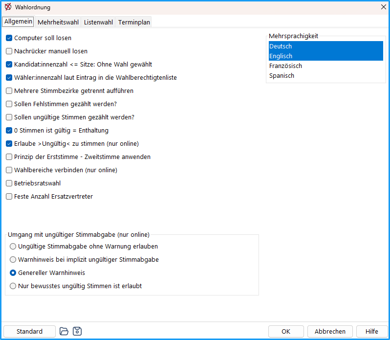

*Abb.: Dialog Wahlordnung – Allgemein*

**Computer soll losen:** Legen Sie fest, ob der Computer bei Stimmen- bzw. Tei­l­zahlengleichheit das Los ziehen soll (Standard) oder die Wahlleitung. (→ [Zufallszahlenverfahren](../12_wahlordnung/12-3_losentscheid.md)).

**Nachrücker manuell losen:** Legt fest, ob Nachrücker automatisch oder manuell bestimmt werden.
Bei Aktivierung entscheidet die Wahlleitung per Los.

**Kandidatenzahl &lt;= Sitze: Ohne Wahl gewählt:** Wenn die Anzahl der Bewerber nicht größer ist als die Anzahl der zu vergebenden Sitze, findet keine Wahl statt und die Bewerber gelten als gewählt (Standard).

**Wähler:innenzahl laut Eintrag in die Wahlberechtigtenliste:** Bei der Bekanntmachung des Wahlergebnisses wird als Kontrolle auch die Anzahl der in der Wähler:innenliste vermerkten Wähler:innen angegeben.

**Mehrere Stimmbezirke getrennt aufführen**: Die Stimmen können für verschiedene Stimmbezirke, z.B. Wahllokale oder Standorte, getrennt ausgezählt und im Wahlergebnis ausgewiesen werden. Für jedes Gremium kann dann die Anzahl der Stimmbezirke angegeben werden.

**Sollen Fehlstimmen gezählt werden?**: Wenn Wähler:innen weniger Stimmen abge­ben als möglich, sind die nicht abgegebenen Stimmen „Fehlstimmen“. Diese können getrennt gezählt und mit dem Wahlergebnis ausgegeben werden.

**Sollen ungültige Stimmen gezählt werden?**: Ist dieser Parameter aktiv, können ungültige Stimmen im Bereich „Zählen & Auswerten“ erfasst und mit dem Wahlergebnis ausgegeben werden. Wenn Wähler:innen bewusst „ungültig wählen“ (online) oder zu viele Stimmen abgeben, werden diese als ungültige Stimmen gezählt.

**0 Stimmen ist gültig = Enthaltung:** Ein Stimmzettel mit 0 abgegebenen Stimmen ist gültig und wird als Enthaltung gewertet. Im Wahlergebnis wird die Zahl der Enthaltungen mit aufgeführt.

**Erlaube &gt;Ungültig&lt; zu stimmen (nur online):** Ist diese Option aktiviert, enthalten die erstellten Stimmzettel ein Ankreuzkästchen, um diese als „ungültig“ zu kennzeichnen. Diese Option gilt nur für Online-Stimmabgaben.

**Prinzip der Erststimme - Zweitstimme anwenden:** Ist diese Option aktiviert, können Wahlbereiche durch Erst- und Zweitstimme miteinander verbunden werden (z.B. Wahlkreis und Gesamtliste oder akademischer Senat und erweiterter akademischer Senat, → [Zweistimmenwahlrecht](../12_wahlordnung/12-4_erststimme.md)). Die Wahlbereiche erhalten dadurch ein Dropdown-Feld "Zweitstimme Wahlbereich" zur Auswahl des Wahlbereichs, an den die bereits gewählten Personen übergeben werden sollen. Die direkt gewählten Personen werden anschließend in diesem Berech (z.B. der Gesamtliste) als "bereits gewählt" ausgewiesen und von der Sitzverteilung ausgeschlossen.

**Wahlbereiche verbinden (nur online):** Ermöglicht es, mehrere Wahlbereiche eines Gremiums miteinander zu verbinden. Verbundene Wahlbereiche erscheinen in der Online-Wahl (erste Generation) auf einem gemeinsamen Stimmzettel. Stimmen werden dabei nicht zwischen den Wahlbereichen übertragen.

Ist die Option aktiv, erscheint im Gremium-Fenster die Schaltfläche „Wahlbereichsverbindungen“. Dort werden die Verbindungen festgelegt (→ [Gremium bearbeiten](./4-4_gremien.md#wahlbereichsverbindungen)).

**Betriebsratswahl:** Wenn diese Option aktiviert wird, werden alle Parameter der Wahlordnung auf die durch das BetrVG vorgeschriebenen Werte gesetzt. (z.B. d'Hondt, gebundene Listen).

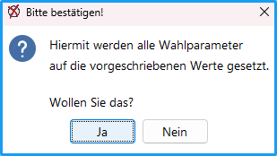

*Abb. : Vorbesetzung Betriebsratswahl bestätigen*

**Feste Anzahl Ersatzvertreter:** Ermöglicht es, eine feste Anzahl an Ersatzmitgliedern (&lt;= Sitze) pro Wahlbereich einzugeben und zu nutzen:
- Mehrheitswahl: Die Ersatzvertreter gelten für alle Kandidierenden (pro Wahlbereich).
- Listenwahl: Die Ersatzvertreter gelten *pro* Liste. Bsp.: „10 sind eingetragen“, diese werden über alle Listen gleich gehandhabt (d.h. bei 5 Listen kriegt jede Liste 10 Vertreter.)

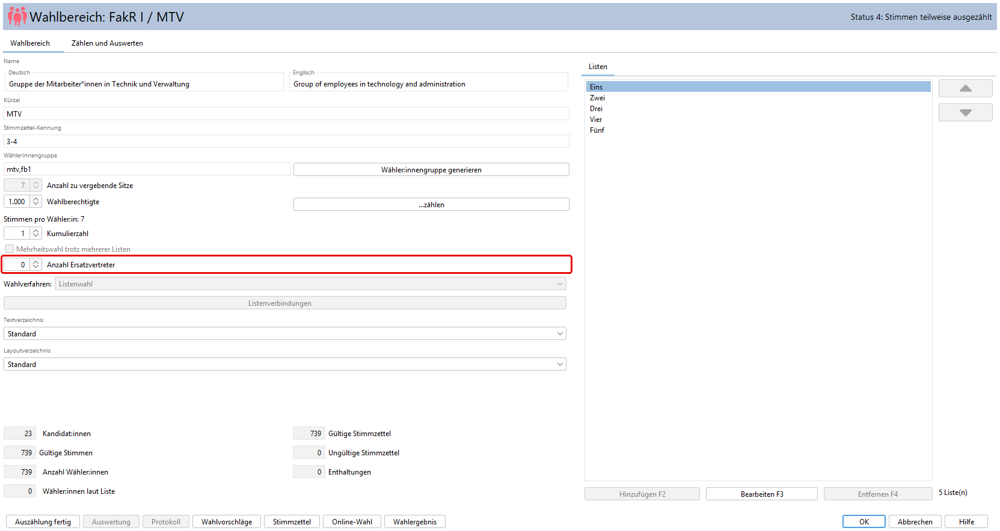

*Abb. : Wahlbereich feste Anzahl der Ersatzvertreter*

:::warning

**Hinweis:** Die Option „Feste Anzahl Ersatzvertreter“ ist nicht mit der Option „Einzelkandidat:innen möglich“ (Registerkarte „Listenwahl“) kombinierbar:

- Ist „Feste Anzahl Ersatzvertreter“ aktiv, lässt sich „Einzelkandidat:innen möglich“ nicht setzen. uniWAHL meldet: „Wenn die Option „Feste Anzahl Ersatzvertreter” aktiviert ist, sind Einzelkandidaten nicht möglich.“
- Ist „Einzelkandidat:innen möglich“ gesetzt und Sie aktivieren „Feste Anzahl Ersatzvertreter“, nimmt uniWAHL das Häkchen bei „Feste Anzahl Ersatzvertreter“ mit einem Hinweis wieder zurück. Entfernen Sie in diesem Fall zuerst „Einzelkandidat:innen möglich“.

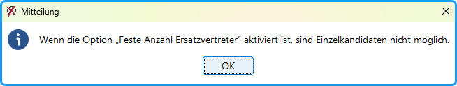

:::

### Umgang mit ungültiger Stimmabgabe (nur online) {#umgang-mit-ungueltiger-stimmabgabe-nur-online}

Es werden vier Optionen zum Umgang mit ungültiger Stimmabgabe während einer Online-Wahl angeboten.

- **Ungültige Stimmabgabe ohne Warnung erlauben**: Sowohl explizites (manuell bewusst ungültig gewählt) als auch implizites (zu viele Stimmen, leere Stimmabgabe) Ungültig-wählen werden ohne Warnung erlaubt.
- **Warnhinweis bei implizit ungültiger Stimmabgabe**: Ein Warnhinweis wird nur bei implizitem Ungültig-wählen ausgegeben.
- **Genereller Warnhinweis**: Sowohl bei explizitem (manuell ungültig gewählt) als auch implizitem (zu viele Stimmen, leere Stimmabgabe) Ungültig-wählen wird eine Warnung ausgegeben.
- **Nur bewusstes ungültig Stimmen ist erlaubt**: Nur explizites, manuelles Ungültig-wählen ist erlaubt. Unbewusstes (zu viele Stimmen, leere Stimmabgabe) wird unterbunden. Der Wählende muss zurück und den Stimmzettel korrigieren.

### Mehrsprachigkeit {#mehrsprachigkeit}

Hier wird ein Feld zur Mehrfachauswahl angezeigt, dass die Selektion mehrerer vordefinierter Sprachen (mit gedrückter SHIFT- oder STRG-Taste) ermöglicht.

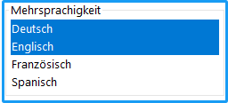

*Abb. : Mehrsprachigkeit aktivieren*

Ist eine Sprache aktiviert und die Konfiguration wird gespeichert, werden verschiedene Felder freigeschalten, um die Ausgabedokumente (Stimmzettel) mehrsprachig ausgeben zu können:

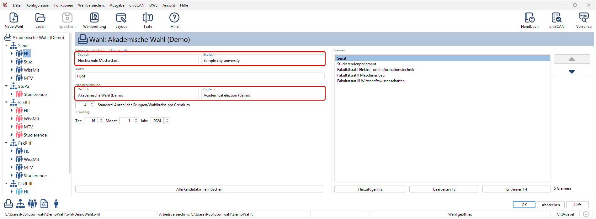

*Abb. : Textfelder im Wahlprojekt in mehrsprachiger Darstellung*

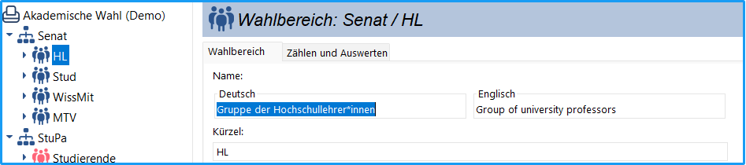

*Abb. : Gremium in mehrsprachiger Darstellung*

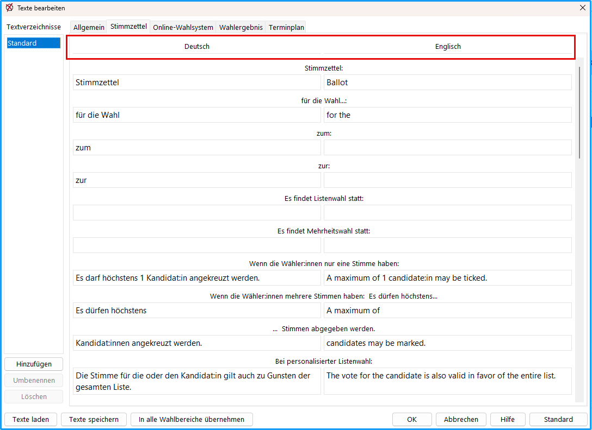

*Abb. : Textbausteine in mehrsprachiger Darstellung*

## Funktionen: {#funktionen}

|  |  |
|---|---|
|  | „Standard“: Nach einer Rückfrage werden die Standardwerte wieder eingesetzt – nur für die gerade geöffnete Registerkarte. |
| 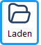 | Die Parameter einer vorher gespeicherten Wahlordnung werden eingesetzt. |
| 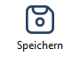 | Die Spezifikationen der Wahlordnung werden in Datei gespeichert |

:::tip

**Tipp:**  Bestehen für verschiedene Gremien unterschiedliche Wahlordnungen, kann man diese verschiedenen Wahlordnungen in verschiedenen Wahlordnungs-Dateien speichern. Für die Bearbeitung der Wahl fasst man die Gremien mit gleicher Wahlordnung jeweils in einem Wahlvorgang („Wahlobjekt“ = whl-Datei) zusammen, dem man die entsprechende Wahlordnung zuweist.

:::

## Mehrheitswahl {#mehrheitswahl}

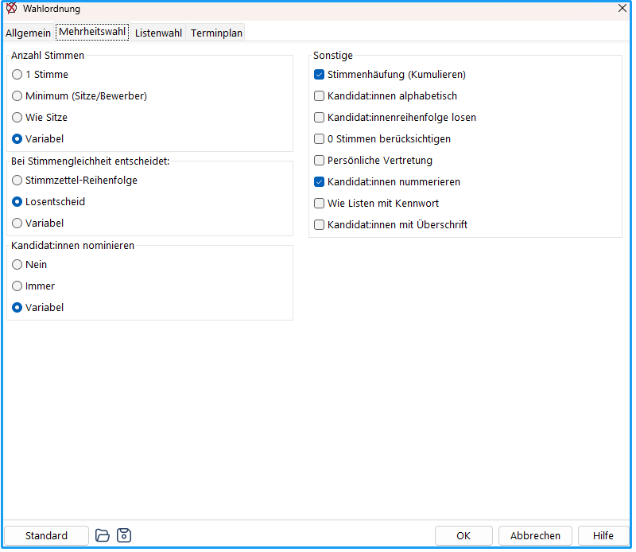

*Abb. : Dialog-Fenster: Wahlordnung Mehrheitswahl*

### Anzahl Stimmen {#anzahl-stimmen}

 Wie viele Stimmen kann jeder Wähler:innen abgeben?

- **1 Stimme**: Jede:r Wähler:in erhält eine Stimme.
- **Minimum (Sitze/Bewerber**): Die Stimmenzahl ist gleich der Zahl der zu vergebenden Sitze, höchstens jedoch gleich der Zahl der Kandidat:innen.
- **Wie Sitze**: Die Stimmenzahl ist gleich der Zahl der zu vergebenden Sitze (Standard).
- **Variabel**: Die Anzahl der Stimmen ist variabel und lässt sich durch keine der vorigen Angaben bestimmen. In diesem Fall wird die Stimmenzahl im Kandidat:innen-Eingabefenster für jede Gruppe explizit angegeben.

:::tip

 **Variabel**: Diese Möglichkeit ist vorgesehen für Gremien, die in ihrer Wahlordnung flexibler sind bzw. in denen alle anderen Optionen nicht greifen.

:::

### Bei Stimmengleichheit entscheidet {#bei-stimmengleichheit-entscheidet}

Wählen Sie, wie Stimmgleichheiten entschieden werden.

- **Stimmzettel-Reihenfolge**: Die Kandidat:innen mit gleicher Stimmenzahl werden in der Reihenfolge des Stimmzettels belassen.
- **Losentscheid**: Die Kandidat:innen mit gleicher Stimmenzahl werden nach dem festgelegten Losverfahren (manuell, automatisch) gelost.
- **Variabel**: Ermöglicht es, das Verfahren bei Stimmengleichheit pro Wahlbereich / Statusgruppe zu entscheiden. Dadurch wird diese Option im Wahlbereich sichtbar.

### Kandidaten nominieren {#kandidaten-nominieren}

Nominierung oder Wahl ohne Bindung an Wahlvorschläge
- **Nein:** Nicht vorgesehen (Standard)
- **Immer**: Wähler:innen können während der Wahl immer wählbare Personen benennen und wählen. Standardmäßig können so viele Personen nominiert werden, wie die Wähler:innen Stimmen haben.
- **Variabel:** Wenn die Möglichkeit zum Nominieren von anderen Kriterien abhängt und/oder die Anzahl variiert, kann man im Wahlbereich-Dialog festlegen, ob und wie viele Personen nominiert werden können (Vorgabe: 0) .

### Sonstige {#sonstige}

**Stimmenhäufung**: Ist Stimmenhäufung (Kumulieren) erlaubt?

**Kandidat:innen alphabetisch:** Auf den Stimmzetteln werden die Bewerber in alphabetischer Reihenfolge aufgeführt (Standard) – oder in der Reihenfolge des Eingangs.

**Kandidat:innenreihenfolge losen**: Wenn Sie den Wahlbereich auf „Kandidateneingabe fertig“ setzen, werden die Kandidat:innen zufällig gemischt.

**0 Stimmen berücksichtigen:** Kandidat:innen, auf die keine Stimmen entfallen sind, werden nicht berücksichtigt (Standard) – oder doch.

**Persönliche Vertretung:** Jedem Kandidat:innen wird ein persönlicher Vertreter zugeordnet. Es findet also kein Nachrücken anderer Kandidat:innen statt.

**Kandidat:innen nummerieren**: Die Bewerber werden bei Mehrheitswahl auf den Dokumenten nummeriert, wenn in dem jeweiligen Layout gewählt.

**Wie Listen mit Kennwort**: Auch bei Mehrheitswahl können die Bewerbenden wie Listen mit Kennwort aufgeführt werden:

&gt; Die Kandidat:innen erhalten ein Feld mit der Bezeichnung: „Kennwort“.
&gt; Im Register „Listenwahl“: „Spez. Bezeichner für Einzelwahlvorschlag: (s. Texte)“.
&gt; Im Dialog „Textbausteine“ / Register „Stimmzettel“ definiert man den „Bezeichner f. Liste mit Einzelbewerber“.

**Kandidaten mit Überschrift:** Ist der Haken gesetzt, wird im Dialog zur Einrichtung der Wahlbereiche / Statusgruppen eine individuelle Überschrift angeboten, die in den Stimmzetteln ausgegeben werden kann.

## Listenwahl (Verhältniswahl) {#listenwahl-verhaeltniswahl}

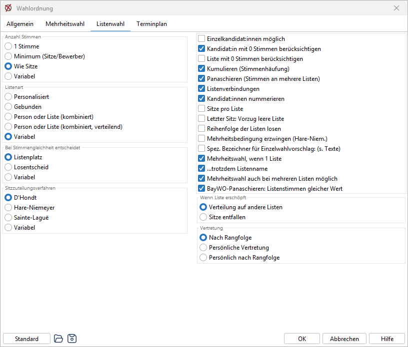

*Abb. : Dialog-Fenster: Wahlordnung Listenwahl*

### Anzahl Stimmen {#anzahl-stimmen}

 Wie viele Stimmen kann jeder Wähler:innen abgeben?

- **1 Stimme** (Standard)
- **Minimum (Sitze/Bewerber**): Die Stimmenzahl ist gleich der Zahl der zu vergebenden Sitze, höchstens jedoch gleich der Zahl der Bewerber.
- **Wie Sitze**: Die Stimmenzahl ist gleich der Zahl der zu vergebenden Sitze.
- **Variabel**: Die Anzahl der Stimmen ist variabel und lässt sich durch keinen der vorigen Algorithmen bestimmen. In diesem Fall wird die Stimmenzahl im Kandidat:innen-Eingabefenster für jede Gruppe explizit angegeben.

### Listenart {#listenart}

- **Personalisiert**: Es werden immer Personen angekreuzt; Personen mit den meisten Stimmen sind gewählt (Standard).
- **Gebunden**: Es kann nur eine Liste angekreuzt werden und die Vergabe der Sitze erfolgt nach der Listenreihenfolge.
- **Person oder Liste (kombiniert)**: Liste und/oder Kandidat kann angekreuzt werden.
- **Person oder Liste (kombiniert, verteilend)**: Es kann die Liste und / oder die Personen angekreuzt werden. Für die Zuteilung der Sitze gilt die für die Liste abgegebene Zahl gültiger Stimmzettel, beim Panaschieren gelten spezielle Regelungen .
- **Variabel:** Bei jeder Liste kann angegeben werden, ob sie personalisiert oder gebunden ist; das ist möglich, wenn die Wahlordnung erlaubt, dass die Listen selbst entscheiden können, welcher Art sie sind.

### Bei Stimmengleichheit entscheidet {#bei-stimmengleichheit-entscheidet}

Wählen Sie, wie Stimmgleichheiten (personalisierte Verhältniswahl) entschieden werden.

- **Listenplatz**: Die Kandidat:innen mit gleicher Stimmenzahl werden in der Reihenfolge des Stimmzettels belassen.
- **Losentscheid**: Die Kandidat:innen mit gleicher Stimmenzahl werden nach dem festgelegten Losverfahren (manuell, automatisch) gelost.
- **Variabel**: Ermöglicht es, das Verfahren bei Stimmengleichheit pro Wahlbereich / Statusgruppe zu entscheiden. Dadurch wird diese Option im Wahlbereich sichtbar.

### Sitzzuteilungsverfahren {#sitzzuteilungsverfahren}

Die Zuordnung der erworbenen Sitze nach der Stimmenzahl der Liste kann nach dem **d‘Hondtschen** Höchstzahlverfahren (Standard), nach **Hare-Niemeyer** oder nach **Sainte-Laguë** erfolgen. Wenn für Gremien unterschiedliche Sitzzuteilungsverfahren vorgeschrieben sind, wählt man die Option „Variabel“. In diesem Fall muss in jedem Gremium das Verfahren bestimmt werden.

**Einzelkandidat:innen möglich:** Einzelkandidat:innen sind möglich und werden in einem Block dargestellt. Sie werden aber wie einzelne Listen behandelt. (Nur bei personalisierten Listen vorgesehen.)

**Kandidat mit 0 Stimmen berücksichtigen:** Kandidat:innen, auf die keine Stimmen entfallen sind, werden bei der Vergabe der Sitze trotzdem berücksichtigt (Standard) – oder nicht.

**Liste mit 0 Stimmen berücksichtigen**: Listen, auf die keine Stimmen entfallen sind, werden bei der Sitzzuteilung (nach Sitzzuteilungsverfahren) trotzdem berücksichtigt – oder nicht.

**Kumulieren (Stimmenhäufung)**: Kann ein Kandidat mehrere Stimmen bekommen? (Nur aktiv, wenn bei Listenwahl mehrere Stimmen zu vergeben sind.)

**Panaschieren (Stimmen an mehrere Listen)**: Dürfen die Stimmen auf mehrere Listen verteilt werden? (Nur aktiv, wenn mehrere Stimmen zu vergeben sind.)

**BayWO-Panaschieren: Listenstimmen gleicher Wert**: Nur sichtbar bei Listenart „Person oder Liste (kombiniert, verteilend)“ oder „Variabel“ und erlaubtem Panaschieren. Aktiviert: Listenstimmen zählen unabhängig von der Größe der Liste gleich viel – die angekreuzte Liste erhält alle nicht an Personen vergebenen Stimmen. Deaktiviert: Es zählen nur die auf die Personen übertragenen Listenstimmen.

**Listenverbindungen**: Verbindungen zwischen Listen zu einem Wahlvorschlag können zugelassen werden.

**Kandidaten nummerieren**: Die Kandidat:innen werden bei Listenwahl auf den Dokumenten nummeriert, wenn in dem jeweiligen Layout gewählt.

**Sitze pro Liste:** Aktiviert die Eingabe der Mindestsitze im Wahlbereich. Diese legen fest, wie viele Sitze eine Liste mindestens erhält. Dabei darf die Summe aller Listenmindestsitze die Gesamtsitzanzahl nicht überschreiten. Aus jeder Liste werden automatisch die Personen mit den meisten Stimmen gewählt, um die Mindestsitze zu besetzen. Die verbleibenden Sitze werden anschließend regulär durch das Sitzzuteilungsverfahren verteilt.

**Letzter Sitz: Vorzug leere Liste**: Bei Teilzahlengleichheit wird der letzte Sitz dem Wahlvorschlag zugeteilt, der anderenfalls keinen Sitz erhalten würde.

**Reihenfolge der Listen losen**: Die Reihenfolge der Listen auf den Stimmzetteln und den Bekanntmachungen kann durch Los ermittelt werden.

**Mehrheitsbedingung erzwingen (Hare-Niem.)**: Eine Liste mit der Mehrheit der Stimmen muss auch die Mehrheit der Sitze bekommen.

**Spez. Bezeichner für Einzelwahlvorschlag: (s. Texte)**: Wenn eine Liste nur einen Bewerber enthält, kann ein spezieller Bezeichner („Einzelwahlvorschlag“) aufgeführt werden. Dieser wird im Menü `Konfiguration / Textbausteine`, Register „Stimmzettel“, als „Bezeichner f. Liste mit Einzelbewerber“ definiert.

**Mehrheitswahl, wenn 1 Liste:** Wenn nur eine Liste eingereicht wurde, findet Mehrheitswahl statt (Standard).

**...trotzdem Listenname:** Obwohl die Liste aufgelöst wurde, da nur ein Listenwahlvorschlag eingereicht wurde und deshalb Mehrheitswahl stattfindet, soll der Name der Liste weitergeführt werden. Sie heißt jetzt „Kennwort".

**Mehrheitswahl auch bei mehreren Listen möglich:** Einige Wahlordnungen schreiben vor, dass unter bestimmten Bedingungen (z.B. wenige Kandidat:innen) trotz mehrerer eingereichter Listen Mehrheitswahl stattfindet. Wenn der Fall gegeben ist, muss bei dem Wahlbereich diese Option gewählt werden.

### Wenn Liste erschöpft {#wenn-liste-erschoepft}

Sind auf einen Wahlvorschlag mehr Sitze entfallen als Bewerber benannt sind, also alle Kandidat:innen gewählt sind, werden die freien Sitze unter Fortführung der Berechnung auf die übrigen Wahlvorschläge **verteilt** (Standard) – oder sie **entfallen**.

### Vertretung {#vertretung}

Bei Verhinderung oder Ausscheiden des Kandidat:innen.

- **Nach Rangfolge:** Die nach der Rangfolge nächste nicht gewählte Person derselben Liste, bei listenübergreifendem Nachrücken auch anderer Liste.
- **Persönliche Vertretung**: Jeder:m Kandidat:innen wird eine persönliche Vertretung zugeordnet. Es findet also kein Nachrücken anderer Kandidat:innen statt.
- **Persönlich nach Rangfolge:** Jede gewählte Person erhält einen festen Vertreter, die erste gewählte Person wird durch die erste nicht gewählte vertreten, usw.

## Terminplan {#terminplan}

Das Register „Wahlordnung“ enthält eine Registerkarte: „Terminplan“. Hier werden einmalig aus der Wahlordnung und ggf. anderen Bestimmungen die Termine für die einzelnen Aktionen eingetragen. Sie werden immer relativ zu dem 1. Wahltag  festgelegt. Diese Eintragungen werden nur einmal vorgenommen, da sich diese – wie auch die anderen Wahlordnungsbestimmungen – normalerweise nicht ändern.

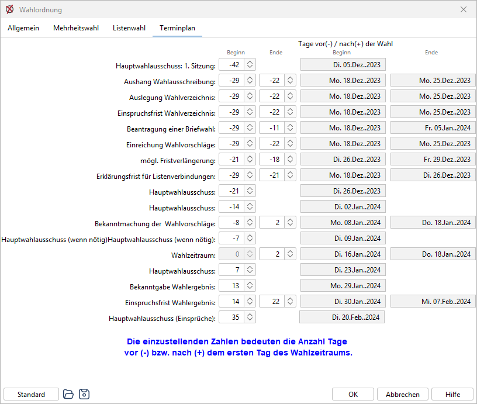

*Abb. : Dialog-Fenster: Wahlordnung Terminplan*

Für die Erstellung des Terminplans sind erforderlich:

- Festlegung des 1. Tages der Stimmabgabe: → [Wahl konfigurieren](./4-3_wahl_konfigurieren.md)
- Texte für den Terminplan: → [Textbausteine](../7_wahldokumente/7-3_textbausteine.md#texte-terminplan)
- Ausgabe des Terminplans: → [Terminplanung](../8_funktionen/8-7_terminplanung.md)

Die Terminplanung wird im Kapitel „[Terminplanung](../8_funktionen/8-7_terminplanung.md)“ ausführlich beschrieben.
