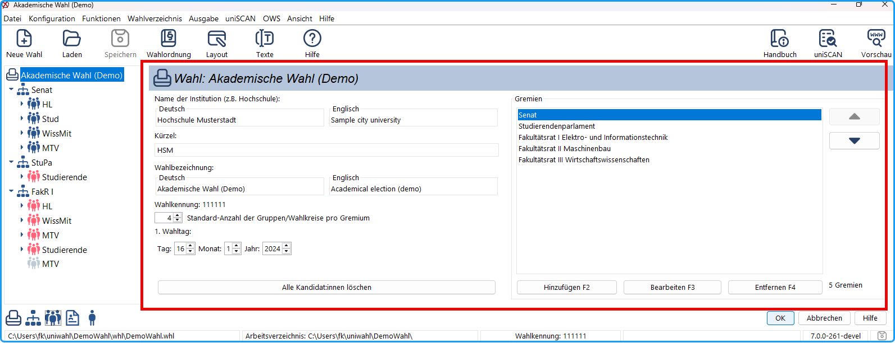
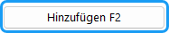
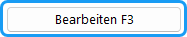
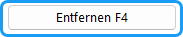
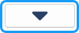
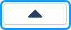
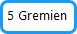

|  |  |
|---|---|
|  | Durch Doppelklick auf das *Wahl*-Symbol im Navigationsbereich öffnet sich der *Wahl*-Dialog rechts. In diesem Fenster werden allgemeine Eigenschaften des Wahlvorgangs definiert und die Gremien festgelegt, für die eine Wahl stattfindet. |

*Abb. : Dialogfenster "Wahl konfigurieren"*

## Allgemeine Angaben zum Wahlvorgang {#allgemeine-angaben-zum-wahlvorgang}

**Name der Institution (z.B. Hochschule)**: Der ausführliche Name wird in den offiziellen Dokumenten benutzt.

**Kürzel**: Die Kurzform wird nur programm-intern benutzt.

**Wahlbezeichnung**: Diese Bezeichnung wird einheitlich in den Wahldokumenten verwendet.

**Standard-Anzahl der Gruppen/Wahlkreise pro Gremium**: Die Standardzahl von Wahlbereichen innerhalb der Gremien, die bei einem neuen Gremium automatisch angelegt werden. Die Bezeichnungen werden als Textbausteine festgelegt

**1. Wahltag**: Datum des ersten Wahltages. Dieses Datum wird für die Erstellung des Terminplans der Wahl verwendet.

## Aufzählungsfelder {#aufzaehlungsfelder}

Auf der rechten Seite befindet sich ein Aufzählungsfeld, in dem die Gremien dieser Wahl erscheinen. Ähnliche Aufzählungsfelder finden sich in vielen Fenstern, z.B. für die Gruppen eines Gremiums oder die Kandidat:innen eines Listenwahlvorschlags, die jeweiligen Elemente. Die Bedienung ist einheitlich:

|  |  |
|---|---|
|  | Ein neues Element wird hinzugefügt. Dazu öffnet sich das entsprechende Fenster; nach dessen Schließen wird das neue Element eingefügt. |
|  | Das ausgewählte Element wird bearbeitet; das entsprechende Fenster öffnet sich (auch durch Doppelklick auf das Element). |
|  | Das ausgewählte Element wird aus der Liste entfernt. |
|  | Das ausgewählte Element wird in der Liste nach **unten** verschoben. |
|  | Das ausgewählte Element wird in der Liste nach **oben** verschoben. |
|  | Rechts unten werden die Anzahl und die Art der Elemente angezeigt |

Auch die folgenden Funktionen sind immer identisch:

## Beenden {#beenden}

**OK**: Die aktuellen Einstellungen von Texten und Parametern werden übernommen.

**Abbrechen**: Das Fenster wird geschlossen ohne Übernahme der Änderungen.

**Hilfe**: Öffnet die Hilfe für dieses Fenster.
