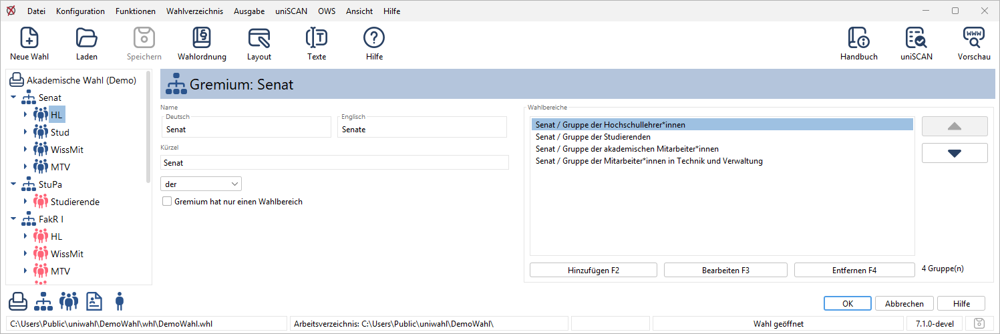
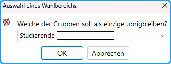
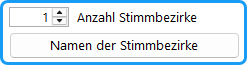
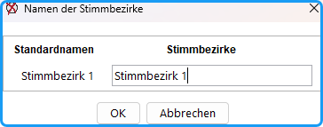
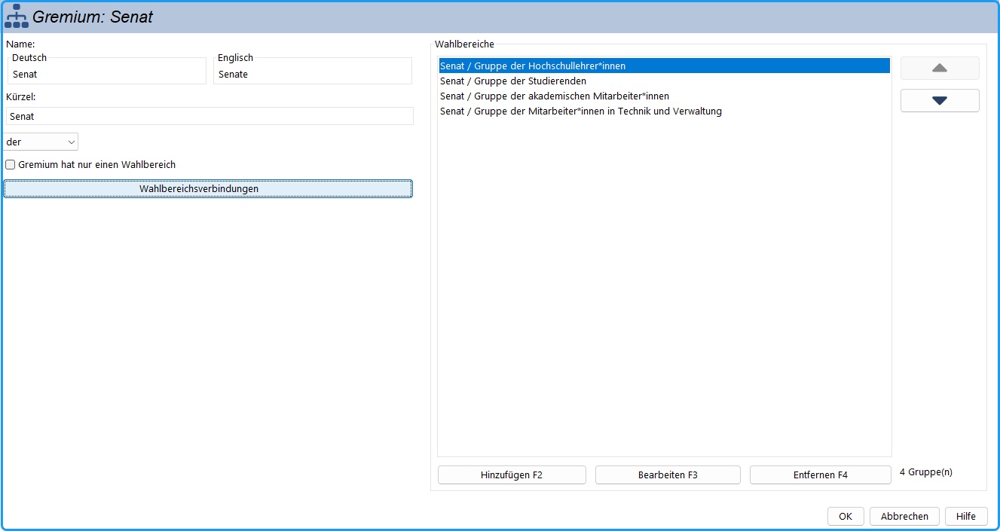
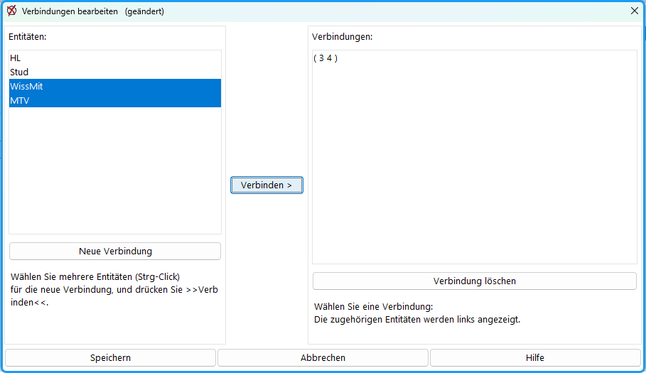
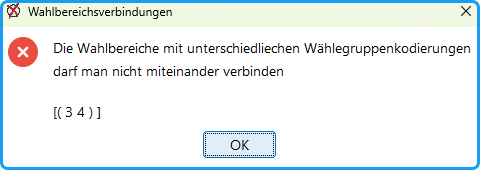
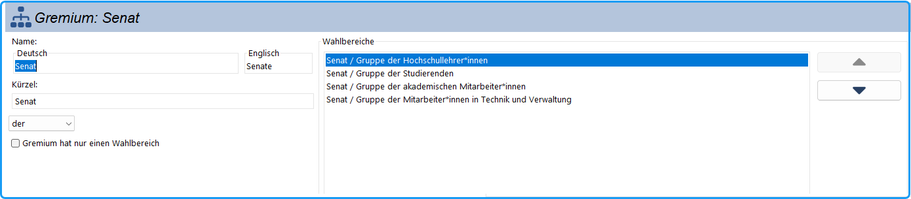
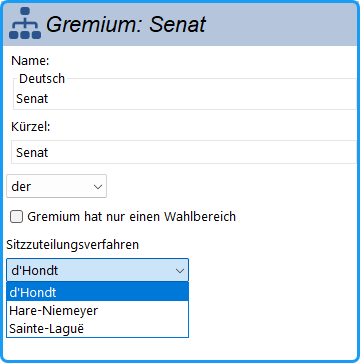

Hier werden die Eigenschaften für das jeweilige Gremium, insbesondere die Bezeichnungen, festgelegt. In dem Aufzählungsfeld (→ [Aufzählungsfelder](./4-3_wahl_konfigurieren.md#aufzaehlungsfelder)) rechts erscheinen die zu diesem Gremium gehörenden Wahlbereiche. Bei einem neuen Gremium sind die Standard-Wahlbereiche schon vorgesehen. Die Bezeichnungen der Wahlbereiche können in jedem Gremium frei gewählt werden.

Man kann beliebig viele Wahlbereiche hinzufügen und deren Bezeichnun­gen frei wählen.

*Abb. : Dialog-Fenster: Gremium bearbeiten*

## Name / Kürzel {#name-kuerzel}

Für die publizierten Wahldokumente werden die langen Namen der Gremien benötigt, für die interne Bearbeitung sind abgekürzte Namen sinnvoller. Deshalb werden hier beide definiert.

## der / die / das {#der-die-das}

Die Gremien haben ein Geschlecht, grammatikalisch gesehen: der Senat, das Konzil, die Frauenversammlung.

## Gremium hat nur einen Wahlbereich {#gremium-hat-nur-einen-wahlbereich}

Nur einen Wahlbereich haben z.B. studentische Gremien wie Fachschaftsräte und Studierendenparlament.

*Abb. : Auswahl eines Wahlbereichs*

Die Wahl der Studierendenvertreter in allen Gremien erfolgt jährlich; deshalb finden zwischen den allgemeinen Wahlen zusätzlich Wahlen der Studierendenvertreter zu allen Gremien statt. In diesem Fall wäre jedes Gremium ein *Studentisches Gremium*.

Hat das Gremium mehrere Wahlbereiche und Sie setzen das Häkchen, öffnet sich der Dialog „Auswahl eines Wahlbereichs“ mit der Frage, welcher Wahlbereich als einziger übrig bleiben soll. Anschließend fragt uniWAHL, ob alle anderen Wahlbereiche des Gremiums gelöscht werden sollen. Bestätigen Sie, werden diese gelöscht; verneinen oder brechen Sie ab, wird das Häkchen nicht gesetzt.

:::warning

**Achtung:**  Die übrigen Wahlbereiche werden dabei endgültig gelöscht. Wenn Sie das Häkchen später wieder entfernen, werden sie **nicht** wiederhergestellt.  Das Häkchen bestimmt nur die Namensdarstellung: Solange es gesetzt ist, heißt der Wahlbereich nur noch wie das Gremium, also statt „Senat/Studierende“ nur noch „Senat“ oder „Fachschaftsrat Medizin“. Entfernen Sie das Häkchen, erscheint wieder der lange Name.

:::

## Mehrere Stimmbezirke {#mehrere-stimmbezirke}

*Abb. : Mehrere Stimmbezirke*

Wenn in der Wahlordnung die Möglichkeit gewählt wurde, dass die Stimmen in verschiedenen Stimmbezirken getrennt ausgewiesen werden sollen, kann hier die Anzahl der Stimmbezirke für dieses Gremium angegeben werden (nur wenn in dem Gremium in keinem Wahlbereich Stimmen eingegeben sind).

Mit der Taste „Namen der Stimmbezirke“ wird der Dialog für die Eingabe der Stimmbezirke-Namen geöffnet. Dort können Sie einen von Ihnen ausgewählten Namen verwenden.

*Abb. : Namen der Stimmbezirke*

## Wahlbereichsverbindungen {#wahlbereichsverbindungen}

Die Schaltfläche „Wahlbereichsverbindungen“ erscheint nur, wenn in der Wahlordnung die Option „Wahlbereiche verbinden (nur online)“ aktiviert ist (→ [Wahlordnung](./4-2_wahlordnung.md#allgemeine-bestimmungen)). Bestehende Verbindungen werden auf der Schaltfläche angezeigt.

Verbundene Wahlbereiche erscheinen in der Online-Wahl (erste Generation) auf einem gemeinsamen Stimmzettel. Stimmen werden dabei nicht zwischen den Wahlbereichen übertragen.

*Abb.: Gremium-Dialog*

Die Schaltfläche öffnet den Dialog „Verbindungen bearbeiten“:

*Abb.: Dialog Verbindungen bearbeiten*

- Klicken Sie auf „Neue Verbindung“, um die Auswahl links aufzuheben.
- Wählen Sie links die zu verbindenden Wahlbereiche aus (mehrere mit gedrückter Strg-Taste) und klicken Sie auf „Verbinden >“. Die neue Verbindung erscheint rechts.
- Um eine Verbindung aufzuheben, wählen Sie sie rechts aus und klicken Sie auf „Verbindung löschen“.
- Mit „OK“ (nach Änderungen „Speichern“) übernehmen Sie die Verbindungen.

:::warning

**Achtung:** Wahlbereiche mit unterschiedlichen Wähler:innengruppen-Kodierungen können nicht miteinander verbunden werden. uniWAHL gibt in diesem Fall beim Speichern eine Fehlermeldung aus.

:::

## Einrichten von Wahlkreisen innerhalb der Gruppen {#einrichten-von-wahlkreisen-innerhalb-der-gruppen}

Einige Wahlordnungen sehen für bestimmte Gremien eine Unterteilung der Wahlbereiche in Wahlbezirke / Wahlkreise vor. Sollen z.B. die Mandate des Senates auf verschiedene Wahlkreise entsprechend den Fakultäten (oder Standorten) aufgeteilt werden, werden diese als Wahlbereiche mit den jeweiligen Zahlen von Sitzen eingefügt: z.B. Geisteswissenschaften: 2, Naturwissenschaften: 2, Medizin: 2, Theologie: 1.

*Abb. : Wahlbereiche innerhalb von Gruppen*

## Sitzzuteilung variabel {#sitzzuteilung-variabel}

Wenn in der Wahlordnung die Möglichkeit gewählt wurde, in den Gremien unterschiedliche Sitzzuteilungsverfahren anzuwenden, erscheint in dem Gremium-Dialog die entsprechende Eingabemöglichkeit:

*Abb. : Sitzzuteilungsverfahren im Gremien-Dialog wählbar*
