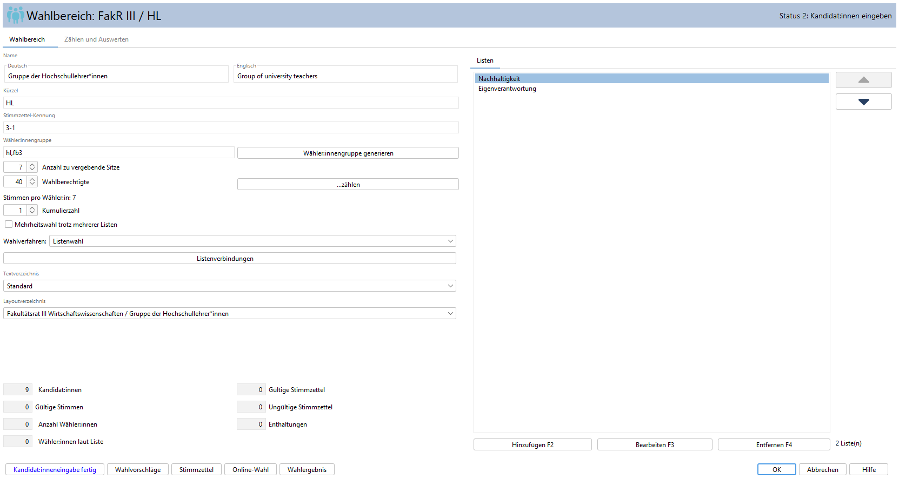
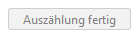
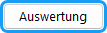
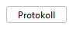
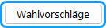
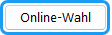

Der Wahlbereich ist die zentrale Einheit für die Bearbeitung; für sie soll ein Stimmzettel erzeugt und später Sitze zugeteilt werden.

## Status der Gruppe {#status-der-gruppe}

Tabelle : Statuszustände der Gruppen
|  |  |
|---|---|
| 0 | Keine Wahl, es werden keine Sitze vergeben |
| 1 | Die Anzahl der Sitze festgelegt |
| 2 | Kandidat:innen eingeben, Wahlverfahren festlegen |
| 3 | Alle Kandidat:innen sind eingegeben |
| 4 | Stimmen teilweise ausgezählt |
| 5 | Stimmen fertig ausgezählt |
| 6 | Der Wahlbereich wurde ausgewertet |

Jeder Wahlbereich wird getrennt bearbeitet und durchläuft während des Wahl­ablaufs verschiedene Stufen, die als „Status„ bezeichnet werden.

## Wahlbereich bearbeiten {#wahlbereich-bearbeiten}

Das Dialogfenster für den Wahlbereich enthält zwei Register:

- **Wahlbereich:** Hier werden die grundlegenden Informationen über die Gruppe zusammengefasst.
- **Zählen und Auswerten:** Hier erfolgen die Auszählung und die Auswertung der abgegebenen Stimmen.

Die Register sind je nach Status des Wahlbereichs aktiviert. Zu Beginn können nur grundlegende Angaben vorgenommen werden. Nach Eingabe der Kandidat:innen sind die weiteren Register aktiviert.

## Registerkarte „Wahlbereich“ {#registerkarte-wahlbereich}

Hier werden die Eigenschaften des jeweiligen Wahlbereichs, insbesondere die Bezeichnungen, festgelegt. Das Aufzählungsfeld (→ [Aufzählungsfelder](./4-3_wahl_konfigurieren.md#aufzaehlungsfelder)) rechts enthält im Fall der Listenwahl die Register *Listen* für die Listenwahlvorschläge und, wenn vorgesehen, *Kandidat:innen* für die Einzelwahlvorschläge, im Fall der Mehrheitswahl nur das Register *Kandidaten*.

**Name:** Die Wahlbereiche sind bei den normalen Gremien die Statusgruppen der Wahlberechtigten. Die Bezeichnungen werden mit dem Menü-Befehl *Konfiguration / Textbausteine / Allgemein*  festgelegt. Für spezielle Anwendungen wie Unterteilung in Wahlkreise, Frauenversammlung etc. (siehe auch [Weitere Gremien](./4-8_weitere_gremien.md)) können diese hier geändert werden. Falls mehrere Sprachen in der Anwendung eingestellt wurden, erscheint neben der deutschen Bezeichnung rechts die im System angegebene Sprache (siehe Abb. Sprache: Englisch).

**Kürzel:** Eine Kurzbezeichnung, die zur internen Verwendung im Navigationsbereich, Export etc. genutzt wird.

**Stimmzettel-Kennung:** Definition der Kennung, die rechts oben auf den Stimmzettel gedruckt werden soll. Das Eingabefeld ist nur vorhanden, wenn im Stimmzettel-Layout-Dialog die Option gewählt wurde (siehe [Layout-Optionen](../7_wahldokumente/7-4_layout.md)). Vorgabe: Gremium-Nr.-Wahlbereich-Nr.

**Wähler:innengruppe:** Im Dialogfenster jedes Wahlbereichs befindet sich ein Eingabefeld „Wähler:innengruppe“, in das die für den Stimmzettel dieses Wahlbereichs zugeordneten Wähler:innengruppen-Merkmale eingetragen werden. Die Merkmale werden durch Komma getrennt (siehe [Zuordnung der Wähler:innengruppen](../10_ows/10-4_waehler_innengruppen.md)).

**Wähler:innengruppe generieren:** Setzt das Feld „Wähler:innengruppe“ auf „Gremium-Kürzel,Wahlbereich-Kürzel“, z. B. „SEN,PROF“. Ein bisher eingetragener Inhalt wird dabei ersetzt.

*Abb. : Dialog-Fenster Wahlbereich bearbeiten*

**Anzahl zu vergebende Sitze:** Hier wird die Anzahl der Mitglieder der einzelnen Wahlbereiche in dem Gremium eingegeben.

**Wahlberechtigte:** Bei der späteren Bekanntmachung des Wahlergebnisses wird für jeden Wahlbereich jedes Gremiums die Anzahl der stimmberechtigten Mitglieder dieser Gruppe und die Wahlbeteiligung mitgeteilt.

**… zählen:** Ein Assistent hilft beim Zählen der Wahlberechtigten (siehe [Wahlberechtigte zählen](../6_auszaehlung_ergebnis/6-6_wahlberechtigte_zaehlen.md)).

**Stimmen pro Wähler:in:** Die Anzahl der Stimmen pro Wähler:in hängt vom Wahlverfahren (Mehrheitswahl / Verhältniswahl) ab und wird durch die Wahlordnung festgelegt. Geben Sie die Eigenschaften über das Menü: *Konfiguration / Wahlordnung* ein. Hier wird die Stimmenzahl angezeigt.

**Wahlverfahren**: Geben Sie hier das Wahlverfahren für den aktuellen Wahlbereich ein:

|  |  |
|---|---|
| Unbestimmt | Noch ist das Wahlverfahren nicht bekannt. |
| Listenwahl | Verhältniswahl, da Listenwahlvorschläge vorliegen |
| Mehrheitswahl | Nur Einzelkandidat:innen |
| Ohne Wahl | Wenn z.B. die Anzahl der Bewerber nicht größer als die Anzahl zu vergebender Sitze ist, gelten die Bewerber als gewählt. Der Status wird auf 6 = „Der Wahlbereich wurde ausgewertet“ gesetzt. |
| Keine Wahl | Es findet keine Wahl statt. |

Tabelle : Übersicht der Wahlverfahren

**Textverzeichnis:** Auswahl des für diesen Wahlbereich gültigen Textverzeichnisses. Damit können abweichende Bezeichnungen und Texte für Ausgaben (z. B. Stimmzettel oder Ergebnisdarstellungen) verwendet werden.

**Layoutverzeichnis:** Auswahl des für diesen Wahlbereich verwendeten Layoutverzeichnisses. Hierüber lassen sich individuelle Layout-Vorlagen für Ausgaben wie Stimmzettel oder Listen festlegen.

### Felder, die nur unter bestimmten Bedingungen erscheinen {#bedingte-felder}

Einige Felder erscheinen nur, wenn die Wahlordnung sie vorsieht (→ [Wahlordnung](./4-2_wahlordnung.md)):

| Feld | erscheint wenn |
|---|---|
| „Kumulierzahl“ | Listenwahl und in der Wahlordnung (Registerkarte „Listenwahl“) „Kumulieren (Stimmenhäufung)“ aktiv – oder Mehrheitswahl und (Registerkarte „Mehrheitswahl“) „Stimmenhäufung (Kumulieren)“ aktiv |
| „Anzahl Ersatzvertreter“ | „Feste Anzahl Ersatzvertreter“ (Registerkarte „Allgemein“) aktiv |
| „Anzahl nominierbare Personen“ | Mehrheitswahl und „Kandidat:innen nominieren“ = „Variabel“ (Registerkarte „Mehrheitswahl“) |
| „Mehrheitswahl trotz mehrerer Listen“ | „Mehrheitswahl auch bei mehreren Listen möglich“ (Registerkarte „Listenwahl“) aktiv; bedienbar nur bei mehr als einer Liste und bis Status 2 |
| „Zweitstimme Wahlbereich“ | „Prinzip der Erststimme - Zweitstimme anwenden“ (Registerkarte „Allgemein“) aktiv |
| „Listenverbindungen“ (Schaltfläche) | Listenwahl und „Listenverbindungen“ (Registerkarte „Listenwahl“) aktiv |
| „Bei Stimmengleichheit entscheidet:“ | Listenwahl und „Bei Stimmengleichheit entscheidet:“ = „Variabel“ (Registerkarte „Listenwahl“) – oder Mehrheitswahl und dort = „Variabel“ (Registerkarte „Mehrheitswahl“) |
| „Überschrift“ | „Kandidat:innen mit Überschrift“ (Registerkarte „Mehrheitswahl“) aktiv und Mehrheitswahl – oder Listenwahl mit zusätzlich „Einzelkandidat:innen möglich“ (Registerkarte „Listenwahl“) |
| „... Frauen“ / „... Männer“ | „Betriebsratswahl“ (Registerkarte „Allgemein“) aktiv |
| „Mindestzahl Sitze für Minderheit“ | „Betriebsratswahl“ (Registerkarte „Allgemein“) aktiv |

## Unteres Feld {#unteres-feld}

Das untere Feld enthält einige Zahlenangaben über Wähler:innen, Stimmen und Stimmzettel, die sich aus der Kandidat:inneneingabe sowie der Auszählung ergeben.

Die Registerkarte „Zählen und Auswerten“ (→ [Fenster: Zählen und Auswerten](../6_auszaehlung_ergebnis/6-2_fenster_zaehlen_auswerten.md)) werden später beschrieben.

## Schaltflächen {#schaltflaechen}

Die Aktionsschaltflächen am unteren linken Ende werden zum Statuswechsel genutzt: „Kandidat:inneneingabe fertig“ (Wechsel von Status 2 auf 3); „Auszählung fertig“ (ab Status 3, Wechsel auf Status 5); „Auswertung“ (Wechsel von Status 5 auf 6).

|  |  |
|---|---|
|  | „Kandidat:inneneingabe fertig“: Schließt die Eingabe der Kandidat:innen ab und setzt den Status des Wahlbereichs von Status 2 auf Status 3. |
|  | „Auszählung fertig“: Ist ab Status 3 nutzbar. Nach einer Rückfrage wird die Auszählung als vollständig markiert und der Status auf 5 gesetzt. |
|  | „Auswertung“: Wird nach *Auszählung fertig* (Status 5) aktiv und startet die Auswertung (Sitzzuteilung) des Wahlbereichs. Der Status wird von 5 auf 6 gesetzt. |
|  | „Protokoll“: Gibt es nur bei Listenwahl; aktiv nach der Auswertung (Status 6). Erzeugt das Auswertungsprotokoll, in dem die Sitzverteilung nachvollzogen werden kann. |
|  | „Wahlvorschläge“: Erzeugt das Dokument mit den Wahlvorschlägen und zeigt es an. |
|  | „Stimmzettel“: Erzeugt den Stimmzettel und zeigt ihn an. |
|  | „Online-Wahl“: Öffnet die Vorschau des Online-Stimmzettels für diesen Wahlbereich – erst ab Status 3 („Kandidat:inneneingabe fertig“). |
|  | „Wahlergebnis“: Erzeugt das Dokument mit dem Wahlergebnis und zeigt es an. |
