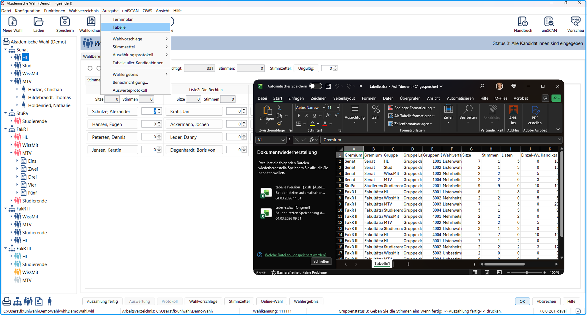

Im Menü `Ausgabe > Tabelle` in uniWAHL können Sie eine systematisch aufgebaute Übersicht aller eingerichteten Gremien und deren zugehörigen Gruppen bzw. Wahlbereiche exportieren. Der Export erfolgt als Excel-Datei und dient der Gremienübersicht sowie als strukturierte Arbeitsgrundlage. Die Datei eignet sich besonders für Qualitätssicherung, interne Abstimmungen mit Wahlleitungen sowie als Grundlage für weitere Arbeitsschritte, etwa die Stimmzettelgestaltung oder die technische Prüfung von Gruppenzuordnungen oder zur Weiterverarbeitung in Wahlbekanntmachungen oder anderen Wahlsystemen.

Abb.: Übersichtstabelle zur Gremienstruktur

Die Export-Datei trägt den Namen **tabelle.xlsx** und enthält eine Gruppe bzw. einen Wahlbereich pro Zeile mit folgenden Spalten:
| Spalte | Bezeichnung | Beschreibung |
|---|---|---|
| A | Gremium | Kürzel des Gremiums, z. B. *Senat*, *StuPa* oder *FakR I*. Diese Information wird im Navigationsfeld angezeigt. |
| B | Gremium Langbezeichner | Ausgeschriebene oder vollständige Bezeichnung des Gremiums, wie sie in offiziellen Dokumenten erscheint. Wird für Stimmzettel, Benachrichtigungen und Protokolle verwendet. |
| C | Gruppe | Kürzel des Wahlbereichs, z. B. *HL* (Hochschullehrende), *Stud* (Studierende), *WissMit* (wissenschaftliche Mitarbeitende), *MTV* (Technik und Verwaltung). |
| D | Gruppe Langbezeichner | Vollständige textliche Beschreibung des Wahlbereichs, z. B. *Gruppe der Hochschullehrerinnen* oder *Gruppe der Studierenden*. Wird für Stimmzettel, Benachrichtigungen und Protokolle verwendet. |
| E | GruppenID | Systeminterne ID zur eindeutigen Identifikation der Gruppe / Wahlbereiche. Wichtig für automatisierte Prozesse, Importe und Schnittstellen. |
| F | Wahlverfahren | Verwendetes Wahlverfahren in der Gruppe: *Listenwahl* oder *Mehrheitswahl*. |
| G | Sitze | Anzahl der Mandate (Sitze), die in dieser Gruppe innerhalb des Gremiums zu vergeben sind. |
| H | Stimmen | Anzahl der Stimmen, die jede wahlberechtigte Person in dieser Gruppe abgeben darf. |
| I | Listen | Anzahl der hinterlegten, zur Wahl zugelassenen Listen (bei Listenwahlverfahren). |
| J | Einzel-Wv. | Anzahl der Einzelwahlvorschläge (bei Mehrheitswahlverfahren). |
| K | Kand.-zahl | Gesamtzahl der hinterlegten Kandidierenden in dieser Gruppe / diesem Wahlbereich. |
| L | Layout | Optionales Layoutkennzeichen (+), das zur Kennzeichnung individueller Layouts (vgl. [Gruppenspezifisches Layout](../7_wahldokumente/7-4_layout.md)) verwendet wird. |
| M | Texte | Hinweis auf das verwendete [Textverzeichnis](../7_wahldokumente/7-3_textbausteine.md#textverzeichnisse) (z. B. *Standard*), das bei Erstellung der Wahldokumente verwendet wird. |
| N | Status | Status des Wahlbereichs bzw. der Gruppe (z. B. 3 = Alle Kandidat:innen sind eingegeben, 4 = Stimmen teilweise ausgezählt). Der Status zeigt den aktuellen Bearbeitungsstand. |
| O | Wahlberechtigte | Anzahl der Wahlberechtigten, die dieser Gruppe zugeordnet sind. Wird auf Basis der Wählerverzeichnisse berechnet. |
| P | Kumulierzahl | Gibt an, wie viele Stimmen pro Kandidierendem kumuliert werden dürfen. Standard ist *1* (eine Stimme pro Kandidat:in). |
| Q | Wählergruppe | Technische Gruppenbezeichnung, häufig bestehend aus Statusgruppe und fakultätsspezifischer Kennung (z. B. *hl,fb1*). Wird zur [Zuordnung der Stimmzettel](../10_ows/10-4_waehler_innengruppen.md) zu den Wählern verwendet. |
| R | Nominierbare Personen | Anzahl der Personen, die in dieser Gruppe vorgeschlagen werden dürfen (z. B. über die [Nominierung in uniWAHL OWS](../../tutorium/7_ows.md#erzeugung-der-online-wahlfunktionen-json)). |

:::tip

**Tipp:** Die Exporttabelle lässt sich hervorragend dafür nutzen, um einen [Strukturdatenimport](./4-1_wahlvorgang_anlegen.md) oder einen [Kandidatenimport](../5_wahlvorschlaege/5-6_kandidatenimport.md) vorzubereiten und so die Daten nach uniWAHL zu re-importieren.

:::
