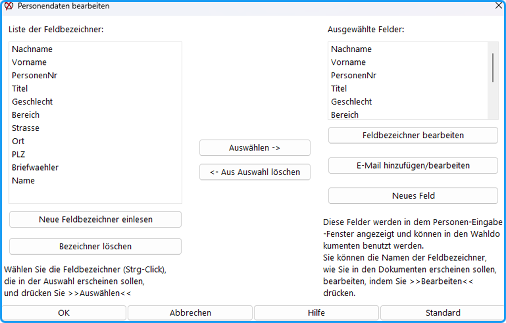
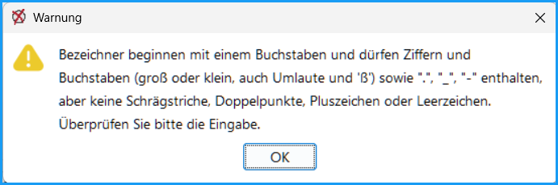
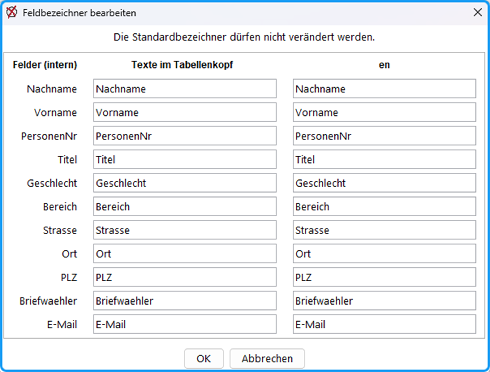
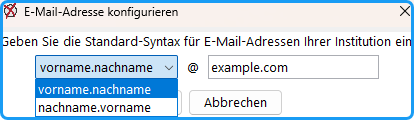
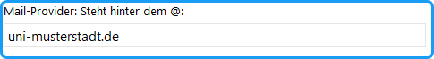
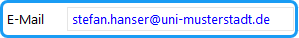

Nachdem die Wahlausschreibung erfolgt ist, ist jetzt ein günstiger Zeitpunkt, das Wahlverzeichnis vorzubereiten, aus dem später die Personendaten der Kandidierenden bezogen werden sollen.

Folgende Schritte sind erforderlich:

- Legen Sie fest, welche Personendaten benötigt werden. Mit der Funktion `Personendaten konfigurieren` legen Sie fest, welche Personendaten der Kandidat:innen für die Ausgabedokumente und sonstige Zwecke (Anschrift) verfügbar sein sollen.
- Bereiten Sie das Wahlverzeichnis vor, indem Sie eine Exceldatei mit den Personendaten der Wahlberechtigten erstellen.(→ [Wahlverzeichnis](./4-9_wahlverzeichnis.md))
- Importieren Sie das Wahlverzeichnis in das interne Wahlverzeichnis-Format (*.wvz).

Sie können beliebige Informationen aus den Wahlverzeichnissen in die Wahldokumente übernehmen: Studienfach, Geburtsdatum, Geschlecht usw.

Zusätzlich können Sie frei formulierte Texte mit Angaben zur Person, die nicht im Wahlverzeichnis stehen, eingeben. So könnte die Partei- oder Gewerkschaftszugehörigkeit oder ein Kennwort angegeben werden. Um diese Felder in der Eingabemaske der Person erscheinen zu lassen, müssen Sie diese „konfigurieren“.

## So konfigurieren Sie die Personendaten: {#so-konfigurieren-sie-die-personendaten}

Menü: *Konfiguration / Personendaten*: Öffnet das Dialogfenster zum Konfigurieren der Personendaten:

*Abb. : Dialog-Fenster zum Konfigurieren der Personendaten*

### Linke Seite {#linke-seite}

Die linke Liste enthält die zur Verfügung stehenden Feldbezeichner.

&gt; **Neue Feldbezeichner einlesen**: Öffnet Dialog zum Einlesen der Feldbezeichner aus einer Wahlverzeichnis-Datei (.txt, .xlsx). Wählen Sie ein Verzeichnis, dessen Kopfzeile die gewünschten Feldbezeichner enthält. Aus diesem Wahlverzeichnis werden die Feldbezeichner angezeigt, die noch nicht standardmäßig in den Personendaten berücksichtigt sind. Die gelesenen Bezeichner werden zur Liste hinzugefügt.

:::warning

**Hinweis:** Feldbezeichner dürfen weder Leer- noch spezielle Sonderzeichen enthalten, prüfen und ändern Sie daher bitte die Kopfzeile Ihrer Wahlverzeichnis-Datei.  

:::

&gt; **Bezeichner löschen**: Die in der Liste selektierten Bezeichner werden gelöscht.

### Mitte {#mitte}

Die ausgewählten Felder sind mittig zu sehen.

&gt; **Auswählen**: Mit dieser Taste werden die links selektierten Bezeichner in die Auswahl (rechts) übernommen.

&gt; **Aus Auswahl löschen:** Mit dieser Taste werden die in der Auswahl selektierten Bezeichner aus der Auswahl gelöscht.

### Rechte Seite {#rechte-seite}

Die ausgewählten Felder sind rechts zu sehen.

&gt; **Feldbezeichner bearbeiten**: Öffnet einen Dialog zum Bearbeiten der Feldbezeichner. Ändern Sie in der rechten Spalte den Begriff und beenden mit „OK“. Es werden dabei die **internen** Bezeichner **nicht** geändert, sondern nur die „Ausgabetexte”, die in den Tabellenköpfen der Ausgabedokumente (Bekanntmachungen, Stimmzettel) erscheinen.

Abb.: Übersichtstabelle zur Gremienstruktur

&gt; **E-Mail hinzufügen / bearbeiten:** Die E-Mail-Adresse wird als Attribut hinzugefügt und später in Standardform vorgeschlagen.

&gt; **Neues Feld**: Öffnet einen Dialog für die Definition eines neuen Feldbezeichners. Die Vorgabe „Zusatz“ kann beliebig geändert werden.

## So werden die speziellen Personendaten in den Ausgabedokumenten mit angezeigt: {#so-werden-die-speziellen-personendaten-in-den-ausgabedokumenten-mit-angezeigt}

Dazu rufen Sie die Dialogfenster für das Layout der Wahldokumente über das Menü: *Konfiguration / Layout / Wahlvorschläge* usw. auf.

Näheres dazu finden Sie in Kapitel *[Layout der Wahldokumente](../7_wahldokumente/7-4_layout.md)*.

## E-Mail-Adresse zu den Attributen hinzufügen {#e-mail-adresse-zu-den-attributen-hinzufuegen}

Wenn die E-Mail-Adressen der Personen nicht im Wahl-Verzeichnis enthalten sind, kann ein Vorschlag für die Adresse aus dem Namen und dem Provider gebildet werden, da die Angehörigen einer Institution/Bereichs häufig eine E-Mail-Adresse mit Standard-Syntax besitzen.

- Öffnen Sie den Dialog zum Konfigurieren der Personendaten: Menü Konfiguration/Personendaten.
- Betätigen Sie: 
Wählen Sie die Syntax aus zwei Möglichkeiten und tragen Sie den Provider-Namen in das Textfeld ein.
- Mit „OK“ wird „E-Mail“ zu den Attributen hinzugefügt.

*Abb. : Syntax für E-Mail-Adressen konfigurieren*

//

Alternativ kann der Providername auch als Textbaustein eingegeben werden:

Öffnen Sie den Dialog „Texte bearbeiten/Allgemein“ über die Taste „Textbausteine“ oder über das Menü: Konfiguration/Textbausteine:

*Abb. : Textbaustein „Mail-Provider: Steht hinter dem @“*

//

Wenn Sie nun auf eine kandidierende Person klicken, sehen sie, dass die Personendaten jetzt ein Eingabefeld für die E-Mail-Adresse enthalten:

*Abb. : Eingabefeld „E-Mail“*

Als Vorgabe wird die aus dem Kandidat:innennamen und dem Namen des Providers gebildete Adresse angezeigt, wobei Umlaute etc. ersetzt wurden. Durch die blaue Farbe wird angezeigt, dass es sich um einen Vorschlag handelt. Dieser kann editiert werden. Durch Betätigen der „OK“-Taste wird diese Angabe gespeichert.

:::tip

**Tipp:**  Wenn z.B. Studierende den Zusatz @stud.xxx oder Mitarbeiter:innen der Verwaltung @verw.yyy haben, sollte man die Kandidat:innen gruppenweise eingeben und beim Wechsel der Gruppe den Textbaustein anpassen.

:::
