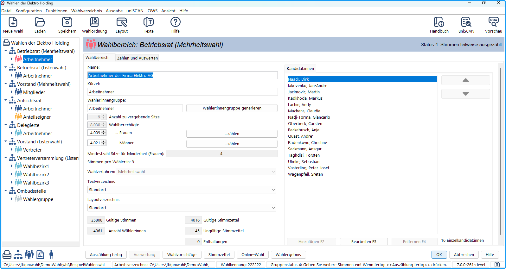
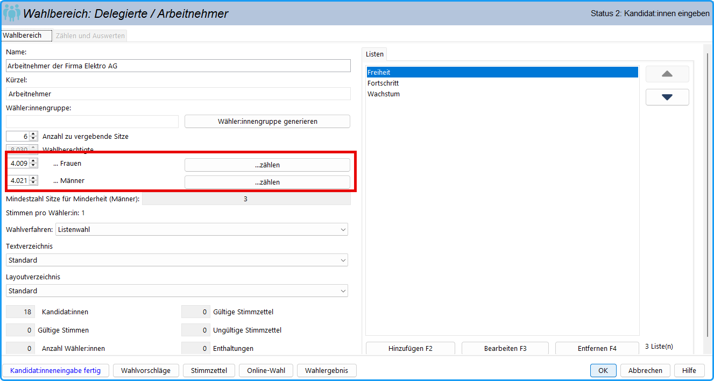
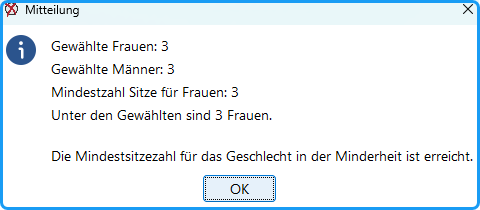

Vergleichen Sie die Eingaben mit dem Beispiel in der Datei *BeispielWahlen.whl*. Diese finden Sie im Arbeitsverzeichnis z.B. **C:\Benutzer\&lt;IhrBenutzername&gt;\uniwahl\DemoWahl\whl**

*Abb. : Beispiele für weitere Gremien*

## So richten Sie weitere Gremien ein: {#so-richten-sie-weitere-gremien-ein}

1. Öffnen Sie das Fenster Wahl konfigurieren (🡪 [Wahl konfigurieren](./4-3_wahl_konfigurieren.md)).
1. Fügen Sie ein neues Gremium ein. Der Name erscheint in den Wahldokumenten, sollte also vollständig und verständlich sein. Der Kürzel-Name wird nur intern benötigt.
1. Benennen Sie die Wahlbereiche: z.B. Betriebsrat: „Firmenname“, „Frauenversammlung: „Beschäftigte“, „Studentinnen“ bzw. Personalrat: „Beamte“, „Angestellte“, „Arbeiter“.
1. Löschen Sie die Bezeichnungen der anderen Bereiche.

## Besonderheiten bei Betriebsratswahlen {#besonderheiten-bei-betriebsratswahlen}

Soll eine Betriebsratswahl nach BetrVG durchgeführt werden, konfigurieren Sie die Wahlordnung entsprechend . Ist die Option *Betriebsratswahl* in der Wahlordnung gesetzt, enthalten die Dialoge Eingabefelder zur Sicherstellung der gesetzlichen Vorgaben.

**Zusammensetzung nach Beschäftigungsarten und Geschlechter**

Das Geschlecht, das in der Belegschaft in der Minderheit ist, muss mindestens entsprechend seinem zahlenmäßigen Verhältnis im Betriebsrat vertreten sein, wenn dieser aus mindestens drei Mitgliedern besteht (§15 BetrVG). Zur Vorbereitung einer Betriebsratswahl ist der Wahlvorstand daher zur Feststellung verpflichtet, welches Geschlecht von seinem zahlenmäßigen Verhältnis im Betrieb in der Minderheit ist. Zu berücksichtigen sind alle dem Betrieb angehörigen Beschäftigen (Ausnahme: Leitende Angestellte). Nach dem sogenannten „d’hondtschen Höchstzahlenverfahren“ wird der Mindestanteil der Betriebsratssitze für das Geschlecht in der Minderheit berechnet. Dazu kann der Sitzverteilung-Rechner  genutzt werden.

Der Dialog *Wahlbereich* wird im Fall von Betriebsratswahlen um die Felder der wahlberechtigten Frauen und Männer und die Mindest-Sitze des *Geschlechts in der Minderheit* ergänzt:

- **Wahlberechtigte … Frauen**: Wahlberechtigte Frauen können direkt eingegeben oder aus einem Wahlverzeichnis gezählt werden. Hierzu ist eine Geschlechterkodierung im Wahlverzeichnis notwendig.
- **Wahlberechtigte … Männer**: Wahlberechtigte Männer können direkt eingegeben oder aus einem Wahlverzeichnis gezählt werden. Hierzu ist eine Geschlechterkodierung im Wahlverzeichnis notwendig.
- **Mindestzahl Sitze für Minderheit**: Bei der Änderung der Zahlen der Wahlberechtigten wird die Mindest-Sitzzahl des *Geschlechts in der Minderheit* automatisch berechnet. Dieses wird im Text auch noch einmal benannt.
- Die Zahl der Wahlberechtigten wird als Summe von Männern und Frauen automatisch berechnet.

*Abb. : Mindest-Sitze des Geschlechts in der Minderheit*

Nach der Auswertung (Sitzzuteilung) wird das Wahlergebnis darauf überprüft, ob genug Personen des *Geschlechts in der Minderheit* gewählt wurden.

*Abb. : Überprüfung des Geschlechts in der Minderheit*
