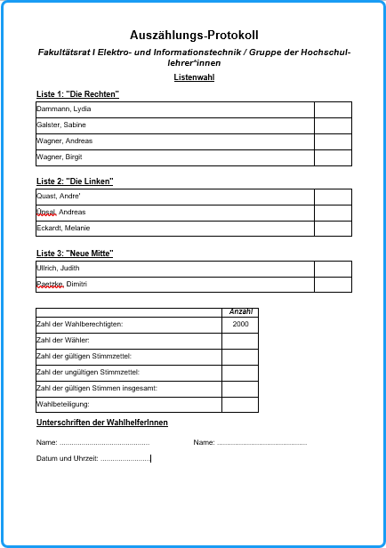

Auf der Basis der Stimmzettel können für jeden Wahlbereich Protokollblätter für das manuelle Auszählen der Stimmen gedruckt werden.

Diese können den Wahlvorständen der einzelnen Stimmbezirke zur Dokumentation zur Verfügung gestellt werden. Mit dem Menübefehl `Ausgabe / Auszählungsprotokoll` wählen Sie zuerst, welche Protokolle erstellt werden sollen.

Die entsprechenden Dateinamen („protokoll_xxx_yyy“: , xxx = Gremienname, yyy = Gruppenname) gibt das Programm vor.

*Abb.: Auszählungsprotokoll*
