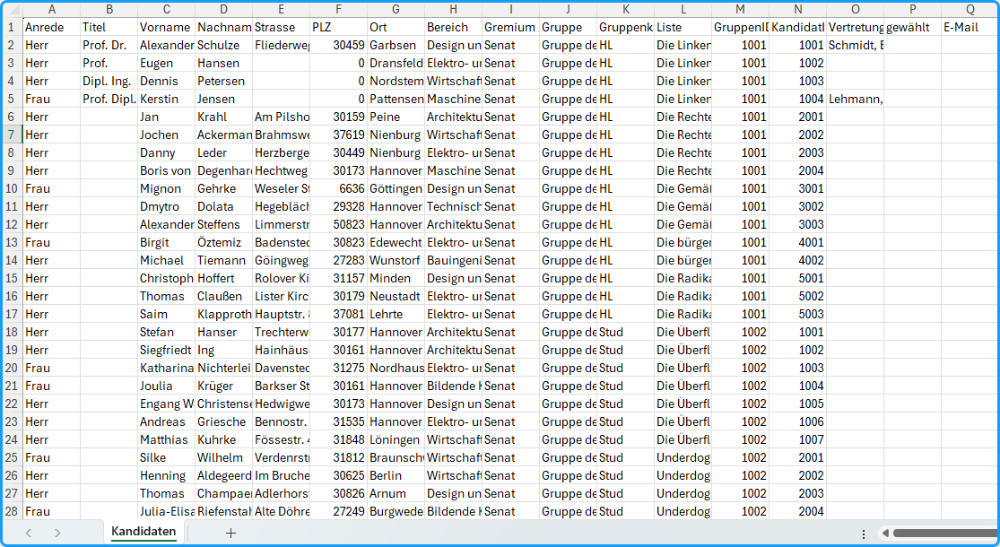

Mit dem Menübefehl `Ausgabe / Tabelle aller Kandidaten` erstellen Sie eine Tabelle aller Kandidat:innen. Es wird eine Excel-Datei ausgegeben mit dem Namen "Alle Kandidaten". Sie enthält neben den personenbezogenen Daten außerdem das Gremium, den Wahlbereich, die Liste, in der die Person kandidiert, den Status gewählt/ nicht-gewählt und die jeweilige Vertretung.

