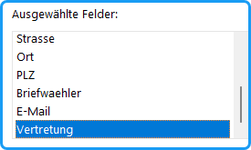
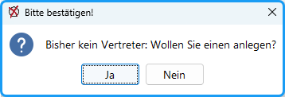
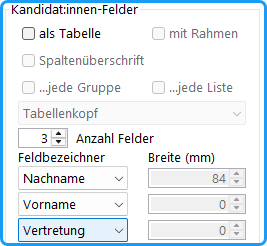
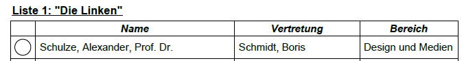
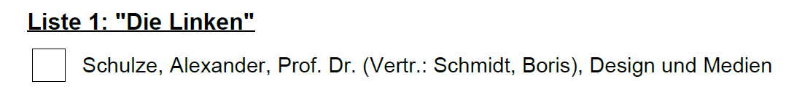

Wenn die Wahlordnung eine persönliche Vertretung der Personen vorschreibt, geht man folgendermaßen vor:

**Konfiguration/ Wahlordnung:** Für die Mehrheits- bzw. Listenwahl wird die persönliche Vertretung gewählt.

**Konfiguration/ Personendaten:** Unter `Ausgewählte Felder` erscheint jetzt zusätzlich `Vertretung`.

*Abb. : Neues Feld in Personendaten*

**Personendialoge:** Es erscheint ein Tastenfeld „Vertretung“, mit der für jede Kandidatur eine Stellvertretungsperson hinzugefügt werden kann. Ist noch keine benannt, öffnet sich bei Betätigung ein neuer Personen-Eingabedialog für diese; später erscheint auf der Taste deren Name.

*Abb. : Neue Schaltfläche in Personendialogen*

**Layout der Dokumente:** Erhöhen Sie in dem Abschnitt „Kandidaten-Felder“ die Anzahl der Felder um eins und wählen Sie dafür: „Vertretung“.

*Abb. : Neue Layout-Felder*

Bei Stimmzetteln erscheint dann in Tabellen eine zusätzliche Spalte mit der Überschrift „Vertretung“:

Wenn nicht die Tabellenform gewählt wurde, erscheint die Vertretung in Klammern mit der Kennzeichnung: „Vertr.:“

Bei der Bekanntmachung der Wahlvorschläge und beim Wahlergebnis wird die Vertretung entsprechend aufgeführt.

Die Begriffe „Vertretung“ als Spaltenüberschrift bzw. „Vertr.:“ sind festgelegt und reserviert.

## Alternative: {#alternative}

Die Stellvertretung wird wie ein normales Personeneigenschaften-Feld behandelt. In der Wahlordnung wird es *nicht* vermerkt. Fügen Sie unter Konfiguration/Personendaten ein Feld hinzu, z.B. „Stellvertretung“ (der Begriff „Vertretung“ ist reserviert, s.o.).

Tragen Sie bei den Personendaten den Vertreternamen ein. Wenn Sie nicht tabellarisch ausgeben, sollten Sie nicht nur den Namen, sondern z.B. „(Vertr.: Schmidt, Boris)“ eingeben.

Für die Ausgabe muss dann dieses Feld mit gewählt werden.
