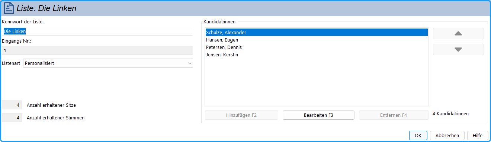
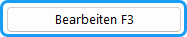
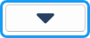

## Eingabe der Wahlvorschläge {#eingabe-der-wahlvorschlaege}

- Durch Doppelklicken im Navigationsbereich auf das Symbol oder den Namen der gewünschten Gruppe öffnet sich das Fenster *Gruppe*.
- Das rechtsstehende Aufzählungsfeld enthält im Fall der Listenwahl die Register *Listen* für die Listenwahlvorschläge und *Kandidat:innen* für die Einzelwahlvorschläge, im Fall der Mehrheitswahl nur das Register *Kandidat:innen*.
- Einzelwahlvorschläge bei Listen- und Mehrheitswahl fügen Sie hier in die Registerkarte *Kandidat:innen* ein .
- Im Fall der Listenwahl fügen Sie in der Registerkarte *Listen* mit „*Hinzufügen*“ eine neue Liste hinzu (→ folgender Abschnitt)*.*

## Eingabe der Listenwahlvorschläge {#eingabe-der-listenwahlvorschlaege}

## Links {#links}

- Öffnen Sie im Gruppe-Fenster die Registerkarte Listen (siehe Abb.).

**Kennwort der Liste**: Der Name der Liste; dieses erscheint in den Wahldokumenten.

**Eingangs Nr.**: Diese Nummer wird vom System automatisch vergeben, entsprechend der Reihenfolge der Listen im Gruppen-Fenster.

**Listenart**: Die Art des Listenwahlvorschlages wird angezeigt. In dem Fall, dass in der Wahlordnung die Listenart als *Variabel* deklariert wurde, kann hier die Listenart festgelegt werden. Es öffnet sich der Liste-Dialog.

**Anzahl erhaltener Sitze**: Die dieser Liste zugewiesene Sitzezahl wird nach der Auswertung angezeigt.

**Anzahl erhaltener Stimmen**: Die von dieser Liste errungene Stimmenzahl wird nach der Auszählung angezeigt.

*Abb. : Dialog-Fenster: Listenwahlvorschlag*

## Rechts {#rechts}

Das Kandidat:innenfeld bildet die in der Liste angegebenen Kandidat:innen der Liste ab und bietet die Möglichkeit diese zu bearbeiten.

|  |  |
|---|---|
|  | Ein neuer Kandidat wird hinzugefügt. Dazu öffnet sich das entsprechende Fenster; nach dessen Schließen wird der neue Kandidat eingefügt. |
|  | Der ausgewählte Kandidat wird bearbeitet; das entsprechende Fenster öffnet sich, ebenfalls durch Doppelklick auf den Kandidat:innennamen. |
|  | Der ausgewählte Kandidat wird aus der Liste entfernt. |
|  | Der ausgewählte Kandidat wird in der Liste nach **unten** verschoben. |
|  | Der ausgewählte Kandidat wird in der Liste nach **oben** verschoben. |
|  | Rechts unten wird die Anzahl der Kandidat:innen angezeigt |

Tabelle : Schaltflächen zur Kandidat:inneneingabe
