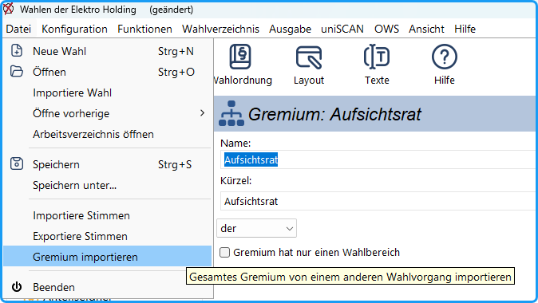
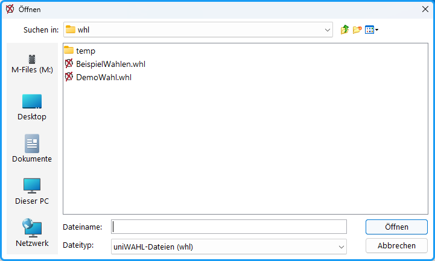
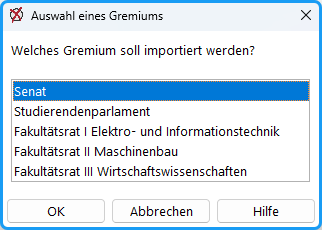
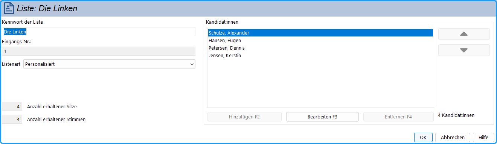

Um die Eingabe von Kandidat:innen auf mehrere Rechner zu verteilen, können Sie einzelne Gremien aus einer vorbereiteten Wahl-Datei importieren.

*Abb. : Menü-Befehl*

Rufen Sie dazu zunächst den Menü-Befehl * Datei / Gremium * importieren auf. Nach dem Aufruf erscheint eine Sicherheitsabfrage, die Sie bestätigen müssen, um den Vorgang fortzusetzen.

*Abb. : Bestätigung des Vorganges*

Das Programm weist darauf hin, dass ein komplettes Gremium aus einem anderen Wahlvorgang übernommen wird. Damit der Vorgang weiter verfolgt werden kann, müssen Sie den Import via  &gt;Ja&lt; bestätigen.

*Abb. : Dateiauswahl*

In diesem Dialog legen Sie fest, aus welcher Wahl-Datei das Gremium importiert werden soll.

*Abb. : Auswahl des zu importierenden Gremiums*

Hier bestimmen Sie, welches Gremium in die aktuell geöffnete Wahl übernommen wird. Nach dem Import können Sie direkt mit der Eingabe oder Bearbeitung der Kandidat:innen beginnen.

*Abb. : Kandidat:inneneingabe*

Ansicht der Bearbeitungsmaske für Wahlvorschläge und Kandidat:innen innerhalb des importierten Gremiums.

Wenn in der aktuellen Wahl bereits ein Gremium mit identischem Namen vorhanden ist, wird dieses beim Import automatisch durch das ausgewählte Gremium ersetzt.
