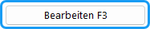
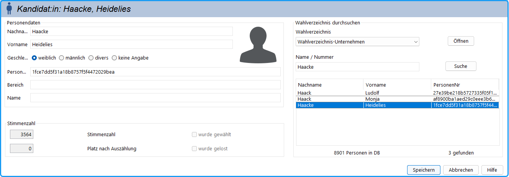
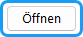
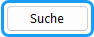
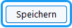
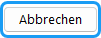

Ein neuer Kandidat wird hinzugefügt durch Betätigen der Taste:

 im Dialog des Wahlbereichs/der Gruppe bzw. der Liste, zu der er gehören soll.

Die Kandidat:innen-Daten können (auch später) bearbeitet werden durch:

 Zum Bearbeiten aus der Gruppe oder aus der Liste, zu der er gehört.

**oder**

im Fenster: Gruppe / Kandidat:innen-Übersicht

**oder**

durch Doppelklick im Navigationsfenster

*Abb. : Dialogfenster zur Eingabe der Personendaten und weiterer Angaben mit Datenbankabfrage*

## Linke Seite: Personendaten {#linke-seite-personendaten}

- Enthält die Personendaten des Kandidat:innen.
- Diese Angaben werden benötigt, wenn Sie:
   1. auf den Stimmzetteln oder den Bekanntmachungen bei den Bewerbern außer dem Namen auch deren Titel, Tätigkeitsbereich angeben müssen,
   1. oder die gewählten Gremienvertreter durch Serienbriefe benachrichti­gen wollen.
- Die Daten können in die Textfelder manuell eingegeben oder aus dem Wahlverzeichnis eingelesen werden (siehe rechtes Feld) .
- Die Daten können manuell korrigiert oder durch zusätzliche Angaben ergänzt werden. Nicht benötigte Angaben können entfallen.
- Die Standardfelder wie Name und die Adressangaben werden immer geöffnet. Wenn Sie weitere Infor­ma­tionen speichern wollen, können Sie die [Personendaten konfigurieren](../4_vorbereitung/4-8_personendaten.md).

## Feld Stimmenzahl-Informationen {#feld-stimmenzahl-informationen}

Im Feld links unten werden Informationen über das auf den Kandidat:innen bezogene Wahlergebnis gezeigt, wie viele Stimmen er bekam, ob er gewählt wurde, welchen Rang er in der Liste bekam und ob zur Bestimmung der Reihenfolge gelost wurde.

## Rechte Seite: {#rechte-seite}

## Feld Wahlverzeichnis durchsuchen {#feld-wahlverzeichnis-durchsuchen}

Zur Übernahme von Kandidat:innen kann das Wahlverzeichnis durchsucht werden.

In diesem Dialog wählen Sie zunächst das gewünschte Wahlverzeichnis aus und öffnen es mit der Schaltfläche . Anschließend können Sie im Feld „Name / Nummer“ nach einer Person unter  suchen. Die gefundenen Einträge werden in der Ergebnisliste angezeigt.

Markieren Sie die gewünschte Person und übernehmen Sie die Auswahl mit  . Mit  schließen Sie den Dialog ohne Übernahme.
