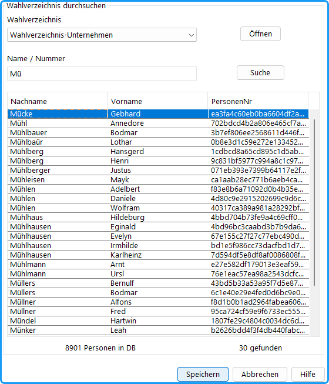

Die persönlichen Daten des Kandidat:innen können Sie aus einem Wahlverzeichnis abrufen. Dafür sind folgende vorbereitende Schritte erforderlich:

- **Personenangaben konfigurieren**: Sie können beliebige Informationen aus den Wahlverzeichnissen einlesen, Studienfach, Geburtsdatum, Geschlecht usw. Dazu müssen Sie [Personendaten konfigurieren](../4_vorbereitung/4-8_personendaten.md).
- **Wahlverzeichnis importieren**: Dabei wird eine externe Wähler:innendatei (*.txt) in das interne Format (*.wvz) übertragen .
- **Wahlverzeichnis öffnen**: Die interne Wähler:innen-Datenbank wird geöffnet; es kann zwischen mehreren geöffneten Wahlverzeichnissen gewechselt werden.

## Personendaten aus einer Datenbank einlesen {#personendaten-aus-einer-datenbank-einlesen}

*Abb. : Personensuche*

## So wählen Sie ein Wahlverzeichnis aus: {#so-waehlen-sie-ein-wahlverzeichnis-aus}

|  |  |
|---|---|
|  | Öffnet ein (weiteres) Wahlverzeichnis; dieses erscheint in der Auswahlbox „*Wahlverzeichnis*“ und ist aktiv. Alle importierten Wahlverzeichnisse (*.wvz) können geöffnet werden. |
|  | Wählen Sie eines der geöffneten Wahlverzeichnisse aus. Die folgenden Suchanfragen beziehen sich auf das angezeigte Verzeichnis. |

## So suchen Sie eine Person {#so-suchen-sie-eine-person}

**1. Suchbegriff:**

Geben Sie in das Eingabefeld entweder die Matrikel-/ Personalnummer oder den Familiennamen(-anfang) der gesuchten Person ein.

**2.**  :

Betätigen Sie die *Suchen*-Schaltfläche (Tastatur: Eingabetaste)

**3. Suchergebnis:**

Ist das Suchergebnis **eindeutig** (bei eindeutigen Nummern immer, bei Namen oft nicht), werden die Daten der gefundenen Person direkt in die Felder geschrieben.

Sind **mehrere** Personen mit demselben Namen(sanfang) gefunden worden, erscheinen diese in der Auswahlbox. Wählen Sie durch Mausklick die gesuchte Person (Tastatur: Auf / Ab und Eingabetaste).

**Vergleichen** Sie die in den Datenfeldern erschienenen Daten mit denen der gesuchten Person. Bei der Eingabe eines Namens genügen die ersten Buchstaben; die Datenbank findet die zugehörigen Namen.

**4. Person übernehmen:**

Übernehmen Sie die ausgewählte Person mit `OK` (Tastatur: `Eingabetaste / Enter`).

:::tip

### Tipp: Tastatursteuerung bei der Kandidat:inneneingabe {#tipp-tastatursteuerung-bei-der-kandidat-inneneingabe}

Die Eingabe von Kandidat:innen kann nahezu vollständig über die Tastatur erfolgen.

#### Funktionen {#funktionen}

`F2` – Kandidat:in hinzufügen

`F3` – Eintrag bearbeiten

`F4` – Eintrag entfernen

#### Suche starten {#suche-starten}

Namen eingeben
Mit `Enter` wird die Suche gestartet

#### Genau ein Suchergebnis {#genau-ein-suchergebnis}

Mit `Enter` wird die gefundene Person in das Formular übernommen
Ein weiteres `Enter` speichert die Eingabe und schließt das Fenster

#### Mehrere Suchergebnisse {#mehrere-suchergebnisse}

Mit den `Pfeiltasten ↑ / ↓` zwischen den Treffern navigieren
Mit `Enter` Auswahl in das Formular übernehmen
Mit erneutem `Enter` speichern und Formular schließen

:::
