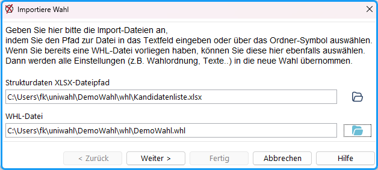
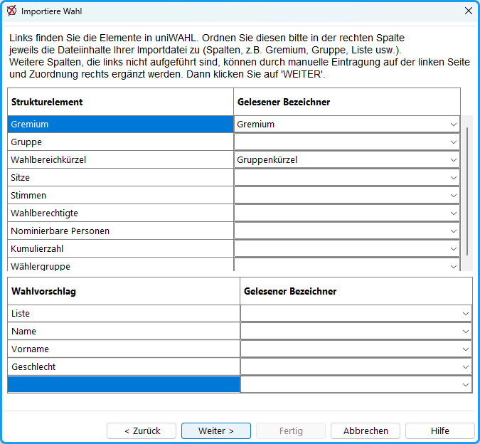
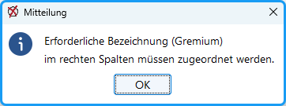
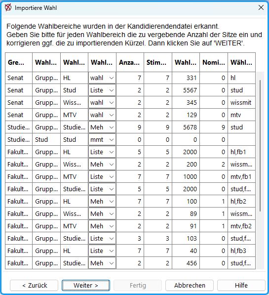
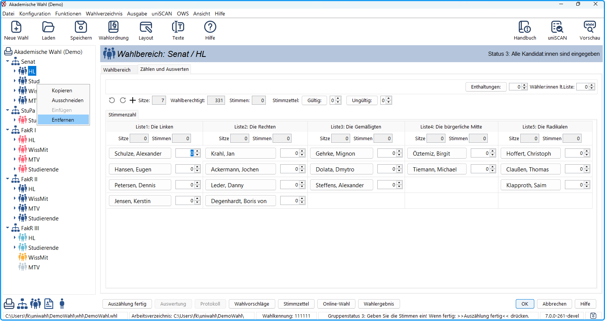

Seit uniWAHL Version 6.5.3 lassen sich Wahlvorschläge über die Funktion des Wahlimports aus einer Transferdatei (XSLX) direkt ins System importieren. Insbesondere bei hohen Kandidierendenzahlen oder wenn alle Wahlvorschläge bereits digital vorliegen, ist dieses Verfahren zu empfehlen, da so eine große Anzahl von Personen sehr schnell per Import hinzugefügt werden kann.

## Importiere Wahlddateien {#importiere-wahlddateien}

Sie importieren eine bereits bestehende Kandidierendenliste im Menü `Datei / Importiere Wahl`. Hier werden Sie durch einen Assistenten geführt, der das Einlesen der Strukturdaten-Datei (Wahlvorschläge) ermöglicht.

*Abb. : Wahldateien auswählen*

|  |  |
|---|---|
| Strukturdaten XLSX-Dateipfad | Wählen Sie hier eine Datei aus, die alle Kandidierenden enthält, z.B. den Export einer Nominierung oder selbst erstellte Kandidierendenliste. |
| WHL-Datei | Wählen Sie hier eine bestehende Wahlvorgangsdatei (Gremien, Gruppen, Wahlordnung, Texte, Layouts etc.), in die die Wahlvorschläge übernommen werden sollen. |

Klicken Sie auf `Weiter`.

## Datenfelder zuordnen {#datenfelder-zuordnen}

Im nächsten Schritt müssen Sie den Spalten der Importdatei die Schlüsselfelder zuordnen, die für den Import benötigt werden.

*Abb. : Spalten zuordnen*

:::warning

**Bitte beachten Sie folgende Hinweise:**

Die Spalten **Gremium** (*Langbezeichner* des Gremiums) und **Wahlbereichskürzel** (*Kurzname* des Wahlbereich) sind beim Kandidatenimport Pflichtfelder und müssen zugeordnet werden. Diese müssen ***exakt*** den Bezeichnern in uniWAHL entsprechen, da sonst neue Gremien bzw. Gruppen angelegt werden.

Das Feld **Gruppe** darf ***NICHT*** zugeordnet werden, da dies ausschließlich für den Gremienimport (vgl. [Wahlimport](../4_vorbereitung/4-1_wahlvorgang_anlegen.md)) genutzt wird.

Das Feld **Wahlbereichskürzel** (*Kurzname* des Wahlbereich) darf ***NICHT*** als "Gruppe" in der Importdatei benannt sein, da sonst automatisch falsch zugeordnet wird.

:::

*Abb. : Erforderliche Felder werden angezeigt*

:::tip

**Tipp: Weitere Datenfelder** der Personendaten, die ins System übernommen werden sollen, können einfach als **gelesener Bezeichner** ausgewählt werden (Titel, Zusätze). Sie können - müssen aber nicht - links benannt werden.

:::

## Import abschließen {#import-abschliessen}

Zuletzt werden die in der Datei erkannten Wahlbereiche angezeigt. In der Tabelle lässt sich kontrollieren, ob - durch fehlerhafte / doppelte Bezeichner - weitere Gruppen angelegt werden und der Import durch Klick auf `Weiter` abschließen.

*Abb. : Importierte Wahlbereiche / Gruppen inklusive weiterer Daten zur Nachkontrolle*

## Datenübernahme kontrollieren {#datenuebernahme-kontrollieren}

Es wird ein neues Wahlprojekt geöffnet. Die erzeugten Strukturen müssen nun geprüft (z.B. via [Export](../../faq/2_benutzerhinweise.md#wie-kann-ich-die-wahldaten-exportieren)) und ggf. bereinigt werden (Kontextmenü im Navigationsfeld). Alle Wahlbereiche, in denen Kandidierende enthalten waren, werden direkt auf Status 3 "**Kandidateneingabe fertig**" gesetzt (eventuell müssen Gruppen [zurückgesetzt](../8_funktionen/8-1_status_zuruecksetzen.md) werden).

*Abb. : Wahlprojektdatei*
