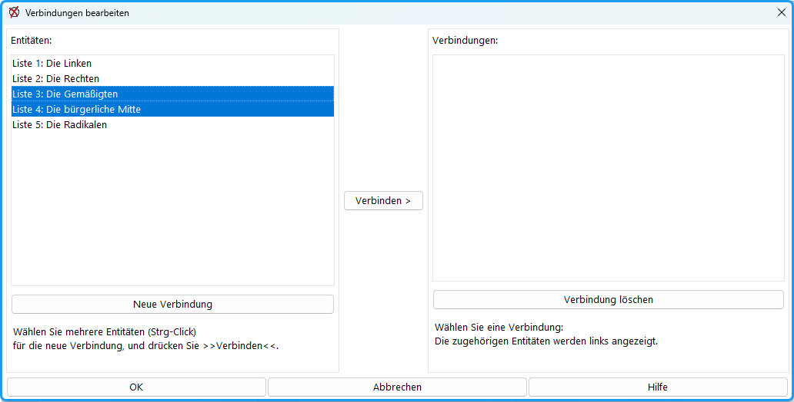
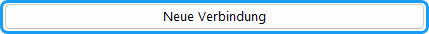
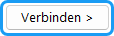

Wenn Ihre Wahlordnung (Menü: `Konfiguration / Wahlordnung / Listenwahl`) die Möglichkeit von Listenverbindungen vorsieht, erscheint im Fenster *Gruppe* eine Schaltfläche *Listenverbindungen*.

Listenverbindungen sind nur bei dem Auswerteverfahren von d’Hondt sinnvoll, da dieses die Listen mit den meisten Stimmen bevorzugt.

*Abb. : Dialog-Fenster für Listenverbindungen*

Im linken Bereich sind alle Listenwahlvorschläge aufgeführt, im rechten Bereich die einzelnen Listenverbindungen.

## So erstellen Sie eine neue Listenverbindung: {#so-erstellen-sie-eine-neue-listenverbindung}

1.  : Eine neue Verbindung erzeugen; dafür werden die Selektierungen gelöscht.
1. Markieren Sie in der linken Tabelle mit der Maus (&gt;&gt;Strg&lt;&lt;-Taste gedrückt halten) die Listen, die verbunden werden sollen.
1.  : Die Nummern der verbundenen Listen erscheinen in der rechten Tabelle in runder Klammer.

## So löschen Sie eine Listenverbindung: {#so-loeschen-sie-eine-listenverbindung}

1. Markieren Sie in der rechten Tabelle eine Listenverbindung.
1. 

Die erstellten Listenverbindungen erscheinen auf der Taste:

