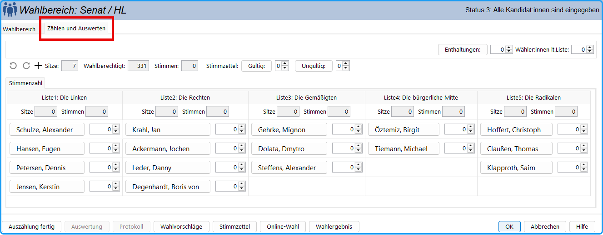

Wenn die Eingabe der Kandidat:innen beendet ist, drücken Sie die Taste:

Bei Vorliegen einer großen Zahl von Wahlbereichen kann man diese Funktion für alle Wahlbereiche gleichzeitig durch den Menü­befehl `Funktionen /Kandidateneingabe fertig (alle Bereiche)` durchführen.

Damit bewirken Sie, dass der Status der Gruppe auf „Status 3 - Alle Kandidaten sind eingegeben“ gesetzt wird.

Dieser Status muss erreicht sein, damit die folgenden Schritte wie der Druck der Bekanntmachung der Wahlvorschläge, der Stimmzettel und der Auszählungsprotokolle erfolgen können.

Es können (von Ausnahmen abgesehen) keine Listen oder Kandidat:innen mehr hinzugefügt oder die Reihenfolge geändert werden, die Personendaten können aber weiterhin bearbeitet oder geändert werden. Zum nachträglichen Hinzufügen müssen Sie den Status des Wahlbereichs zurücksetzen auf „Status 2: Kandidat:innen eingeben“: Menü ` Funktionen/Status zurücksetzen` oder Strg-Z.

Im Fall der *Mehrheitswahl* werden die Kandidat:innen alphabetisch sortiert, falls das in der Wahlordnung vorgesehen ist (`Konfiguration / Wahlordnung / Mehrheitswahl / Kandidaten alphabetisch`).

Im Fall der *Listenwahl* werden die Listen in zufälliger Reihenfolge angeordnet, wenn das in der Wahlordnung vorgesehen ist (`Konfiguration / Wahlordnung / Listenwahl / Reihenfolge der Listen losen`).

Ab jetzt kann die Registerkarte `Zählen und Auswerten` geöffnet werden.

*Abb. : Register: Zählen und Auswerten*

Die Kandidat:innen sind listenweise aufgeführt, Einzelbewerber bilden die letzte Spalte. Bei großer Anzahl von Listen und Kandidat:innen kann die Ansicht mit Hilfe der Rollbalken verschoben werden.

|  |  |
|---|---|
|  |  |
