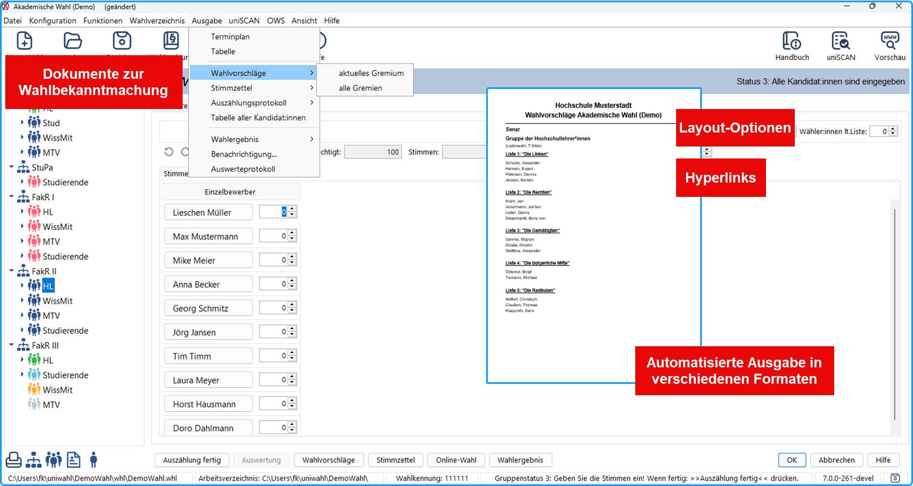

import DocCardList from '@theme/DocCardList';

Nach Eingang der Wahlvorschläge können Sie das Wahlverfahren aller Gremien und Wahlbereiche festlegen: Für jeden Wahlbereich werden die Anzahl der Listen und der Kandidat:innen eingegeben und das Wahlverfahren bestimmt.

Anschließend wird beschrieben, wie die Wahlvorschlagslisten und die Namen der Kandidat:innen in Eingabemasken eingegeben werden. Die Personendaten können aus einem Wahlverzeichnis eingelesen werden.

Jetzt kann die Wahlbekanntmachung herausgegeben werden, durch die die Wähler:innen informiert werden, wer sich zur Wahl stellt, und die Stimmzettel werden hergestellt.

- **Wahlverfahren spezifizieren**: Für jeden Wahlbereich werden die Anzahl der Listen und der Kandidat:innen eingegeben und das Wahlverfahren bestimmt.
- **Kandidat:innen**: Die Namen und Adressen der Kandidat:innen werden in einem Eingabefenster eingegeben.
- **Wahlbekanntmachung**: Die Wähler:innen werden darüber informiert, wer sich zur Wahl stellt.
- **Stimmzettel erstellen**: Die Stimmzettel werden direkt gedruckt oder mit Hilfe einer Ausgabedatei hergestellt.

<DocCardList />

