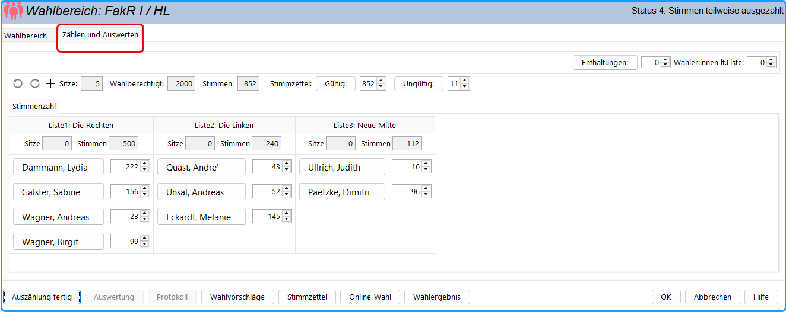
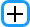
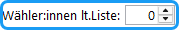
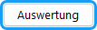
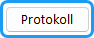
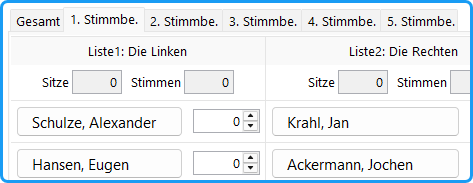
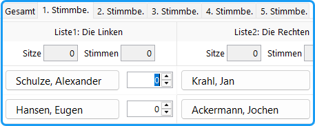

Öffnen Sie in dem Gruppenfenster die Registerkarte: *Zählen und Auswerten* für die Auszählung der Stimmzettel.

*Abb. : Registerkarte Zählen und Auswerten*

- **Sitze:** Anzahl der zu vergebenden Sitze der Gruppe.
- **Wahlberechtigt:** Anzahl der wahlberechtigten Mitglieder der Gruppe.
- **Stimmen:** Abgegebene Stimmen. Zähltaste für ungültige Stimmen (wenn in Wahlordnung aktiv).
- **Stimmzettel:** Zähltaste und Eingabefeld für ungültige Stimmzettel; wenn Wähler mehr als eine Stimme haben, auch für gültige Stimmzettel.

Die **Listenwahlvorschläge** sind spaltenweise angeordnet:

- **Liste #:** Kennwort der Liste, evtl. abgekürzt.
- **Sitze:** Anzahl der nach Sitzzuteilung auf die Liste entfallenen Sitze.
- **Stimmen:** Anzahl der auf die Liste entfallenen Stimmen.
- **Je Kandidat:** Namenstasten und Zählfelder: entweder Tastenklick oder direkt in das Zahlenfeld eintragen. Zur Eingabe der fertig gezählten Stimmen selektieren Sie ein Zahlenfeld durch Doppelklick oder Klick *auf die graue Fläche drumherum* und gehen weiter mit der Tab-Taste.
- Bei gebundenen Listen oder kombinierter Listenart besitzt auch die Liste ein Zählfeld für die Stimmen, die für die Liste (statt für Kandidat:innen) abgegeben werden.

## Werkzeugleiste und Funktionen {#werkzeugleiste-und-funktionen}

| Schaltfläche | Beschreibung |
|---|---|
|  | Mit der *Undo -*Taste können die letzten Eingaben in umgekehrter Reihenfolge in beliebiger Tiefe wieder rückgängig gemacht werden. |
|  | Rückgängig gemachte Änderungen wiederherstellen |
|  | Die Stimmenzahl des markierten Kandidat:innen erhöhen (markieren durch Klicken in das rechteckige Feld oder zweimal in das Stimmzahlenfeld). Durch Betätigen der **+** Taste der Tastatur wird derselbe Dialog gestartet. |
|  | **Option Wahl ohne Bindung:** Wenn die Wähler:innen bei Mehrheitswahl nicht an die Wahlvorschläge gebunden sind und auf dem Stimmzettel wählbare Personen vorschlagen können, werden sie hier eingegeben. Es öffnet sich das Personendaten-Eingabefenster. Anschließend wird das Zählfenster neu geöffnet und der Zählvorgang kann fortgesetzt werden. |
|  | Die Anzahl der Fehlstimmen (wenn Wähler:innen weniger Stimmen abge­ben als möglich) wird in dem nebenstehenden Feld gezählt: entweder Tastenklick oder Pfeiltasten oder direkt in das Zahlenfeld eintragen (nur wenn in `Wahlordnung / Allgemein` angewählt). |
|  | Die Anzahl der „Wähler:innen laut Wahlberechtigtenverzeichnis“ wird in dem nebenstehenden Feld gezählt: entweder Pfeiltasten oder direkt in das Zahlenfeld eintragen (nur wenn in `Wahlordnung / Allgemein` angewählt). |
|  | Durch Betätigen diese Schaltfeldes wird das Hinzufügen von Stimmen beendet. Dieser Vorgang ist notwendige Voraussetzung für das Auswerten und die Feststellung des Wahlergebnisses. Bei Vorliegen einer großen Zahl von Wahlbereichen kann man diese Funktion für alle Wahlbereiche gleichzeitig durch den Menübefehl *Funktionen /Auszählung fertig (alle Bereiche)* durchführen.  **Tipp:** **Betätigen Sie diese Funktion erst, wenn wirklich alle Stimmen (z.B. von anderen Wahllokalen) eingegeben wurden.** |
|  | Die Auswertung und die Feststellung des Wahlergebnisses wird gestartet. Die gewählten Kandidat:innen werden farbig markiert und die von jeder Liste erworbenen Sitze werden angezeigt. Bei Vorliegen einer große Zahl von Wahlbereichen kann man diese Funktion für alle Wahlbereiche gleichzeitig durch den Menübefehl *Funktionen /Sitzverteilung starten (alle Bereiche)* durchführen. |
|  | Ein Auswertungsprotokoll wird ausgegeben. Daraus kann die Zuteilung der Sitze an die Listen verfolgt werden. |

## Mehrere Stimmbezirke (wenn die Wahlordnung dies vorsieht) {#mehrere-stimmbezirke-wenn-die-wahlordnung-dies-vorsieht}

*Abb. : Wahlbereich nach Stimmbezirken getrennt*

Sollen mehrere Stimmbezirke getrennt ausgezählt werden, erscheinen die Auszählungsfelder in verschiedenen Registerkarten. Die erste stellt die Gesamtzahl der Stimmen aller Stimmbezirke dar und ist nicht editierbar. Die Eingabe der Stimmen erfolgt in den Registerkarten der einzelnen Stimmbezirke.

*Abb. : Auszählen mehrerer Stimmbezirke*

Diese Option kann in der Wahlordnung (Menü: `Konfiguration / Wahlordnung / Allgemein`) gewählt werden: *Mehrere Stimmbezirke getrennt aufführen.* Dann müssen für *jedes Gremium* die Anzahl der Stimmbezirke und ggf. deren Namen angegeben werden.
