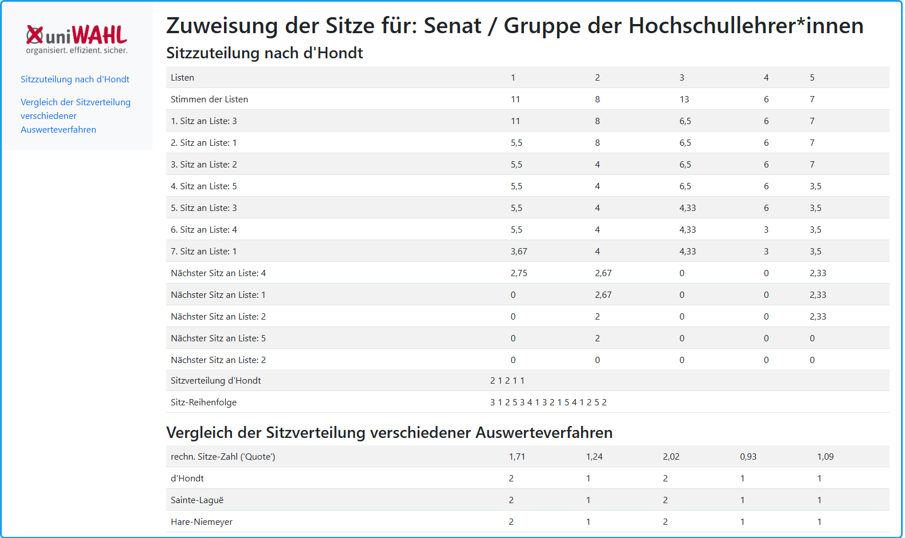
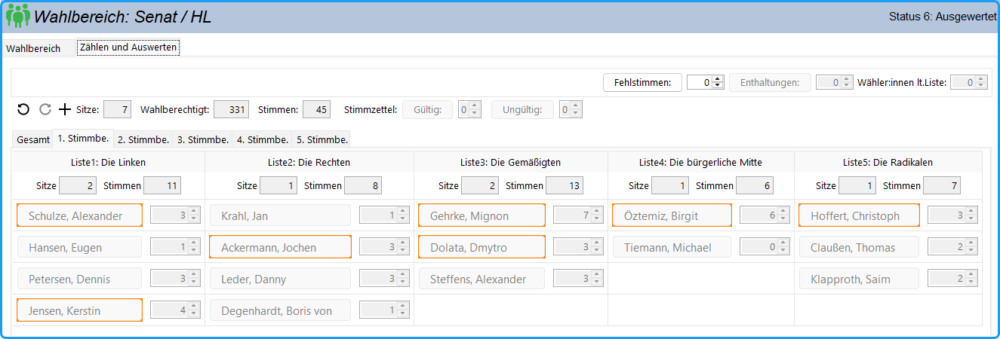
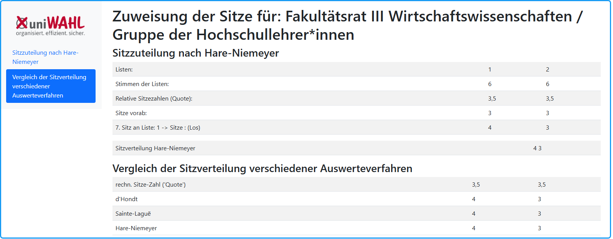

|  |  |
|---|---|
|  | Das Wahlergebnis wird berechnet und die Sitze werden zugewiesen. Die Anzahl der Sitze pro Liste wird angezeigt und die gewählten Personen erscheinen farbig unterlegt. |

**Genaue Informationen über die Auswertung der Wahl, die Verteilung der Sitze auf die Listen und die Bewerber erhalten Sie unter: [Zuteilung der Sitze](../12_wahlordnung/12-2_sitzzuteilung.md)**

## Keine Wiederholung der Auswertung! {#keine-wiederholung-der-auswertung}

Nach erfolgter Auswertung darf die Auswertung nicht ohne Weiteres wiederholt werden, da normalerweise Losentscheidungen sowohl bei der Verteilung der Sitze auf die Listen als auch bei der Reihenfolge der gewählten Kandidat:innen (Mehrheitswahl) benötigt werden.

## Auswerteprotokoll {#auswerteprotokoll}

Mit dem Menübefehl: `Funktionen / Auswerteprotokoll` kann ein Protokoll angezeigt werden, das bei der Zuteilung der Sitze auf die Listen erstellt wird. Bei Losentscheid wird dieser vermerkt.

## Auswertung nach d'Hondt bzw. Sainte-Laguë {#auswertung-nach-d-hondt-bzw-sainte-lagu}

*Abb. : Auswerteprotokoll: Auswertung nach d'Hondt bzw. Sainte-Laguë*

1. Zeile: Die Stimmenzahlen der 3 Listen werden angezeigt: (500 / 240 / 125).

In der folgenden Zeile wird die Zuteilung des 1. Sitzes an die Liste 1 protokolliert und anschließend die neuen Teilzahlen aufgelistet:

Die Stimmenzahl der ersten Liste 500 wurde durch 2 geteilt, die anderen nicht verändert.

Nach Vergabe der Sitze wird das Verfahren weitergeführt, bis die Nachrück-Reihenfolge vollständig ermittelt wurde: Die Sitze-Reihenfolge ist die ermittelte Reihenfolge. Aus dieser Reihenfolge ergibt sich auch, welche Listen bei listenübergreifendem Nachrücken zum Zuge kommen.

Bei Teilergleichheit (d'Hondt und S.-L.) oder Restgleichheit (H.-N.) wird der Losentscheid vermerkt. Im Wahlergebnis wird nur vermerkt, wenn der letzte Sitz durch Los entschieden wurde.

Die nach d’Hondt ermittelte Sitzverteilung und zum Vergleich die nach dem Hare-Niemeyer-Verfahren und dem Sainte-Laguë-Verfahren werden genannt. Es werden außerdem die relativen Sitze-Anteile ('Quote') angegeben, aus denen die Sitzzuteilungsverfahren ganzzahlige Werte machen.

Wäre in der nebenstehenden Abbildung die Wahlordnungsbestimmung: Letzter Sitz: Vorzug leere Liste angewendet, wäre bei gleicher Teilerzahl 125,0 der letzte Sitz an Liste 3 gefallen; so hat sie bei Losentscheid 0 Sitze erhalten.

## Reihenfolge bei listenübergreifendem Nachrücken {#reihenfolge-bei-listenuebergreifendem-nachruecken}

In der Zeile „Nachrück-Reihenfolge“ wird die Reihenfolge der Listen aufgeführt, in der bei ausgeschöpfter Liste listenübergreifend nachgerückt wird. Diese wird durch Fortsetzung des d’Hondtschen Verfahrens ermittelt. In dem o.g. Beispiel wird in der Reihenfolge Liste 3, Liste 2, Liste 2, Liste 3, Liste 3 nachgerückt. Eine *namentliche Nennung* der Nachrücker aus anderen Listen ist nicht sinnvoll, da vorher nicht klar ist, welche Person der nachrückberechtigten Liste nachbenannt wird.

*Abb. : Zählergebnis und Auswertung*

## Auswertung nach Hare-Niemeyer {#auswertung-nach-hare-niemeyer}

*Abb. : Auswertungsprotokoll*

Jeder Wahlvorschlag erhält zunächst so viele Sitze, wie sich für ihn entsprechend dem Verhältnis der Zahl der auf ihn entfallenen Stimmen zur Stimmenzahl aller Wahlvorschläge als ganze Zahl ergibt, in diesem Beispiel jeweils *Sitze vorab*: 2 / 1 / 1.

Weitere Sitze sind in der Reihenfolge der höchsten verbleibenden Zahlenbruchteile zu vergeben. Die (weiteren) Sitze gehen also an Liste 1 und 3.

Daraus ergibt sich die Sitzverteilung, die mit der nach den anderen Verfahren ermittelten, verglichen werden kann.

Im Gegensatz zu den Verfahren von d’Hondt und Sainte-Laguë ist das Hare-Niemeyer-Verfahren nicht rekursiv, d.h. es kann nicht das listenübergreifende Nachrücken für alle Kandidat:innen bestimmt werden, da die verbleibenden Zahlenbruchteile nur *einmal* angewendet werden dürfen. Stattdessen muss das Verfahren mit den verbleibenden Listen neu durchgeführt werden.
