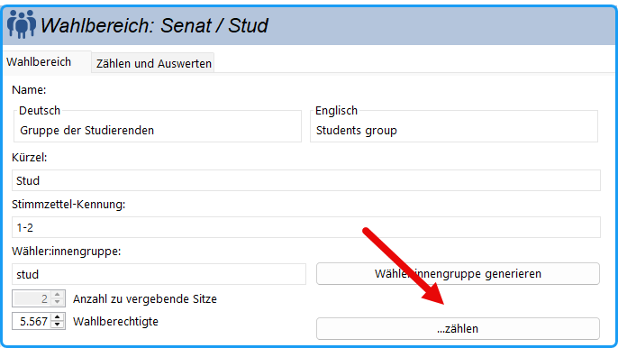
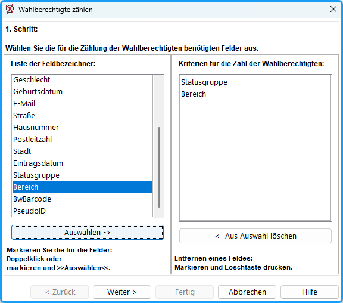
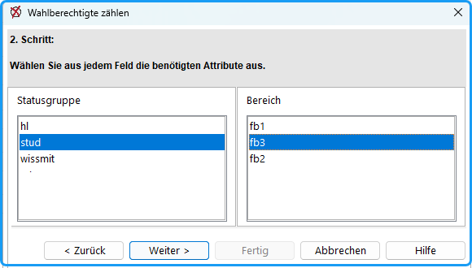
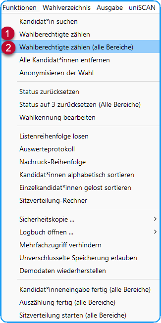
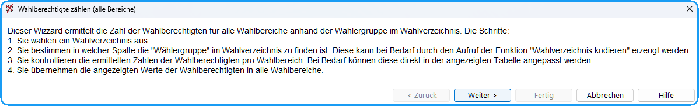
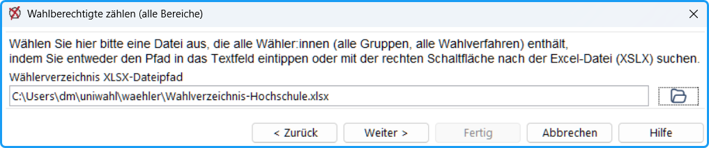
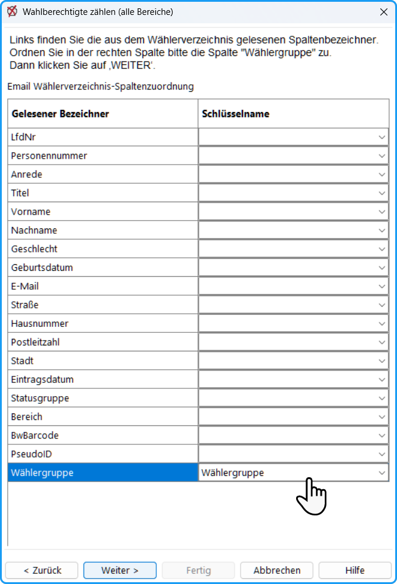
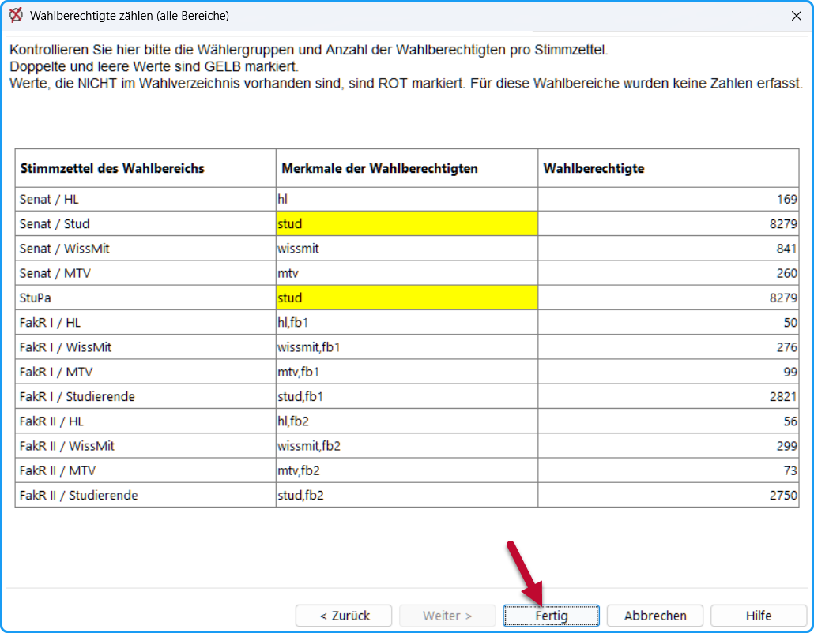

Für die Feststellung des Wahlergebnisses muss die genaue Zahl der Wahlberechtigten bestimmt werden. Diese kann sich während des Wahlvorgangs durch Zu- und Abgänge oder durch Wechsel des Wahlbereichs geändert haben.

Der Assistent zum Zählen der Wahlberechtigten lässt sich auf zwei Wegen starten:

- Im Dialogfenster des Wahlbereichs über die Schaltfläche **…zählen** neben dem Eingabefeld für die Anzahl der Wahlberechtigten. Dieser Weg zählt die Wahlberechtigten für den jeweiligen Wahlbereich.
- Über den Menübefehl `Funktionen > Wahlberechtigte zählen` beziehungsweise `Funktionen > Wahlberechtigte zählen (Alle Bereiche)`. Zweiteres durchläuft alle Wahlbereiche in einem Schritt und trägt die ermittelten Zahlen automatisch ein, sodass eine manuelle Eingabe in jedem einzelnen Wahlbereich entfällt.

:::tip

Bei Betriebsratswahlen u.a. werden wahlberechtigte Männer und Frauen in getrennten Feldern aufgeführt und gezählt. Hierfür werden Feldbezeichner wie „Geschlecht“ verwendet. (vgl. [Weitere Gremien](../4_vorbereitung/4-8_weitere_gremien.md))

:::

## Im Wahlbereich {#im-wahlbereich}

*Abb.: Wahlberechtigte zählen*

Im Dialogfenster des Wahlbereichs befindet sich neben dem Eingabefeld für die Anzahl der Wahlberechtigten ein Tastenfeld **„...zählen“**. Damit wird ein Assistent gestartet.

**Vorbereitung**: Zuerst wird nach dem Wahlverzeichnis gefragt, das durchgezählt werden soll (Excel-Datei „.xls“ oder „.xlsx“). Dieses wird im Ordner „waehler“ im Arbeitsverzeichnis gesucht.

*Abb. : Auswahl der Felder*

**1. Schritt: Auswahl der Felder:**

Angezeigt werden alle in dem Wahlverzeichnis (in der ersten Zeile) gefundenen Felder. Wählen Sie die Bezeichner für die Spalten aus, die für die Zählung benutzt werden sollen. Sie werden durch Doppelklick oder Taste `Auswählen` in die rechte Liste übernommen. Die Reihenfolge und die Anzahl sind beliebig.

Wenn Sie z.B. die Studierenden einer bestimmten Fakultät zählen wollen, wählen Sie in dem Beispiel die Felder `Statusgruppe` und `Bereich`. Wenn Sie zusätzlich die weiblichen und männlichen Wahlberechtigten angeben müssen, nehmen Sie noch `Geschlecht` hinzu.

*Abb. : Auswahl der Attribute*

Klicken Sie auf `Weiter`.

**2. Schritt: Auswahl der Attribute:** Für jedes vorher ausgewählte Feld erscheint eine Liste der gefundenen Einträge. Markieren Sie in jeder Liste einen Eintrag.

`Weiter`

**3. Schritt:** Die ermittelte Anzahl der Wahlberechtigten der gewählten Gruppe wird angezeigt.

Klicken Sie auf `Fertig` .

Die ermittelte Zahl kann direkt in die Daten des Wahlbereichs übernommen werden: `Ja`

Danach sollten Sie mit `OK` die Daten des Wahlbereichs sichern.

**Nachtrag:** Wenn Sie im 3. Schritt `zurück` sagen, können Sie eine neue Auswahl vornehmen. Sie müssen die ermittelten Zahlen notieren und nachher in den jeweiligen Wahlbereichen nachtragen.

## Im Menü "Funktionen" {#im-menue-funktionen}

*Abb.: Menüeinträge*

**1. Wahlberechtigte zählen**

Dieser Eintrag ruft den oben beschriebenen Assistenten auf (gilt pro Wahlbereich) ohne Wählergruppen-Codes.

**2. Wahlberechtigte zählen (Alle Bereiche)**

Diese Eintrag ruft einen Assistenten für alle Wahlbereiche auf.

*Abb.: Beschreibung des Assistent*

Es wird ein **Wahlverzeichnis mit Wählergruppen** benötigt. Sie können dafür die Funktion [Wählergruppen kodieren](../10_ows/10-4_waehler_innengruppen.md) nutzen, wenn Ihr Wahlverzeichnis nicht bereits über eine solche Spalte verfügt.

- Wählen Sie das Wahlverzeichnis aus.

- Wählen Sie die Spalte, die die Wählergruppenzuordnung enthält.

- Kontrollieren Sie die Zahlen und schließen den Dialog ab.

