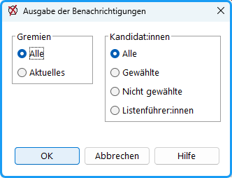

Wenn Sie bei der Eingabe der Bewerber:innen die Adressen miterfasst haben, ist die Benachrichtigung der gewählten Mitglieder der Gremien ohne Aufwand mit Serienbriefen möglich.

## So erstellen Sie die Serienbrief-Datei: {#so-erstellen-sie-die-serienbrief-datei}

Wählen Sie im Menü: *Ausgabe* den Befehl: //Benachrichtigung.

//
 Abb. : Ausgabe der Benachrichtigungen

- Bestimmen Sie im Dialogfenster, für welche Gremien die gewählten oder nicht gewählten Personen benachrichtigt werden sollen.
- Wenn Sie unterschiedliche Serienbrief-Vorlagen für die Gewählten und die Nicht-Gewählten benutzen, erstellen Sie getrennte Dateien.
- Das Programm erzeugt eine Datei mit dem Namen *Benachrichtigung.txt* (gesamte Wahl, alle benachrichtigen) bzw. *Benachrichtigung_www_xxx.txt* (xxx = Gremienname, www = gewählt /nicht gewählt); in dieser befinden sich die Datensätze für die Serienbriefe. Alle beim [Konfigurieren der Personendaten](../4_vorbereitung/4-8_personendaten.md) ausgewählten Datenfelder werden ausgegeben.

## So erstellen Sie den Serienbrief mit Microsoft Word (.docx): {#so-erstellen-sie-den-serienbrief-mit-microsoft-word-docx}

Am Beispiel von MS-Word wird die Serienbrieferstellung gezeigt:

- Im Verzeichnis .*../uniwahl/ausgabe/beispiele* befinden sich die Dateien *Brief_Gewaehlt.doc* und *Brief_NichtGewaehlt.doc* und entsprechende Adressdateien. Öffnen Sie diese Briefe mit *MS-Word*.
- Rufen Sie mit dem Menü: `Extras / Seriendruck` oder mit der entsprechenden Schaltfläche den Seriendruck-Manager auf.
- Sie sehen, dass in diesem Fall das Hauptdokument *Briefxxx.doc* mit der Datenquelle *Beispiel_Gewaehlt_senat.txt* verbunden ist.
- Mit der Schaltfläche *ABC* schalten Sie zwischen der wirklichen Adresse und den Platzhaltern (Seriendruckfeld) hin und her.
- Mit der Taste `Seriendruckfeld einfügen` können Sie Platzhalter an beliebige Stellen einfügen. Dabei werden Ihnen die in der Datenquelle definierten Feldnamen zur Auswahl angeboten. Dieses sind: *Anrede*, *Titel, Vorname, Nachname, Strasse, PLZ, Ort, Gremium.*
- Mit der Taste Bedingungsfeld einfügen können Sie dem Herrn in der Adresse sein „n“ geben: Wenn Anrede Gleich „Herr“, dann einfügen: „n“; oder Wenn Anrede Gleich „Herr“, dann „Sehr geehrter Herr“, sonst „Sehr geehrte Frau“.
- Probieren Sie es doch selbst einmal: Öffnen Sie ein neues Dokument, öffnen Sie den *Seriendruck-Manager* und lassen Sie sich von ihm leiten.

## Serienbriefe mit Libre-/OpenOffice (odt): {#serienbriefe-mit-libre-openoffice-odt}

1. Öffnen Sie die Beispieldatei *Brief_Gewaehlt.odt* oder *Brief_NichtGewaehlt.odt* und erstellen Sie ein neues Serienbrief-Dokument: Menü: `Datei / Neu / Textdokument` .
1. Sie müssen die Adressdatei erst einmal anmelden: Menü: *Datei* / Assistenten / Adressdatenquelle. Typ: andere Datenquelle, Datenbanktyp: Text, Pfad zu den Textdateien: ...ausgabe/beispiele. Feldtrenner: \{Tab\}, da Sie eine tabulatorgetrennte Textdatei verwenden. Text enthält Kopfzeile aktivieren.
1. Fügen Sie an den gewünschten Positionen die Feldbefehle ein, z.B. statt &lt;Anrede&gt;: Menü: *Einfügen / Feldbefehl / Andere*. Dann wählen sie als *Feldtyp*: *Seriendruck-Feld* und aus der recht ausgewählten Datenbank das entsprechende Feld.
1. Die Adressdatei muss registriert werden: Menübefehl *Datei / Assistenten / Adressdatenquelle* öffnet den Assistenten:
   - andere externe Datenquelle, Weiter→, dann Taste: Einstellungen
   - Dialog: Adress-Datenquelle anlegen
Datenbank-Typ: Text
Pfad zu den Textdateien: ...user/uniwahl/ausgabe/beispiele. (statt user steht der Benutzername, der Pfad kann bei Ihrer Installation anders lauten)
   - Datenbankeigenschaften:
Feldtrenner: \{Tab\}
Texttrenner: \{Keiner\}
Text enthält Kopfzeile
   - Taste: Fertigstellen
   - Taste: Feldzuordnung z.B. Name: Nachname
   - Taste: Fertigstellen
1. Einfügen von Serienbrief-Feldern
   - Menü: *Ansicht / Datenquellen*, Datenquellen- Browser
   - Doppelklick auf die Datenquelle: *Benachrichtigung*...
   - Doppelklick auf *Tabellen*
   - Tabellenknopf in Dokument ziehen

1. Bedingungsfelder einfügen: (Datenquellen- Browser ist geöffnet)
1. Menü: Einfügen / Feldbefehl / Andere: Funktionen /Bedingter Text
1. Tabellenknopf (z.B. „Anrede“) in Bedingung-Feld ziehen und dahinter schreiben: == „Herr“ , Dann Sehr geehrter Herr Sonst: Sehr geehrte Frau
1. Seriendruck ausgeben.
