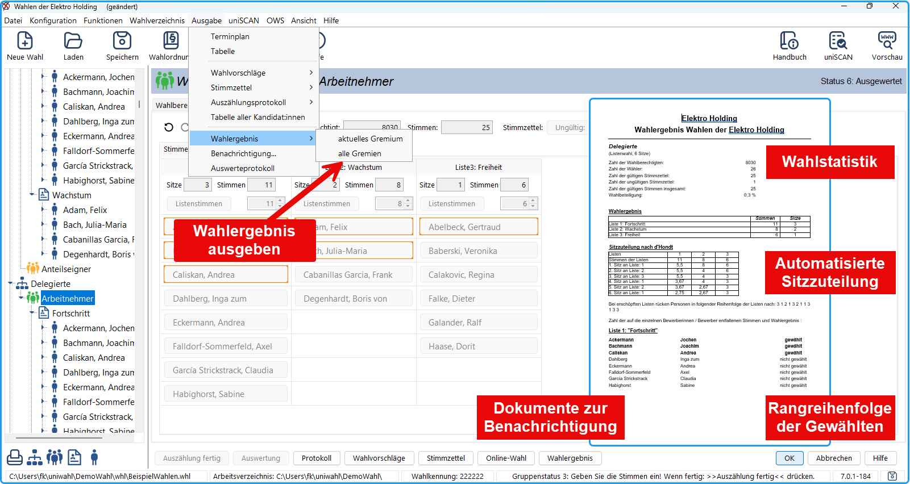

import DocCardList from '@theme/DocCardList';

In diesem Kapitel wird beschrieben, wie die für jede:n Kandidat:in abgegebenen Stimmen gezählt werden. Die Auszählung kann geprüft und korrigiert werden. Zwischenergebnisse können gespeichert werden. Die *Undo*-Funktion, mit der man fehlerhafte Eingaben rückgängig machen kann, und die Auszählung an mehreren Rechnern wird besonders hervorgehoben.

Die Stimmabgabe ist beendet, jetzt kommt die Nachbearbeitung. Das Wahlergebnis kann für jeden Wahlbereich per Tastendruck ermittelt werden. Um zu verstehen, wie das Auswerteverfahren funktioniert, können Sie im Bereich „Verhältniswahl und Mehrheitswahl“ nachlesen.

Die Ausgabe der Wahlergebnisse erfolgt in Ausgabedateien in verschiedenen Formaten.

- **Stimmen auszählen**: In einem Zählfenster werden die für jede:n Kandidat:in abgegebenen Stimmen gezählt.
- **Bekanntmachung der Wahlergebnisse**: Die Ausgabe erfolgt auf Drucker oder in eine Ausgabedatei in verschiedenen Formaten.

<DocCardList />

