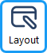
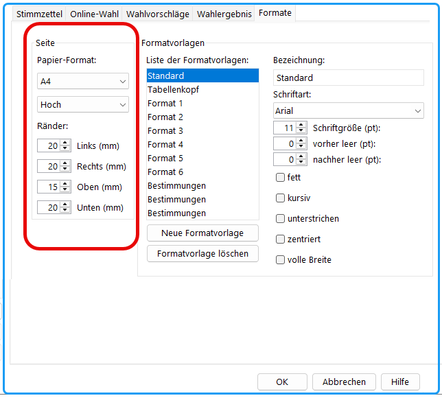

 oder der Menü­befehl: `Konfiguration / Layout / Formate` öffnet den Dialog für das Einrichten der Seiteneinstellungen**.**

*Abb. : Dialog-Fenster: Seite einrichten*

`Papier-Format:`' Auswahl der Seitengröße, z. B. `A4` und Auswahl der Seitenausrichtung z.B. `Hoch:` .

`Links (mm):` Festlegen des linken Seitenrandes in Millimetern.

`Rechts (mm):` Festlegen des rechten Seitenrandes in Millimetern.

`Oben (mm):` Festlegen des oberen Seitenrandes in Millimetern.

`Unten (mm):` Festlegen des unteren Seitenrandes in Millimetern.

Diese Werte bestimmen die nutzbare Druck- oder Anzeigefläche.
