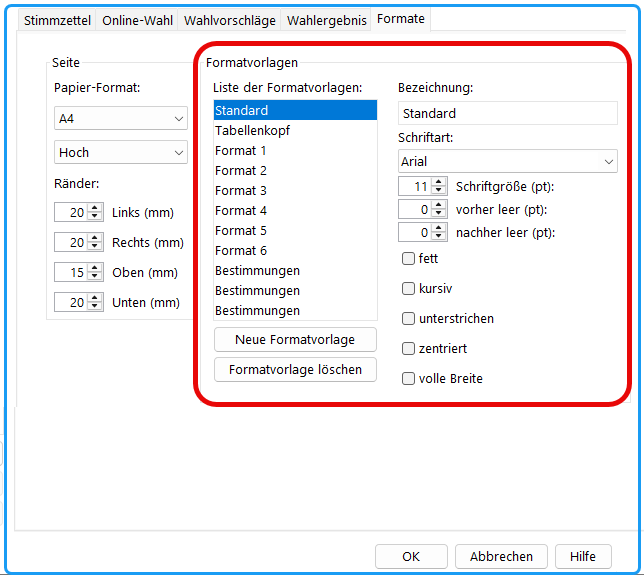

Sie können die Texte in ihrem Aussehen beeinflussen und Ihren Wünschen anpassen. Für die Gestaltung der Texte werden so genannte Formatvorlagen benutzt. Dieses sind Vorlagen für die Gestaltung von Texten, Überschriften oder anderen hervorgehobenen Zeilen.

Wie Sie diese Formatvorlagen benutzen, lernen Sie hier (→[Layout der Wahldokumente](./7-4_layout.md)).

Öffnen Sie die Formatvorlagen durch Klicken auf      oder durch den Menü­befehl: `Konfiguration / Layout / Formate` , dieser öffnet den Dialog für das Einrichten der Seiteneinstellungen**.**

*Abb. : Dialog-Fenster: Formatvorlage bearbeiten*

## Formatvorlagen {#formatvorlagen}

## Liste der Formatvorlagen {#liste-der-formatvorlagen}

In diesem Fenster werden die Formatvorlagen definiert. Die Formatvorlagen haben Namen, deren Vorgabewerte „*Standard“, „Tabellenkopf“, „Format 1“... „Format 6"* verändert werden können. Mit diesen Namen werden die Formatvorlagen beim Layout der Druckdokumente aufgerufen.

`Standard` : Die Standardschrift wird überall als Grundeinstellung verwendet.

`Tabellenkopf` : Diese Formatvorlage wird für die Kopfzeilen von tabellarischen Listen verwendet.

`Format 1 bis ... Format 6` : Diese werden für hervorgehobene Textstellen wie Überschriften etc. benutzt.

## Neue Formatvorlage {#neue-formatvorlage}

Dieser Button erzeugt neue Formatvorlagen.

## Formatvorlage löschen {#formatvorlage-loeschen}

Dieser Button entfernt die aktuell ausgewählte Formatdefinition.

## Bezeichnung {#bezeichnung}

Geben Sie hier den gewünschten Namen an.

## Schriftart {#schriftart}

Wählen Sie aus der Liste die Formatvorlage aus, die Sie bearbeiten wollen. In dem rechten Feld erscheinen die Eigenschaften der gewählten Formatvorlage.

**Schriftart**: Wählen Sie eine beliebige Schrift aus den Schriftarten des Systems.

**Schriftgröße (pt):** Geben Sie die Schriftgröße in pt (1 pt = 1/72 Zoll) an.

**Vorher leer (pt):** Zwischenraum *vor* der Zeile.

**Nachher leer (pt):** Zwischenraum *nach* der Zeile.

**Fett, kursiv, unterstrichen, zentriert:** Geben Sie den Schriftschnitt an.

**Volle Breite:** Diese Angabe besagt, ob diese Überschrift die gesamte Papierbreite einnehmen soll, unabhängig von der Spaltenangabe.
