Die Formulierungen in den Wahl-Dokumenten sind zwar prinzipiell vorgegeben, sie können jedoch an die Formulierungen, die von der jeweiligen Wahlordnung vorgeschrieben oder von der Wahlkommission oder der Wahlleitung bestimmt werden, angepasst werden. Über den Menü­befehl: *Konfiguration / Textbausteine* wird das Register *Texte bearbeiten* geöffnet.

:::warning

**Wichtiger Hinweis:**
Die Länge der Texte ist grundsätzlich nicht auf die Länge des Eingabe­feldes beschränkt. Bewegen Sie den Mauszeiger mit den Pfeiltasten oder* *den Tasten „Pos1“ und „Ende“ an die gewünschte Stelle im Text.

:::

 und 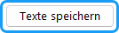

Mit diesen Schaltflächen lassen sich komplette Sätze von Textbausteinen laden und speichern. So kann man bei unterschiedlichen Anforderungen leicht umschalten oder Texte von einem Wahlprojekt in ein anderes übertragen. Auch lassen sich z.B. englischsprachige Formulierungen speichern. Ist die Mehrsprachigkeit aktiviert  wird für jede Sprache ein eigene Sprachdatei (.tv) gespeichert, die getrennt weitergegeben und geladen werden kann.

**Standard:** Mit der Schaltfläche „Standard“ werden nach einer Rückfrage alle Texte des gewählten Textverzeichnisses auf die Vorgaben von uniWAHL zurückgesetzt. Speichern Sie vorher die aktuellen Texte, wenn Sie diese noch benötigen.

## Textverzeichnisse {#textverzeichnisse}

Mit Hilfe von Textverzeichnissen ist es möglich, einen vordefinierten Satz von Textbausteinen direkt in uniWAHL zu speichern und diesen dann in unterschiedlichen Wahlbereichen einzusetzen. So können verschiedene Wahlprojekte noch einfacher in einer Wahlprojekt-Datei (WHL) kombiniert werden (z.B. Sprachanforderungen unterschiedlicher Gremien, Texte für "Nominierung" oder "Einfache Sprache" in bestimmten Wahlbereichen).

Die Textverzeichnisse werden im Navigationsfeld links im Dialog Textbausteine dargestellt. Das Textverzeichnis "Standard" (Standardtexte) kann nicht gelöscht werden. 
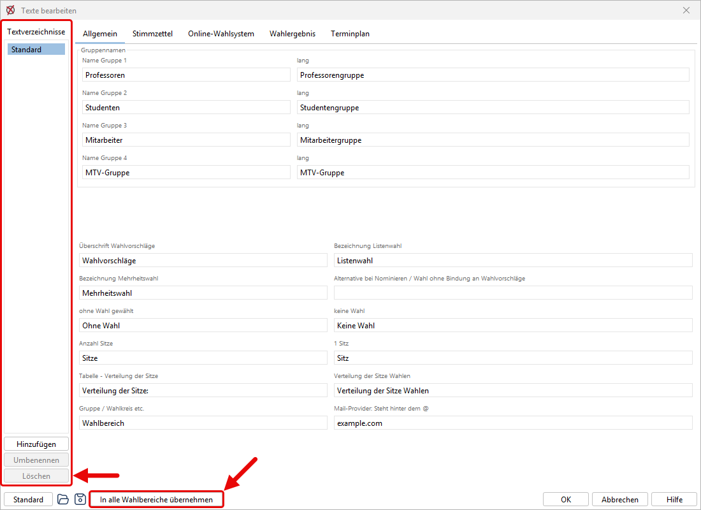

|  |  |
|---|---|
| 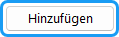 | Erstellt ein neues Textverzeichnis. Es muss anschließend ein Name für das Textverzeichnis vergeben werden. |
| 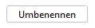 | Ein bestehendes Textverzeichnis kann hierüber umbenannt werden, um es sprechend zu bezeichnen. |
| 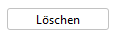 | Ein bestehendes Textverzeichnis (außer "Standard") kann hierüber wieder aus der Anwendung entfernt werden. |
| 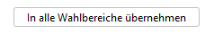 | Mit Hilfe der Schaltfläche "In alle Wahlbereiche übernehmen" lässt sich ein Textverzeichnis schnell auf alle Wahlbereiche anwenden. |

Im Dialogfenster des Wahlbereichs stehen die Felder **Textverzeichnis** und **Layoutverzeichnis** als Dropdown-Auswahl zur Verfügung. Darüber lässt sich für jeden Wahlbereich individuell festlegen, welches Text- bzw. Layoutverzeichnis verwendet werden soll. Die Auswahl **Standard** greift auf das jeweils hinterlegte Standardverzeichnis zurück.

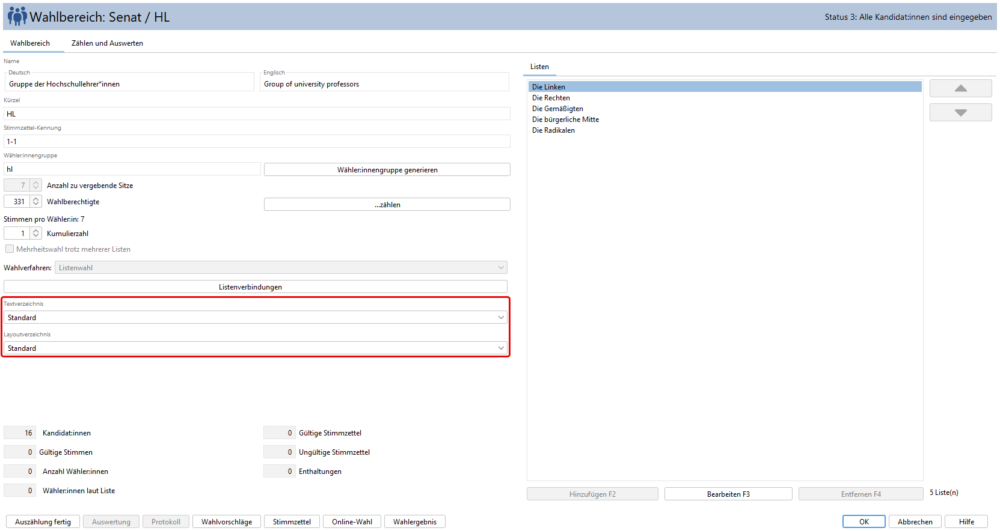

## Texte Allgemein {#texte-allgemein}

In diesem Register sind einige allgemeine Texte und Bezeichnungen der Gruppen sowie Texte von der Übersichtstabelle und den Wahlvorschlägen zusammengefasst. Hier werden auch die Vorgabe-Gruppennamen definiert.

|  |
|---|
| **Bei Mehrheitswahl ohne Bindung an Wahlvorschläge siehe [Hinweis](../5_wahlvorschlaege/5-1_verfahren.md#wahl-ohne-bindung-an-wahlvorschlaege)**. |

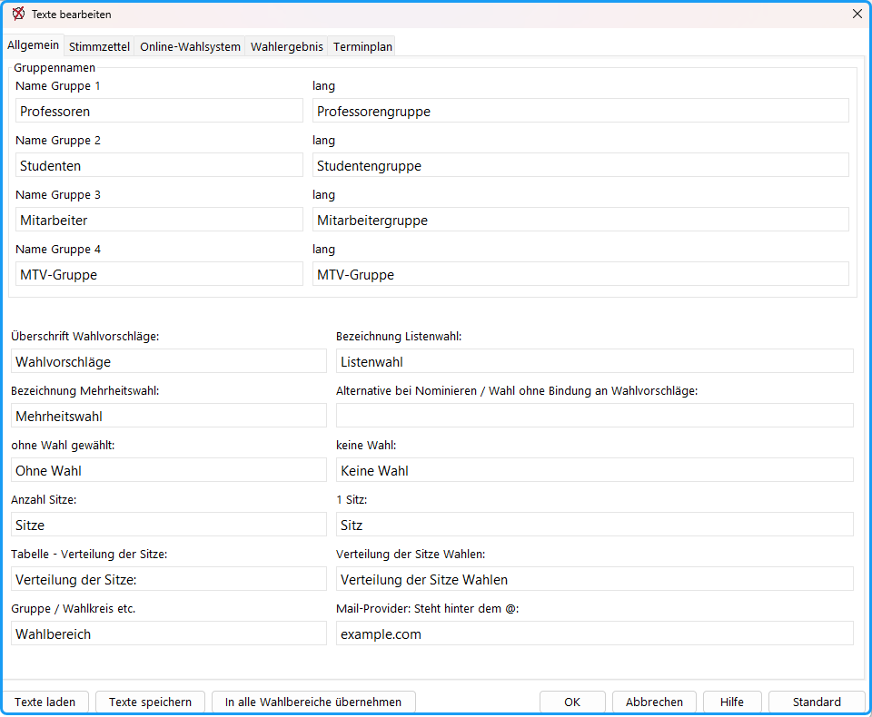

*Abb. : Textbausteine: Allgemeine Texte*

## Texte der Stimmzettel {#texte-der-stimmzettel}

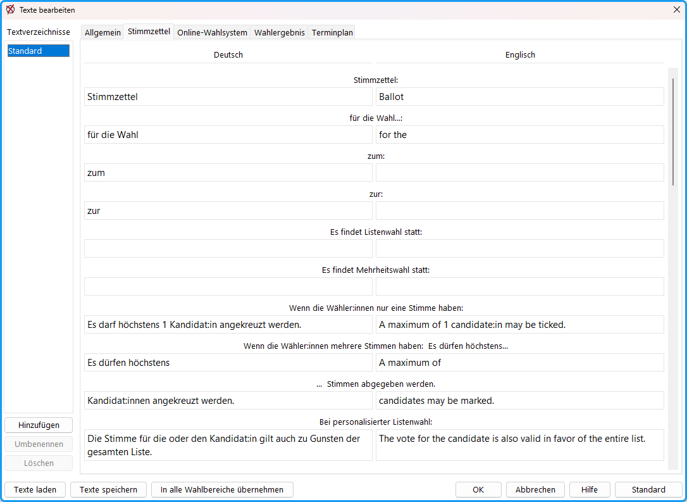

*Abb. : Textbausteine Stimmzettel*

**Stimmzettel für die Wahl zum/zur:** Diese Texte werden in der Überschrift der Stimmzettel dargestellt.

**Es findet Listen-/Mehrheitswahl statt**: Wenn die Ankreuzregeln *nicht* mit diesem Satz beginnen sollen, sondern direkt mit der Anzahl Kreuze, lassen Sie dieses Feld leer.

**Texte zur Stimmenzahl:** Hier können Texte eingegeben werden, die die Anzahl der maximalen Stimmen einer wählendenden Person (nur ein Stimme, mehrere Stimmen) widerspiegelt, wobei bei mehreren Stimmen zwei Texte („Wenn die Wähler:innen mehrere Stimmen haben: Es dürfen höchstens... X …Stimmen abgegeben werden.“) zusammengesetzt werden.

**Personalisierte / Gebundene / Kombinierte Listenwahl**: Hier können Texte eingegeben werden, die zur Ergänzung in dem Block der Hinweise für die Stimmabgabe für das jeweilige Wahlverfahren ausgedruckt werden. Bei leerem Feld wird diese Funktion ignoriert.

**Stimmhäufung (Kumulieren) / Panaschieren**: Hier können Texte eingegeben werden, die zur Ergänzung in dem Block der Hinweise für die Stimmabgabe für das jeweilige Wahlverfahren ausgedruckt werden. Bei leerem Feld wird diese Funktion ignoriert.

**Regeln für ‚Kandidat:innen nominieren’**: Dieser Text wird in den Hinweisen für die Stimmabgabe ausgegeben, wenn bei der Stimmabgabe Kandidat:innen nominiert werden können.

**Hinweise für das Ankreuzen der uniSCAN-Stimmzettel:** Was muss die wählende Person beim Ankreuzen beachten?

**Listen abkürzen Zusatz:** Bei gebundenen Listen ist es möglich, die Anzahl der auf dem Stimmzettel aufgeführten Kandidat:innen zu beschränken. In dem in der Abbildung gezeigten Fall, erscheint der Text: *„sowie xx weitere (insgesamt yy) Kandidierende“.* Bleibt das 3. Feld leer und im 2. steht: „weitere Kandidat:innen“, ist der Ausgabetext: „sowie xx weitere Kandidierende“. Bleibt das 2. Feld leer, wird nur die Gesamtzahl genannt.

**Mehrsprachigkeit:** Die Sprachen werden in der Wahlordnung (`Konfiguration / Wahlordnung`, Register „Allgemein“, Liste „Mehrsprachigkeit“) ausgewählt. Sind mehrere Sprachen gewählt, zeigen die Textbausteine je Sprache eine eigene Spalte, damit die Texte nebeneinander übersetzt werden können.

## Texte zur Online-Wahl {#texte-zur-online-wahl}

Hier können alle Texte des **Online-Wahlsystems** geändert werden. Diese Texte werden per JSON-Datei an das uniWAHL Online-Wahlsystem übergeben.

**Vorschau**: Nutzen Sie die Vorschau-Funktion am Ende des Dialogs, um eine Live-Vorschau der Online-Wahlkabine zu erhalten. Sollten Sie Textänderungen vornehmen wollen, kopieren Sie den Text aus der Wahlkabine und fügen ihn im Suchfeld ein, so finden Sie schnell den zu ändernden Text und können ihn in den Textbausteinen direkt anpassen. Ein erneuter Klick auf „Vorschau“ zeigt die Wahlkabine mit geändertem Text an.

**Suche**: Geben Sie hier Texte ein, die Liste der Textbausteine wird automatisch reduziert.

:::info

**Hinweis:** Die technischen Bezeichner zeigen an, unter welcher Komponente der Text im uniWAHL Online-Wahlsystem geführt wird, und dienen rein der Übergabe der Texte an die Parameter per JSON-Datei. Welche Bezeichner erscheinen, hängt von der Generation des Online-Wahlsystems ab: bei der 1. Generation z. B. `avBooth…` (Wahlkabine), bei der 2. Generation z. B. `common.goBack`. Treten Texte mehrfach auf, lässt sich anhand der Bezeichner erahnen, in welchem Kontext der Text verwendet wird.

:::

**Geänderte Texte anzeigen**: Hierdurch wird ein Filter gesetzt, der jeden Textbaustein ausblendet, dessen Text dem uniWAHL-Standardtext der jeweiligen Sprache gleicht. Angezeigt werden also nur die geänderten Texte.

**Mehrsprachigkeit**: Sind in der Wahlordnung mehrere Sprachen gewählt (siehe oben unter [Texte der Stimmzettel](#texte-der-stimmzettel)), wird für jede Sprache eine eigene Spalte angezeigt.

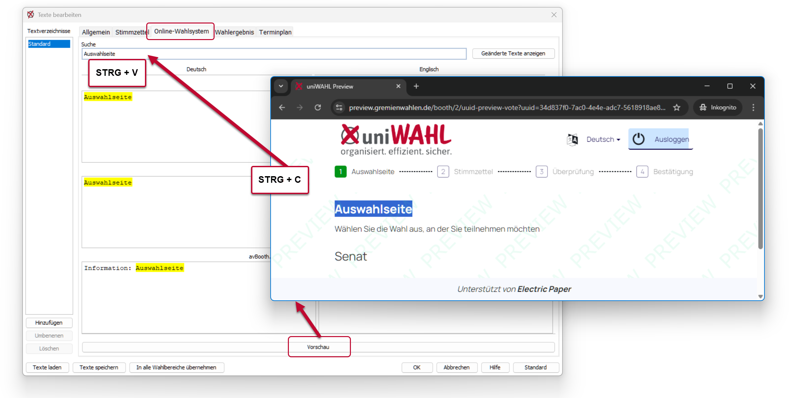

*Abb. : Textbausteine und Vorschau des Online-Wahlsystems*

:::tip

**Tipp:** Mit Hilfe der Tastenkombination STRG + H lässt sich neben der Suchleiste ein Ersetzen-Feld einblenden, das zum Ersetzen von häufig vorkommenden Texten genutzt werden kann.

:::

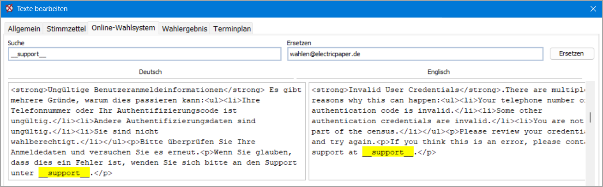

*Abb. : Textbausteine suchen / ersetzen*

## Texte der Wahlergebnisse {#texte-der-wahlergebnisse}

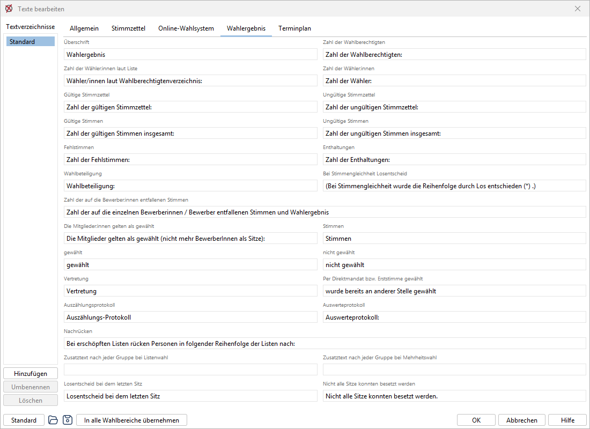

*Abb. : Textbausteine Wahlergebnisse*

**Zusatztext nach jeder Gruppe:** Hier können Texte formuliert werden, die ausführlicher beschreiben, wie das Wahlergebnis für Listen- oder Mehrheitswahl zustande gekommen ist, oder die die Vertretungs- bzw. Nachrückregelung erklären.

## Texte Terminplan {#texte-terminplan}

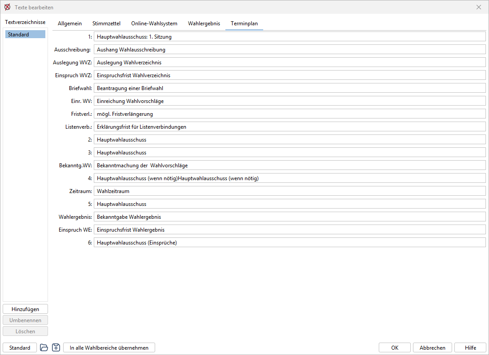

*Abb. : Textbausteine Terminplan*

Die hier gewählten Texte werden benutzt: im Register `Wahlordnung / Terminplan`  und in der `Kurzform des Terminplans` .
