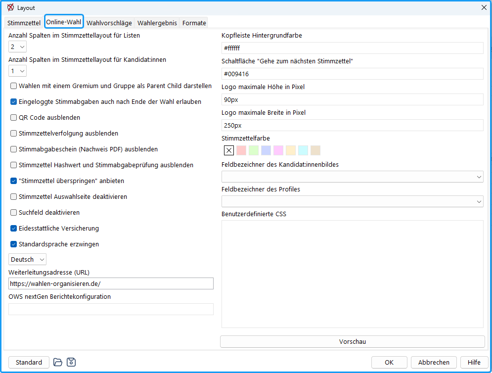
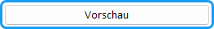
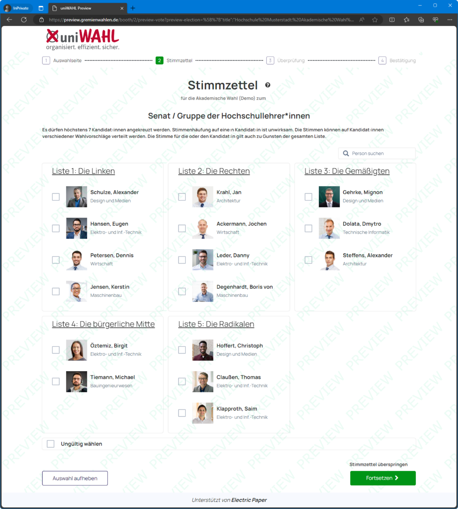
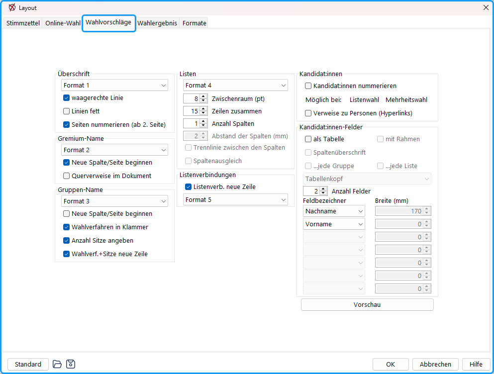
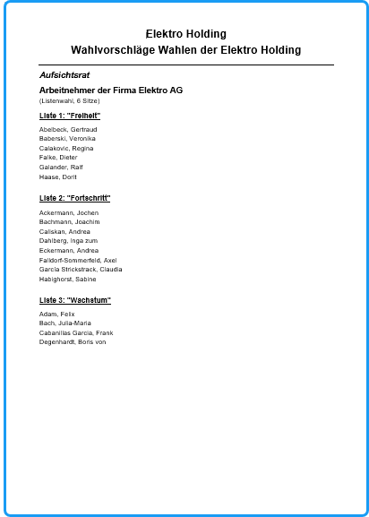
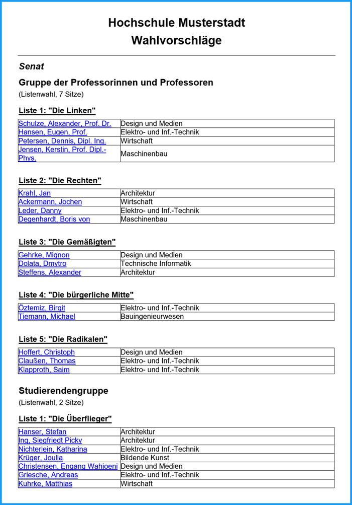
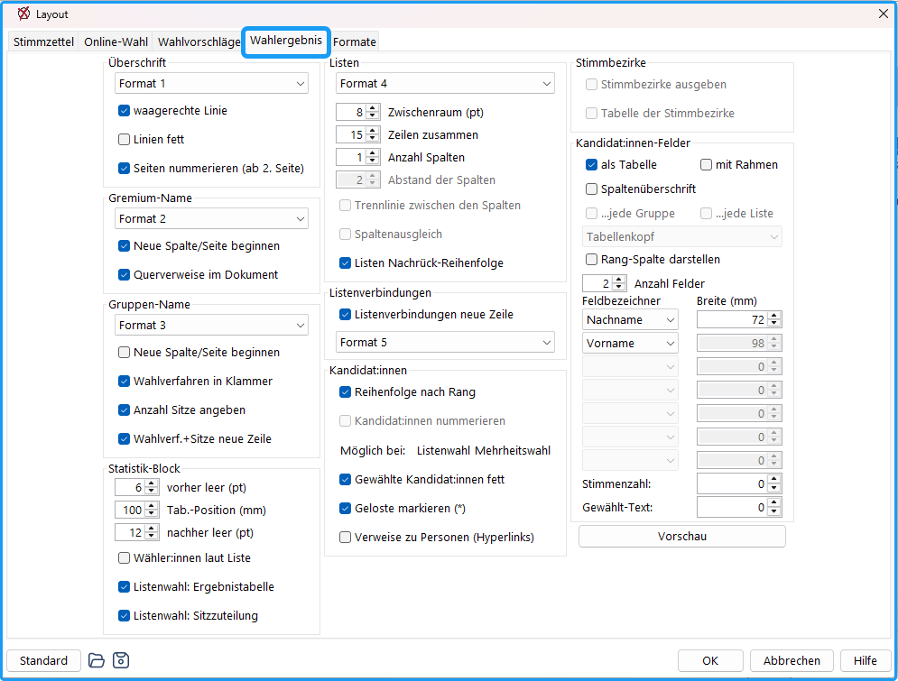
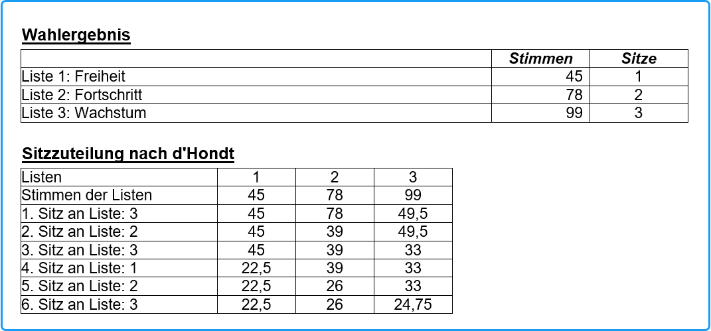
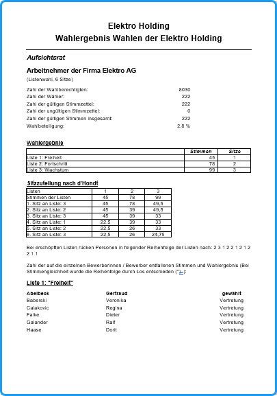

## Layout der Online-Wahl {#layout-der-online-wahl}

Das Layout der Online-Wahlkabine im uniWAHL Online-Wahlsystem (OWS) kann im allgemeinen oder gruppenspezifischen Layout angepasst werden. Die Einstellungen werden per JSON-Datei an das Online-Wahlsystem übergeben.

*Abb. : Layout-Einstellung der Online-Wahl*

**Anzahl Spalten im Stimmzettellayout für Listen (mehrspaltige Darstellung)**: Es kann eingestellt werden, über wie viele Spalten der Stimmzettel verfügt. Dies gilt für Listen- als auch Mehrheitswahl.

**Anzahl Spalten im Stimmzettellayout für Kandidat:innen**: Hiermit wird das innere Format der Stimmzettel angepasst. Es kann entschieden werden, ob innerhalb von Listen mehrere Spalten existieren. Dies gilt sowohl für Listen- als auch Mehrheitswahl.

**Wahlen mit einem Gremium und Gruppe als Parent Child darstellen**: Es handelt sich um eine spezielle Layout-Option für Wahlen mit nur einem Stimmzettel. Im Standard werden Online-Wahlen als sogenannte Parent(Gesamtwahl)-Child(Wahlbereich)-Kombination erzeugt. Wird die Option deaktiviert, werden weder Auswahlseite noch andere übergreifende Merkmale (Navigationselemente, Texte) einer Gesamtwahl erzeugt.

**Eingeloggte Stimmabgaben auch nach Ende der Wahl erlauben**: Ist diese Option aktiviert, können bereits eingeloggte Wähler:innen die Stimmabgabe auch nach dem Schließen der Wahl beenden.

**QR Code ausblenden**: Blendet den Code zur Prüfung der Wahlteilnahme auf der Abschlussseite aus.

**Stimmzettelverfolgung ausblenden**: Auf der Seite zum Übereilungsschutz kann der Link zur Überprüfung der korrekten Verschlüsselung ausgeblendet werden.

**Stimmabgabeschein (Nachweis PDF) ausblenden**: Auf der Seite zur Bestätigung der Stimmabgabe kann die Schaltfläche zum „Drucken“ eines PDF-Nachweises deaktiviert werden.

**Stimmzettel Hashwert und Stimmabgabeprüfung ausblenden**: Die Anzeige der Stimmabgabe-ID und Prüfung der Wahlteilnahme kann deaktiviert werden.

**'Stimmzettel überspringen' anbieten**: Es erscheint ein Hyperlink im Stimmzettel, der entweder zurück zur Auswahlseite (wenn aktiv) oder zum nächsten Stimmzettel führt.

**Stimmzettel Auswahlseite deaktivieren**: Deaktiviert das Inhaltsverzeichnis aller Stimmzettel der wahlberechtigen Person.

**'Ungültig wählen' oben platzieren**: Das Auswahlkästchen „Ungültig wählen“ wird oben platziert.

**Suchfeld deaktivieren**: Das Feld „Person suchen“ wird auf den Stimmzettel ausgeblendet.

**Eidesstattliche Versicherung**: Es wird ein Kontrollkästchen innerhalb der Anleitung aktiviert, das einen konfigurierbaren Text (Baustein "affidavitHtml" suchen) enthält. Erst nach Betätigen des Kontrollkästchen kann die Abstimmung gestartet werden.

**Standardsprache erzwingen (Mehrsprachigkeit)**: Es kann gewählt werden, ob der Stimmzettel in einer vordefinierten (Standard-)Sprache angezeigt wird oder ob sich die Anzeige nach der Sprache des Betriebssystems richtet. Mit Hilfe der Sprachauswahl kann die Standardsprache definiert werden.

**Weiterleitungsadresse (URL)**: Wohin wird die wählende Person nach Verlassen der Wahlkabine geführt? Homepage, Campusseite o.ä.?

**Kopfleiste Hintergrundfarbe**: Hier kann der Kopf der Wahlkabine angepasst werden.

**Schaltfläche 'Gehe zum nächsten Stimmzettel'**: Die Farbe der Schaltfläche im Stimmzettel und der Navigationsleiste kann angepasst werden.

**Logo maximale Höhe in Pixel**: Die Höhe des Logos kann in Pixel eingestellt werden oder auf „auto“ gesetzt werden.

**Logo maximale Breite in Pixel**: Die Breite des Logos kann in Pixel eingestellt oder auf „auto“ gesetzt werden.

**Stimmzettelfarbe**: Es wird eine Hintergrundfarbe im Stimmzettel angezeigt.

**Feldbezeichner des Kandidat:innenbildes**: Es kann ein Feld aus den Personendaten (→ S.90) genutzt werden, das eine Bild-URL enthält, um ein Kanidat:innenbild im Stimmzettel darzustellen.

**Feldbezeichner des Profiles**: Es kann ein Feld aus den Personendaten (→ S.91) genutzt werden, das eine URL enthält, um ein erweitertes Kanidat:innenprofil im Stimmzettel darzustellen.

|  | Erstellen Sie mit den – noch nicht gespeicherten – Einstellungen eine Vorschau der Wahlkabine der aktuell geöffneten Gruppe / des aktuellen Wahlbereichs. |
|---|---|

**Benutzerdefinierte CSS**: Das Erscheinungsbild von uniWAHL-Online-Wahlkabinen lässt sich hierüber weiter anpassen und speichern.

*Abb. : Vorschau der Online-Wahlkabine*

## Layout der Wahlvorschläge {#layout-der-wahlvorschlaege}

Hier werden nur die zum Layout der Stimmzettel  zusätzlichen Funktionen beschrieben:

*Abb. : Layout Bekanntmachung der Wahlvorschläge*

## Überschrift {#ueberschrift}

**Formatvorlage**: Wählen Sie die Formatvorlage für die Überschrift.

**waagerechte Linie:** Eine waagerechte Linie soll die Überschrift von den folgenden Tabellen trennen.

**Linien fett**: wenn der Drucker nur zart druckt.

**Seiten nummerieren (ab 2. Seite):** Die Seiten werden nummeriert.

## Gremium-/ Gruppen-Name {#gremium-gruppen-name}

**Neue Spalte/Seite beginnen:** Eine neue Spalte / Seite wird zu Beginn eines jeden neuen **Gremiums** begonnen. Entsprechend kann auch jede **Gruppe** auf einer neuen Seite begonnen werden.

**Querverweise im Dokument:** Am Beginn des Dokuments stehen die Gremiennamen als Querverweise, damit man bei der Internet-Präsentation schnell zu dem jeweiligen Gremium springen kann. Exportieren Sie die Datei in PDF- oder HTML-Format.

**Wahlverfahren in Klammer**: Hinter dem Namen des Wahlbereichs wird das zugehörige Wahlverfahren (Mehrheitswahl / Listenwahl) angegeben.

**Anzahl Sitze angeben**: Anzahl der für die jeweilige Gruppe zu vergebenden Sitze.

**Wahlverf.+ Sitze** **neue Zeile**: Wenn das Wahlverfahren und / oder die Anzahl der zu vergebenden Sitze für die jeweilige Gruppe angegeben werden soll, kann dafür eine neue Zeile gewählt werden.

**Verweise zu Personen (Hyperlinks)**: Wird ein PDF- oder HTML-Dokument für die Veröffentlichung der Wahlvorschläge im Inter-/Intranet erzeugt, kann mit dieser Option ein direkter Bezug zu einer Vorstellungsseite des Kandidat:innen erzeugt werden (siehe folgende Anmerkung).

## Internet-Werbung der Kandidierenden {#internet-werbung-der-kandidierenden}

Wenn **Verweise zu Personen (Hyperlinks)** aktiviert ist, erstellt das Programm automatisch für jede Person eine Kandidat:innen-Web-Seite im Verzeichnis ...*/uniwahl/aus­gabe/Kandidat:innen* mit dem Namen: *NachnameVorname.html*, z.B. *HansenHans.html.* In dieser Datei steht nur der Name der Person als Überschrift. Die Kandidat:innen können dann eine beliebige HTML-Datei mit demselben Dateinamen liefern, die dann die vorhandene Datei überschreibt.

Für Sie als WahlbearbeiterIn ist nur wenig zu tun:

- Im Wahlaufruf teilen Sie mit, dass die Bewerbenden die Möglichkeit haben, sich in der Wahlbekanntmachung mit einer eigenen Web-Seite selbst darzustellen.
- Die Bewerbenden müssen dann eine HTML-Datei mit dem Namen *NachnameVorname.html* einreichen, z.B. *HansenHans.html*.
- Geben Sie die E-Mail-Adresse an, an die diese geschickt werden sollen und vermerken Sie, dass die Verantwortung für den Inhalt allein bei den Kandidat:innen liegt.
- Sie bzw. eine studentische Hilfskraft kopieren dann diese Dateien in das Verzeichnis ...*/uniwahl/ausgabe/Kandidat:innen*.
- Nach Ablauf der Bewerbungsfrist lassen Sie alle Dateien dieses Verzeichnisses in das entsprechende Verzeichnis des Web-Servers kopieren.
- Der Aufwand ist gering, die Wirkung groß!

## Beispiele für Bekanntmachung der Wahlvorschläge {#beispiele-fuer-bekanntmachung-der-wahlvorschlaege}

*Abb. : Wahlvorschläge Listenwahl*

*Abb. : Wahlvorschläge Listenwahl (als Tabelle mit zusätzlichen Personenangaben)*

## Layout der Wahlergebnisse {#layout-der-wahlergebnisse}

*Abb. : Layout der Wahlergebnisse*

Hier werden nur zusätzliche Funktionen zum Layout der Stimmzettel  und Wahlvorschläge  beschrieben:

## Überschrift: {#ueberschrift}

**Format 1:** Schriftformat der Überschrift.

**Waagerechte Linie:** Fügt eine Trennlinie unter der Überschrift ein.

**Linien fett:** Trennlinien werden fett dargestellt.

**Seiten nummerieren (ab 2. Seite):** Die Seiten werden ab der zweiten Seite nummeriert.

## Gremium-Name: {#gremium-name}

**Format 2:** Schriftformat des Gremium-Namens.

**Neue Spalte/Seite beginnen:** Der Gremium-Name beginnt auf einer neuen Spalte oder Seite.

**Querverweise im Dokument:** Im Dokument werden Querverweise zu anderen Stellen eingefügt.

## Gruppen-Name: {#gruppen-name}

**Format 3:** Schriftformat des Gruppen-Namens.

**Neue Spalte/Seite beginnen:** Der Gruppen-Name beginnt auf einer neuen Spalte oder Seite.

**Wahlverfahren in Klammer:** Das Wahlverfahren wird in Klammern hinter dem Gruppen-Namen ausgegeben.

**Anzahl Sitze angeben:** Die Anzahl der zu vergebenden Sitze wird ausgegeben.

**Wahlverf.+Sitze neue Zeile:** Wahlverfahren und Sitzanzahl werden in einer neuen Zeile ausgegeben.

## Statistik-Block: {#statistik-block}

In diesem Block werden die Anzahl der Wahlberechtigten und die Wahlbeteiligung usw. angegeben.

**vorher leer (pt):** Zwischenraum *vor* dem Statistik-Block.

**Tab.-Position (mm):** Tabulatorposition für die Zahlenangaben.

**nachher leer (pt):** Zwischenraum *nach* dem Block.

**Wähler:innen laut Liste:** Wenn in der Wahlordnung diese Option gewählt wurde, wird diese Zahl, die im Auszählungsfenster eingegeben wurde, zur Überprüfung der Konsistenz mit ausgegeben.

**Listenwahl: Ergebnistabelle:** Bevor die Einzelergebnisse für alle Kandidat:innen aufgelistet werden, kann eine Tabelle mit den Stimmen und Sitzen jeder Liste erscheinen. (→ Abb.)

**Listenwahl: Sitzzuteilung:** In einer Tabelle kann das Zustandekommen der Sitzzuteilung für das jeweilige Verfahren Sitz für Sitz dargestellt werden.

*Abb. : Bei Listenwahl können das tabellarische Wahlergebnis und das Zustandekommen der Sitzverteilung angezeigt werden.*

## Listen: {#listen}

**Nachrück-Reihenfolge**: Hier wird die Reihenfolge ausgedruckt, in der bei ausgeschöpfter Liste die Bewerber anderer Listen nachrücken. (*Wahlver­fahren* →Seite 130 , Listenübergreifendes Nachrücken → Seite 60).

## Listenverbindungen: {#listenverbindungen}

**Listenverbindungen neue Zeile:** Listenverbindungen werden in einer neuen Zeile ausgegeben.

**Format 5:** Schriftformat der Listenverbindungen.

## Kandidaten: {#kandidaten}

**Reihenfolge nach Rang**: Die Kandidat:innen werden in der durch die Stimmabgabe und Sitzzuteilung ermittelten Reihenfolge aufgeführt (Standard). Andernfalls behalten sie die ursprüngliche Reihenfolge.

**Kandidat:innen nummerieren:** Die Kandidat:innen werden durchnummeriert.

**Gewählte Kandidat:innen fett**: Die gewählten Kandidat:innen werden fett hervorgehoben.

**Geloste markieren (*)**: Die Kandidat:innen, bei denen zur Feststellung der Reihenfolge ein Losentscheid erforderlich war, werden durch (*) markiert. Das gilt für gewählte und nicht gewählte Kandidat:innen, auch wenn der Losentscheid für die Vergabe eines Sitzes nicht erheblich war.

**Verweise zu Personen (Hyperlinks)**: Mit dieser Option kann bei der Online-Veröffentlichung ein direkter Bezug zu einer Vorstellungsseite der Kandidat:innen erzeugt werden. (siehe Anmerkung S. [83](#internet-werbung-der-kandidierenden))

## Stimmbezirke: {#stimmbezirke}

**Stimmbezirke ausgeben:** Mit dieser Option werden die Ergebnisse der einzelnen Stimmbezirke (Nr.) in der Tabelle aufgeführt, bei der Wahlordnung diese Option gewählt wurde ( → Seite 22).

**Tabelle der Stimmbezirke:** Am Ende der Ergebnisse des Gremiums kann eine Tabelle der Nummern der Stimmbezirke und deren Namen erstellt werden.

## Kandidaten-Felder {#kandidaten-felder}

**als Tabelle:** Die Kandidat:innen-Felder werden als Tabelle dargestellt.

**mit Rahmen:** Die Tabelle wird mit Rahmen dargestellt.

**Spaltenüberschrift:** Die Tabelle erhält Spaltenüberschriften.

**…jede Gruppe / …jede Liste:** Die Spaltenüberschrift wird bei jeder Gruppe bzw. jeder Liste wiederholt.

**Tabellenkopf:** Auswahl des Formats für den Tabellenkopf.

**Rang-Spalte darstellen:** Eine zusätzliche Spalte mit dem Rang der Kandidat:innen wird ausgegeben.

**Anzahl Felder:** Anzahl der dargestellten Personendatenfelder.

**Feldbezeichner / Breite (mm):** Auswahl der anzuzeigenden Felder (z.B. Nachname, Vorname) und deren Spaltenbreite in Millimetern.

**Stimmenzahl (mm):** Feldbreite für die Stimmenzahl.

**Gewählt-Text (mm):** Feldbreite für die Angabe „gewählt" bzw. „Stellvertretung".

**Vorschau:** Öffnet eine Vorschau des Wahlergebnisses mit den aktuellen Layout-Einstellungen.

:::warning

**Hinweis:**  Wenn mehrere Stimmbezirke aufgeführt werden sollen, werden entsprechend viele Spalten mit der für „Stimmenzahl“ gewählten Breite eingefügt. Diese Breite wird den vorherigen Spalten weggenommen. Deshalb sollte man in diesem Fall möglichst nur 1 Feld für die Personendaten wählen.

:::

## Beispiel für Bekanntmachung der Wahlergebnisse {#beispiel-fuer-bekanntmachung-der-wahlergebnisse}

*Abb. : Wahlergebnis*
