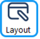
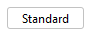
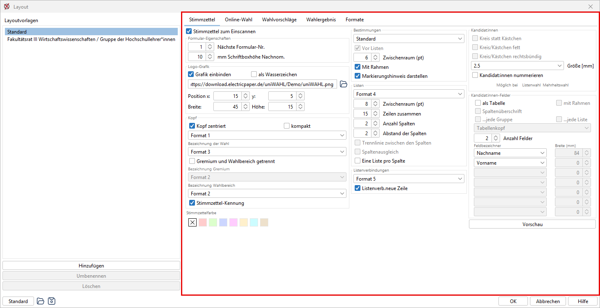
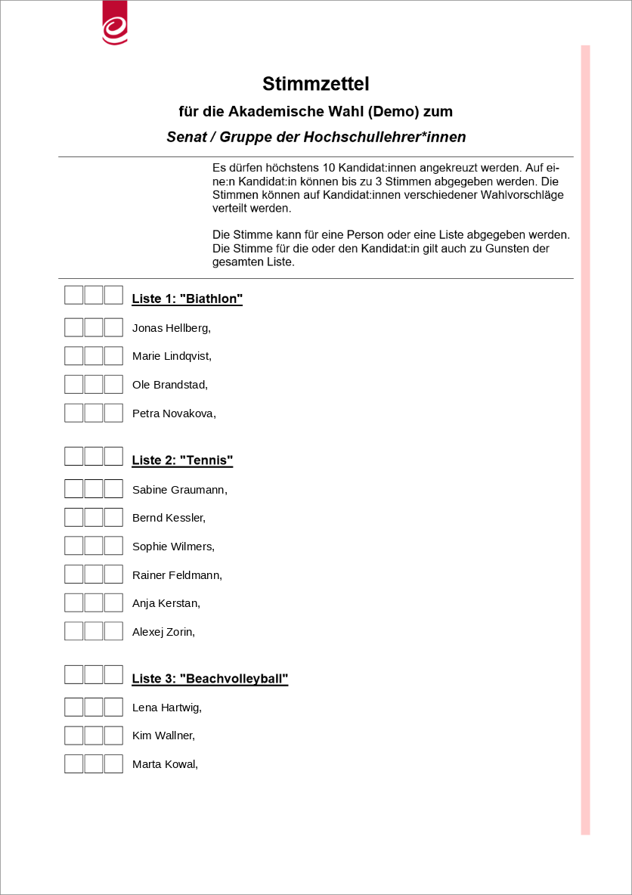
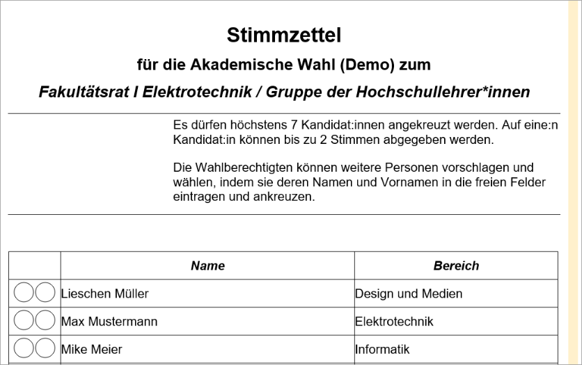
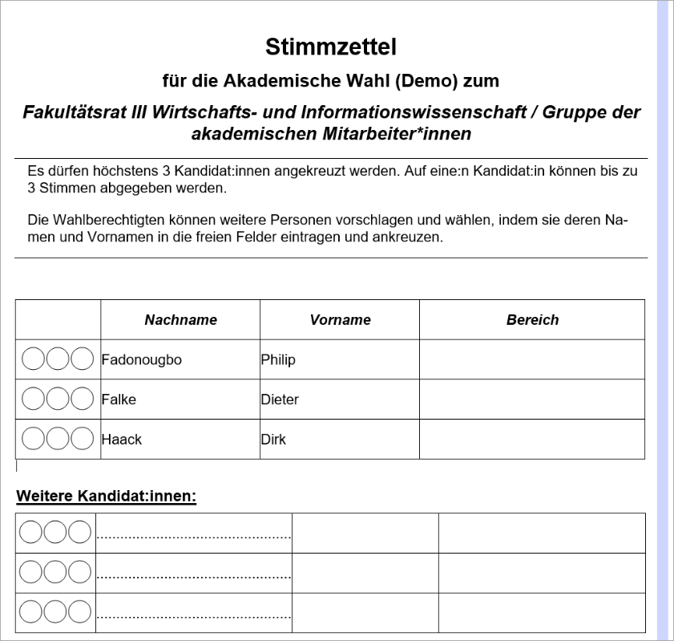
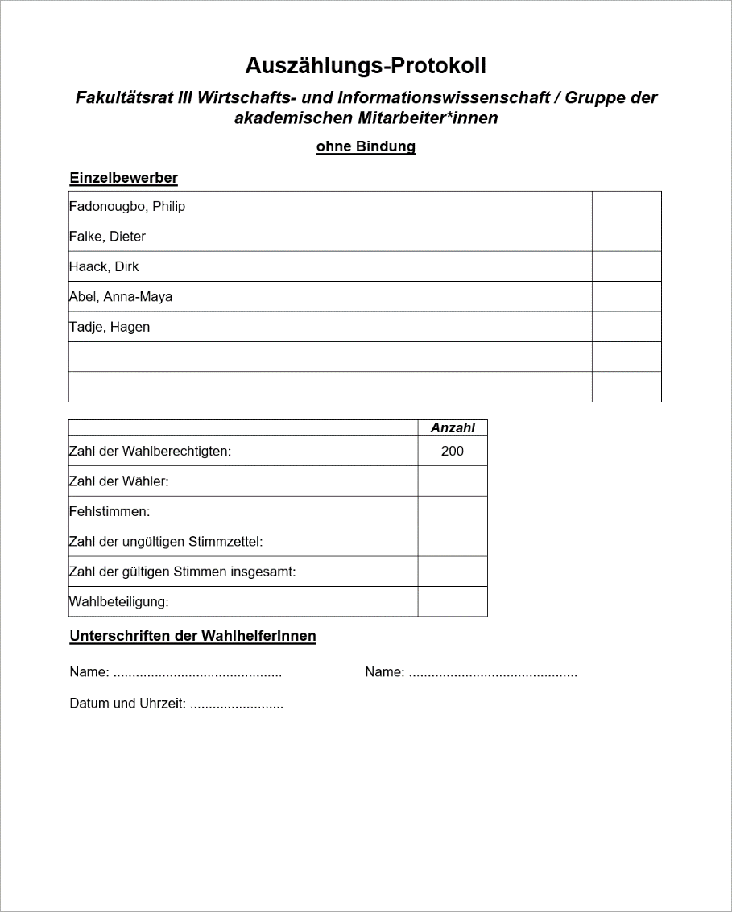
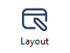
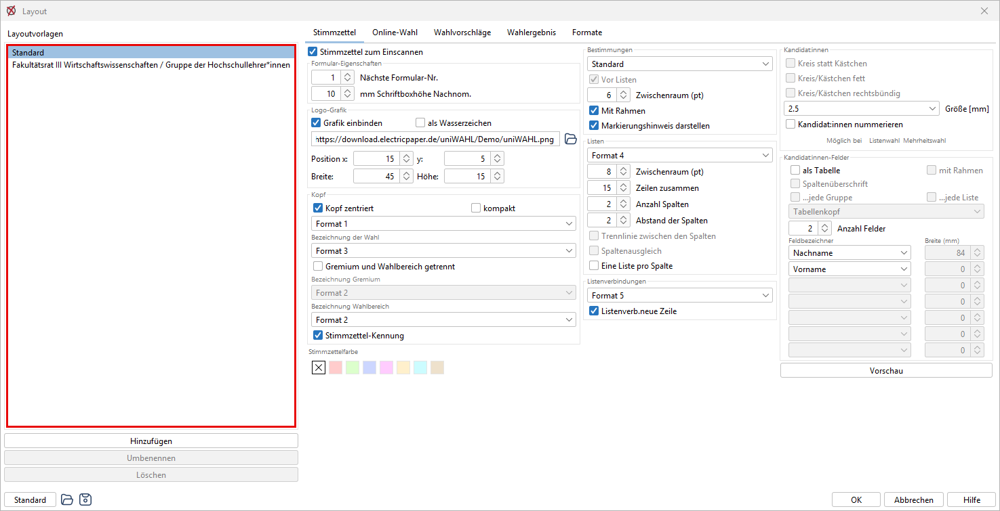
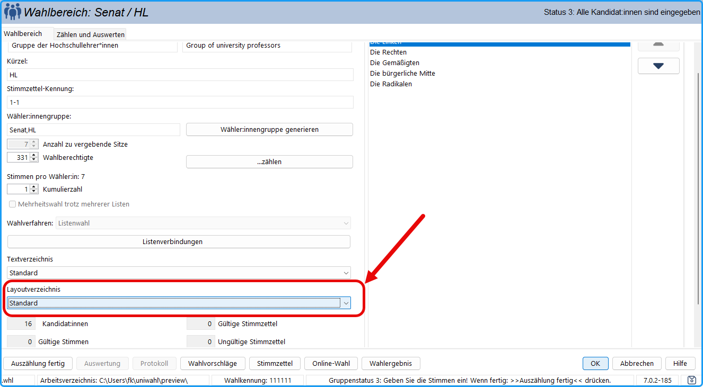

Sie können das Layout der Bekanntmachungen und der Stimmzettel beeinflussen.

Öffnen Sie das Layout-Register  mit der Taste der Werkzeugleiste oder mit dem Menübefehl: `Konfiguration / Layout der Dokumente`

So können komplette Sätze von Layout-Parametern können gespeichert / geladen werden.

## Allgemeine Funktionen: {#allgemeine-funktionen}

|  |  |
|---|---|
|  | Übernimmt für alle Layout-Einstellungen die Standardwerte. |
|  | Ein gespeicherter Satz von Layoutparametern einschl. Formatvorlagen kann geladen werden. (Die Seiteneinstellungen, Ränder etc., sind nicht enthalten.) |
|  | Ein vollständiger Satz von Layoutparametern einschl. Formatvorlagen wird gespeichert. |

:::tip

**Tipp:**  Häufig kann man mit einem einheitlichen Layout alle Stimmzettel gestalten. Es kommt jedoch auch vor, dass für einzelne Wahlbereiche einige Parameter geändert werden müssen, z.B. weil zu viele Kandidat:innen vorhanden sind .**  **Wenn Sie für die Mehrzahl Ihrer Stimmzettel ein optimales Layout gefunden haben, speichern Sie dieses Layout unter einem selbsterklärenden Namen, z.B. „MeinStandardLayout.lay“. Jetzt bearbeiten Sie den Problem-Stimmzettel mit den vielen Kandidat:innen, erhöhen die Anzahl der Spalten, verkleinern die Schriftarten usw., bis Sie eine ideale Form gefunden haben. Speichern Sie dieses Layout z.B. unter dem Namen „MeineVielenKandidat:innen.lay“.

:::

## Layout der Stimmzettel {#layout-der-stimmzettel}

*Abb. : Layout der Stimmzettel*

In diesem Fenster werden die Parameter für die Gestaltung der Stimmzettel eingegeben (vergleichen Sie die [Beispiel-Ausdrucke](./7-4_layout.md#beispiele-fuer-stimmzettel-und-auszaehlungsprotokoll)).

**Stimmzettel zum Einscannen:** Diese Option wird ausgewählt, wenn Stimmzettel für das automatische Auszählen erstellt werden sollen. Das Aussehen des Dialogfensters ändert sich und weitere Optionen ( → [uniSCAN Stimmzettel](../9_uniscan/9-4_stimmzettel.md) ) können gewählt werden.

### Allgemein {#allgemein}

**Blöcke durch Linien trennen:** Waagerechte Linien trennen die Bereiche.

**Linien fett:** Die Linien können fett gezeichnet werden.

### Logo-Grafik {#logo-grafik}

**Grafik einbinden:** Man kann eine Grafik (Dienstsiegel, Briefkopf etc.) im Stimmzettel anzeigen.

**als Wasserzeichen:** Die Grafik wird in der Papierform in geringerer Schwärzung gezeichnet.

Im Textfeld mit dem Ordner-Symbol (ohne Beschriftung) tragen Sie den Dateinamen der gewünschten Grafik ein oder wählen die Datei über das Ordner-Symbol aus. Es werden hier auch URL zu Bilddateien (aber keine SVG) unterstützt. Bei Verwendung von Logos zur Onlinewahl wird eine URL empfohlen.

**Position etc.:** Koordinaten der Position der Grafik (bezogen auf die linke obere Ecke des Papiers) und deren Größe angeben (siehe Hinweis am Ende dieses Kapitels).

### Kopf {#kopf}

**Kopf zentriert:** Die Zeilen des Kopf-Bereichs werden zentriert.

**kompakt**: Die Zeilen „Stimmzettel“ und „für die Wahl...“ werden zusammengefasst, die Regeln werden linksbündig und ohne Zwischenraum aufgeführt.

**Gremium und Wahlbereich getrennt:** Nicht selektiert: Gremium und Wahlbereich erscheinen in einer Zeile mit derselben Schriftart. Wenn selektiert: Gremium und Wahlbereich erscheinen in zwei Zeilen mit evtl. unterschiedlicher Schrift.

**Formatvorlagen:** Wählen Sie die Formatvorlagen für die Überschrift („Stimmzettel“), die Bezeichnung der Wahl und den Namen des Wahlbereichs.

**Stimmzettel-Ken****nung:** Die Stimmzettel werden rechts oben mit einer Kennung versehen (zum einfacheren Sortieren). Die Kennung wird im Wahlbereich-Dialog definiert .

### Stimmzettelfarbe {#stimmzettel-farbe}

In diesem Bereich kann entschieden werden, ob der Stimmzettel eine farbliche Markierung zur besseren optischer Abgrenzung erhalten soll. Es kann aus vordefinierten Farben gewählt werden. Ist eine Stimmzettelfarbe ausgewählt, wird auch der Kopfbereich (Überschrift) des Wahlbereichs / der Statusgruppe farblich gekennzeichnet.

### Bestimmungen {#bestimmungen}

**Vor Listen:** Der Block mit den Bestimmungen zur Stimmabgabe erscheint, wie in dem ersten Beispiel  vor den Kandidat:innen-Listen, anderenfalls unten auf dem Stimmzettel.

**Hor. Position (mm):** Tabulator-Position in mm.

**Zwischenraum (pt):** Vertikaler Zwischenraum zwischen den verschiedenen Bestimmungen.

**Mit Rahmen:** Die Bestimmungen werden mit einem Rahmen dargestellt.

**Markierungshinweis darstellen:** *[*Nur* bei Stimmzettel zum Einscannen]* Auf dem Stimmzettel wird der Markierungshinweis für uniSCAN dargestellt.

### Listen {#listen}

**Formatvorlage**: Für den Listennamen

**Zwischenraum (pt)**: Vertikaler Zwischenraum zwischen den Listen in pt.

**Zeilen zusammen**: Beim Umbruch von Spalten/Seiten sollen die Listen möglichst nicht auseinandergerissen werden. Nur bei langen Listen wird ab der angegebenen Grenze ein Umbruch erlaubt

**Anzahl Spalten:** Anzahl der Spalten der Kandidat:innenlisten.

**Abstand der Spalten:** Der horizontale Abstand in mm.

**Trennlinie zwischen den Spalten:** *[Nicht bei Stimmzettel zum Einscannen]* Eine senkrechte Linie wird zwischen den Spalten angezeigt.

**Spaltenausgleich:** *[Nicht bei Stimmzettel zum Einscannen]* Der Text wird auf die Spalten gleichmäßig verteilt, jedoch werden die Listen nicht aufgetrennt.

**Eine Liste pro Spalte:** *[*Nur* bei Stimmzettel zum Einscannen]* Jede Liste wird in einer Spalte dargestellt,

**Listen abkürzen** *[*Nur* bei gebundenen Listen]*: Gebundene Listen können auf eine bestimmte Anzahl von Kandidat:innen abgekürzt werden. Es folgt der Zusatz *„sowie xx weitere (insgesamt yy) Kandidierende“* (s. Textbausteine/Stimmzettel).

**Gebundene Listen kompakt** *[*Nur* bei gebundenen Listen]*: Bei gebundenen Listen können die Kandidat:innen kompakt in einem Block aufgeführt werden. Bei großer Kandidat:innenzahl sinnvoll.

### Listenverbindungen {#listenverbindungen}

**Formatvorlage:** Darstellung der Listenverbindung

**Listenverb. neue Zeile:** Die Listenverbindungen werden unter dem Kennwort der Liste aufgeführt, nicht in derselben Zeile.

### Kandidaten {#kandidaten}

**Kreis statt Kästchen**: *[Nicht bei Stimmzettel zum Einscannen]* Kreuz im Kreis statt im Kästchen.

**Kreis / Kästchen fett**: *[Nicht bei Stimmzettel zum Einscannen]* wenn der Drucker zu dünn zeichnet.

**Kreis / Kästchen rechtsbündig:** *[Nicht bei Stimmzettel zum Einscannen]* Die Ankreuzfelder erscheinen an dem rechten Rand.

**Größe**: Durchmesser bzw. Seitenlänge der Ankreuzfelder in mm.

**Kandidaten nummerieren:** Die Kandidat:innen werden nummeriert, wenn für das jeweilige Wahlverfahren (Mehrheitswahl / Listenwahl) dieses vorgesehen wurde (Menü: *Konfiguration / Wahlordnung*). Wird diese Option gewählt, werden die Kandidat:innen auch auf dem Auszählungsprotokoll nummeriert. Ist bei den Kandidaten-Feldern „als Tabelle“ gewählt, wird „Kandidaten nummerieren“ abgewählt und gesperrt.

### Kandidaten-Felder {#kandidaten-felder}

**als Tabelle:** Werden bei den Kandidat:innen neben den Namen noch weitere Angaben gemacht (Tätigkeitsbereich, Vertretung), kann eine tabellarische Darstellung sinnvoll sein; anderenfalls werden sie zusammengeschoben. In der Online-Wahl werden Kandidierende 2-zeilig mit Unterschrift angezeigt, wenn diese Funktion aktiviert ist.

**mit Rahmen:** Die Tabelle erhält einen Gitterrahmen.

**Spaltenüberschrift**: Die Tabellenspalten erhalten als Überschrift die Feldbezeichner.

**...jede Gruppe / ...jede Liste**: Soll jede Gruppe / Liste die Überschriften wiederholen? Wenn nicht, erscheinen sie einmal pro Seite.

**Formatvorlage**: der Spaltenüberschrift / Tabellenkopf

**Anzahl Felder:** Sollen außer dem Namen noch weitere Angaben wie Tätigkeitsbereich, Studienfach etc. erscheinen, wird hier die Anzahl der Felder angegeben.

**Feldbezeichner:** Aus den Aufklappboxen werden die entsprechenden Feldbezeichner ausgewählt. Diese wurden beim Konfigurieren der Perso­nen­angaben bereitgestellt . Die ersten Felder sollten den Namen enthalten. Es können nur so viele Bezeichner gesetzt werden, wie in „Anzahl Felder“ festgelegt wurde.

**Breite (mm):** Die Spaltenbreiten werden in mm angegeben. Die noch verfügbare Restbreite wird der letzten Spalte zugewiesen. Diese ist deshalb nicht direkt veränderbar.

 : Öffnet eine Vorschau des Papier-Stimmzettels im jeweiligen Office-Format (LibreOffice, Microsoft Word).

:::tip Tipps

***1. Viele Kandidat:innen auf einer Seite***

**Bei Stimmzetteln ist es wichtig, dass alle Kandidat:innen auf einer Seite aufgeführt werden, damit alle die gleichen Chancen haben, schnell gesehen zu werden.**

Ist die Anzahl der Kandidat:innen groß, sollten Sie folgendermaßen vorgehen:

-&gt; Seitenränder schmaler (im Layout, Register „Formate“, Bereich „Seite“, siehe [Seite einrichten](./7-1_seite_einrichten.md))
-&gt; Stimmzettel-Kopf kompakt machen (Layout /Stimmzettel)
-&gt; Erhöhen Sie die Anzahl der Spalten. Ist die „Anzahl Felder“ &gt; 1, sollten Sie „Kandidat:innen-Felder / als Tabelle“ deaktivieren, damit es kompakter wird.
-&gt; Bei größeren Lücken: „Zeilen zusammen“ verkleinern.
-&gt; Verkleinern Sie die „Größe“ der Ankreuzfelder der Kandidat:innen.
-&gt; Verkleinern Sie die Schriftgröße der Formatvorlage „Standard“.
-&gt; Verkleinern Sie die Schriftgrößen der Überschriften und reduzieren Sie deren Zwischenräume.

Wenn das alles nicht hilft, vergrößern Sie das Papier auf A3.

**Beispiel:**

*100*  Kandidat:innen: A4 hoch, 5 Spalten, Kästchen 4 mm, Standard 10pt**  **Wenn Sie eine Lösung des Problems gefunden haben, sollten Sie den kompletten Satz von Layout-Parametern speichern und bei Bedarf wieder laden .

***2. Kandidat:innen in anderem Format***

Sollen Kandidierende in einem anderen Format auf dem Stimmzettel angezeigt werden, z.B. "ohne Komma" oder "Vorname Nachname" oder "Titel Nachname, Vorname", müssen die Daten in den [Personendaten](../5_wahlvorschlaege/5-4_fenster_kandidat_in.md) zunächst im gewünschten Format aggregiert werden z.B. in einem [neuen Feld](../4_vorbereitung/4-8_personendaten.md) (Das kann via [Wahlverzeichnisimport](../4_vorbereitung/4-10_wahlverzeichnis_importieren.md) gefüllt werden).

:::

:::warning Wichtige Hinweise

***1. Zeilenhöhe***  Um die Seitenaufteilung gefälliger zu machen, wird bei kleiner Anzahl von Kandidat:innen die Zeilenhöhe automatisch vergrößert.**  **Bei weniger als 20 Kandidat:innen pro Spalte, wird die Mindesthöhe auf 16 pt (5,5 mm) gesetzt, bei &lt; 15 pro Spalte auf 24 pt (8,3 mm) und bei &lt; 10 pro Spalte auf 30 pt (10,8 mm). Die Höhe wird zusätzlich dynamisch an die Größe des Ankreuzfeldes angepasst, also ggf. vergrößert.

***2. Grafik einbinden in Papierstimmzetteln***  **Erstellen** Sie eine Grafik durch Einscannen des Dienstsiegels oder des Hochschul-/Firmenlogos (alle gängigen Grafikformate: bmp, gif, jpg, png, tiff).  **Bearbeiten** Sie die Datei eventuell mit einem Grafik-Programm (z.B. MS-Paint). Mit dem Menü-Befehl „Bild / Strecken“ können Sie z.B. die Größe anpassen.  **Speichern** Sie die Bitmap mit „Datei / Speichern unter“ als „Monochrom-Bitmap“ z.B. in das Verzeichnis „.../uniwahl/ausgabe“.  Bei der Ausgabe wird die Grafik in das dafür vorgesehene Feld eingepasst. Dabei kann sie bei ungünstigen Angaben verzerrt werden.  Wenn Sie die Grafik in der Originalgröße ausgeben möchten, selektieren Sie die Grafik durch Klick, mit der rechten Maustaste öffnen Sie das Menü, wählen „Bild...“ bzw. „Grafik...“ und dann das Register „Typ“. Sie sehen die gewählte Größe; klicken Sie auf **„Originalgröße“** und geben diese Angaben in Ihr Layout.  Viel einfacher ist es, das Dienstsiegel **manuell** auf die Druckvorlagen der Stimmzettel zu setzen.

***3. Hinweis zu Online-Wahlen***  Nutzen Sie eine Grafik-URL des Dienstsiegels oder des Hochschul-/Firmenlogos (alle gängigen Grafikformate: bmp, gif, jpg, png, tiff), indem Sie diese von Ihrer Website o.ä. kopieren (Webbrowser - Rechtsklick auf die Grafik - Link kopieren.) 
Ist die Option "**als Tabelle**" aktiviert, werden besondere Layout-Optionen bei den Kandidierenden freigeschalten:
- Kandidat:innenbilder werden angezeigt (wenn im Layout / Online-Wahl hinterlegt)
- Kandidat:innenprofile werden angezeigt (wenn im Layout / Online-Wahl hinterlegt)
- Kandidat:innenfelder Anzahl Felder &gt;= 3 werden unterhalb des Kandidierenden als Beschreibung angezeigt

:::

## Beispiele für Stimmzettel und Auszählungsprotokoll {#beispiele-fuer-stimmzettel-und-auszaehlungsprotokoll}

*Abb. : Stimmzettel Mehrheitswahl (Wahl ohne Bindung an Wahlvorschläge, Kumulieren möglich)*

*Abb. : Stimmzettel Listenwahl (Kombinierte Personen- und Listenwahl) mit Stimmzettel-Farbe*

*Abb. : Stimmzettel Mehrheitswahl (Kumulieren möglich, Ausgabe als Tabelle mit zusätzlichen Personenangaben)*

*Abb. : Protokoll für das manuelle Auszählen*

## Layoutvorlagen {#layoutvorlagen}

Um ein gruppenspezifisches Layout (individuelles Layout für einzelne Stimmzettel) zu erzeugen, können Sie die Funktion "Layoutvorlagen" nutzen.

Die Layoutvorlagen werden zentral unter  verwaltet. Das Navigationsfeld **"Layoutvorlagen"** auf der linken Seite listet alle verfügbaren Vorlagen auf. Über **Hinzufügen**, **"Umbenennen"** und **"Löschen"** lassen sich Vorlagen anlegen und verwalten. Die Vorlage **"Standard"** kann nicht gelöscht werden. Die Register „Wahlvorschläge“ und „Wahlergebnis“ sind nur beim Layout „Standard“ bearbeitbar; in den übrigen Layoutvorlagen sind sie gesperrt.

*Abb. : Gruppenspezifisches Layout der Stimmzettel*

:::warning

**Hinweis zu „Stimmzettel zum Einscannen":** Diese Einstellung gilt für die gesamte Wahl und ist daher eine Ausnahme: Wird der Haken innerhalb einer Layoutvorlage gesetzt, übernimmt uniWAHL ihn automatisch auch in den zentralen Layout-Dialog – unabhängig davon, in welcher Vorlage die Änderung vorgenommen wurde.

:::

Im Dialogfenster des Wahlbereichs steht dafür das Dropdown-Feld **"Layoutverzeichnis"** zur Verfügung. Darüber lässt sich für jeden Wahlbereich individuell festlegen, welches Layout verwendet werden soll. Die Auswahl **"Standard"** greift auf das zentral hinterlegte Standardlayout zurück.

*Abb.: Layoutverzeichnis innerhalb des Wahlbereichs*
