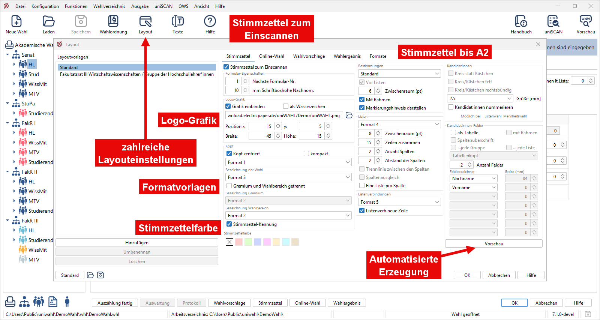

import DocCardList from '@theme/DocCardList';

<DocCardList />

Hier werden die verschiedenen Ausgabemöglichkeiten für die Wahldokumente dargestellt. Die Ausgabe erfolgt grundsätzlich in eine Datei, die von *OpenOffice/LibreOffice* oder *Microsoft Word* gelesen und hier weiterbearbeitet werden kann. So können die Formatierungen noch verbessert und individueller gestaltet werden. Die Ausgabe kann dann direkt auf den Drucker oder auf Datei in verschiedenen Formaten (PDF, HTML) erfolgen .

Sie lernen auch, wie Sie direkt Web-Seiten erstellen können, um die Wahlbekanntmachung und das Wahlergebnis auf den (z.B. internen) Internet-Seiten zu veröffentlichen.

Wie Sie die Texte der Ausgabe-Dokumente an die Bedürfnisse Ihrer Organisation anpassen können, finden Sie in den [Textbausteinen](./7-3_textbausteine.md).

Die Ausgabe aller Wahldokumente erfolgt mit ***Microsoft Word** bzw. **Libre-/OpenOffice ***:

1. **Vorschau / Preview**: Vor dem Ausdrucken kann das Dokument geprüft werden.
1. **Korrektur**: Wenn nötig, können Formulierungen verändert, Texte hinzugefügt und das Layout verbessert werden.
1. **Dateiausgabe**: Die Dokumente werden automatisch gespeichert, der Dateiname ist entweder „*document.odt“* oder „*document_xxx_yyy_zz.odt“* bzw*. „.docx“;* dabei bedeutet:
   1. *document*: „vorschlaege“, „stimmzettel“, „ergebnis“ etc.
   1. *xxx*: den Gremiumnamen, wenn nötig
   1. *yyy*: den Gruppennamen, wenn nötig.
   1. //zz:// das Länderkürzel, wenn nötig
1. **Export in Fremdformate**:
   1. **PDF** – *Portable Document Format*: Format für Web-Publikation
   1. **HTML** – *Hypertext Markup Language*: Format für Web-Publikation
   1. und weitere Formate...

### Anpassung der Texte {#anpassung-der-texte}

Die Ausgabetexte sind bei allen Ausgabeformen die gleichen. Sie können diese Formulierungen ändern, um sie z.B. an die Formulierungen in Ihrer Wahlordnung anzupassen. Lesen Sie dazu die Hinweise im Kapitel `Textbausteine`.

:::info

**Hinweis:**  Sie laden und speichern jeweils mit dem Wahlvorgang die Einstellungen der Texte, Wahlordnung und Layouts.
  Bevor Sie die Dokumente drucken, sollten Sie zuerst die:  - **Seite einrichten:** Dabei legen Sie das Papierformat und die Ränder fest . - **Formatvorlagen:** Die Formatvorlagen sind die Basis des Layouts der Dokumente . - **Layout der Dokumente:** Hier werden die Einzelheiten der Gestaltung der einzelnen Dokumente festgelegt .

:::

:::note

**Anmerkung:** 
- die Ausgabedokumente müssen ggf. überarbeitet werden, da z.B. im Kopf der Stimmzettel erscheint : „ ...für die Wahl zum Frauenversammlung“.
- auch könnten die männlichen Bezeichnungen („Bewerber“) stören.
- die HTML-Dokumente müssen deshalb eventuell vor der Veröffentlichung nachbearbeitet werden, was in wenigen Minuten geschieht.

:::
