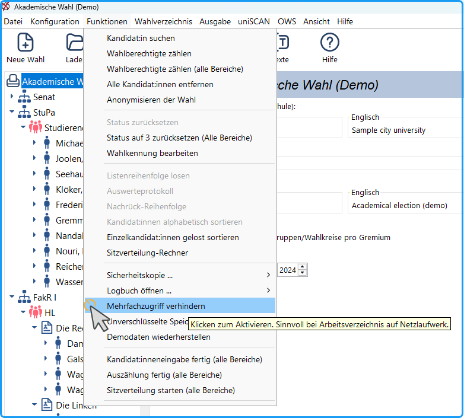

uniWAHL ist als Einzelplatzsystem konstruiert und arbeitet ähnlich wie die Office-Programme als Desktop-Applikation mit verschiedenen lokalen Dateiformaten (.whl, .lay, .tv, .ord, .wvz). Typischerweise wird die Software aber als Unternehmenslizenz vertrieben und kann deshalb auf weiteren Computern in Ihrer Organisation installiert sein.

Wenn die Projektdaten auf einem Netzlaufwerk oder in einem Cloud-Speicher gehalten werden und mehrere Personen diese bearbeiten können, sollte man die Datei vor Mehrfachzugriff schützen. Wenn in dem Menübefehl: *Funktionen / Mehrfachzugriff* *verhindern* (→ Abb.) das Häkchen gesetzt ist, kann die erste Person normal auf die Datei zugreifen und Änderungen speichern. Eine zweite Person kann die Datei nur lesen, aber Veränderungen nicht speichern.

Klicken auf den Menübefehl ändert den Zustand, setzt bzw. löscht das Häkchen.

Treten Probleme durch ungewollt gesperrte Dateien auf, entfernt man das Häkchen.

 Abb. : Mehrfachzugriff verhindern

| **Hinweis: uniWAHL nutzt den lokalen Arbeitsspeicher Ihres Computers zur Verarbeitung der Daten aus den Projekt-XML-Dateien (.whl, .lay, .tv, .ord, .wvz-Dateien). Insbesondere entfernte Dateiablagen (Netzlaufwerk, Cloud, Dokumentenmanagementsystem), VPN- oder Remote-Desktop-Verbindungen können daher zu Leistungseinbußen führen. Wir empfehlen die Projektdateien vor der Bearbeitung lokal zu kopieren.** |
|---|
