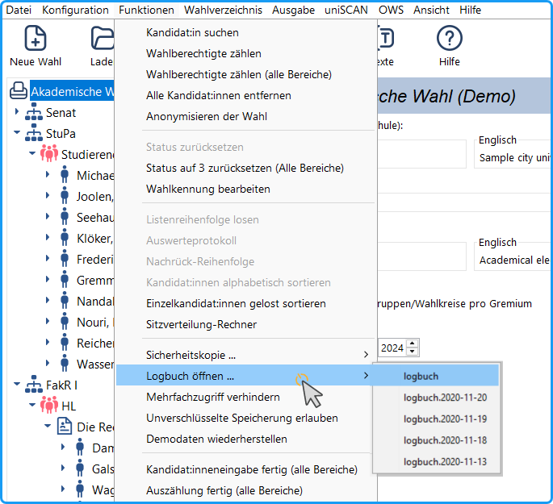
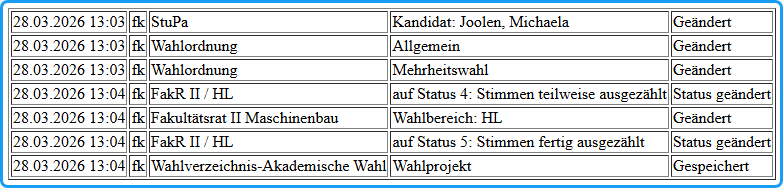

Mit der Logbuch-Funktion wird protokolliert, wer wann was bei der Wahlbearbeitung geändert hat. Diese Funktion ist wichtig, wenn mehrere Personen an der Vorbereitung der Wahl beteiligt sind. An diesen Protokollen kann die Wahlleitung den Wahlvorgang transparent nachvollziehen.

An jedem Bearbeitungstag wird eine neue Datei angelegt.

*Abb. : Logbuch - Ausschnitt der Funktionen-Menüs*

Geöffnet werden diese Logbücher durch den Menübefehl „*Funktionen/Logbuch öffnen ...*“. Im Untermenü erscheint eine Liste der letzten Logbücher: In der ersten Zeile das des aktuellen Tages, die anderen enthalten im Namen das jeweilige Datum. Die Datei wird im Browser geöffnet.

Die Logbuch-Dateien stehen im Installationsverzeichnis von *uniWAHL* im Ordner „logbuch“.

*Abb. : Beispiel für Logbuch-Einträge*

Folgende Einträge werden im Logbuch erfasst (Abb.):

- Datum-Zeit-Stempel (TT.MM.JJJJ hh:mm)
- Benutzername
- Betroffener Bereich der Anwendung (z.B. Wahlordnung, Gruppe usw.)
- Durchgeführte Aktion

Tabelle : Mögliche Aktionstypen im Logbuch
| Aktionstyp | Beschreibung |
|---|---|
| Gelöscht | Ein Person aus einem Wähler:innenverzeichnis wurde entfernt. |
|  | Alle Kandidat:innen aus dem Wahlprojekt wurden entfernt. |
|  | Beim Anonymisieren der Wahl wird so geloggt, als ob alle Kandidat:innen gelöscht wurden. |
| Geändert | Eine Formatvorlage wurde angepasst. |
|  | Das Stimmzettellayout wurde angepasst. |
|  | Das Wahlergebnislayout wurde angepasst |
|  | Das Layout der Wahlvorschläge wurde angepasst. |
|  | Personendaten wurden verändert. |
|  | Textbausteine wurden geändert. |
|  | Die Wahlordnung wurde angepasst. |
|  | Ein Gremium wurde geändert. |
|  | Eine Gruppe wurde geändert. |
|  | Eine Liste wurde geändert. |
|  | Ein Kandidat wurde geändert. |
|  | Eine Person wurde verändert. |
| Gespeichert | Eine geänderte Person wurde ins Wähler:innenverzeichnis geschrieben. |
|  | Die Textbausteine wurden in eine Datei gespeichert. |
|  | Die Wahlordnung wurde in eine Datei gespeichert. |
|  | Das Wahlprojekt (.whl) wurde unter anderer Namen gespeichert. |
|  | Das Wähler:innenverzeichnis wurde in eine Datei gespeichert. |
| Geöffnet | Das Wahlprojekt (.whl) wurde geöffnet. |
| Hinzugefügt | Ein Gremium wurde hinzugefügt. |
|  | Eine Gruppe wurde hinzugefügt. |
|  | Eine Liste wurde hinzugefügt. |
|  | Eine Kandidat wurde hinzugefügt. |
|  | Eine neue Person wurde im Wähler:innenverzeichnis hinzugefügt. |
| Briefwahl beantragt | Bei einer Person wurde Briefwahl beantragt. |
| Alphabetisch sortiert | Die Einzelkandidat:innen innerhalb einer Gruppe wurden sortiert. |
| Listenreihenfolge gelost | Die Reihenfolge einer Liste wurden gelost. |
| Status geändert | Der Status eines Gremiums wurde hochgesetzt. |
| Status zurückgesetzt | Der Status eines Gremiums wurde zurückgesetzt. |
